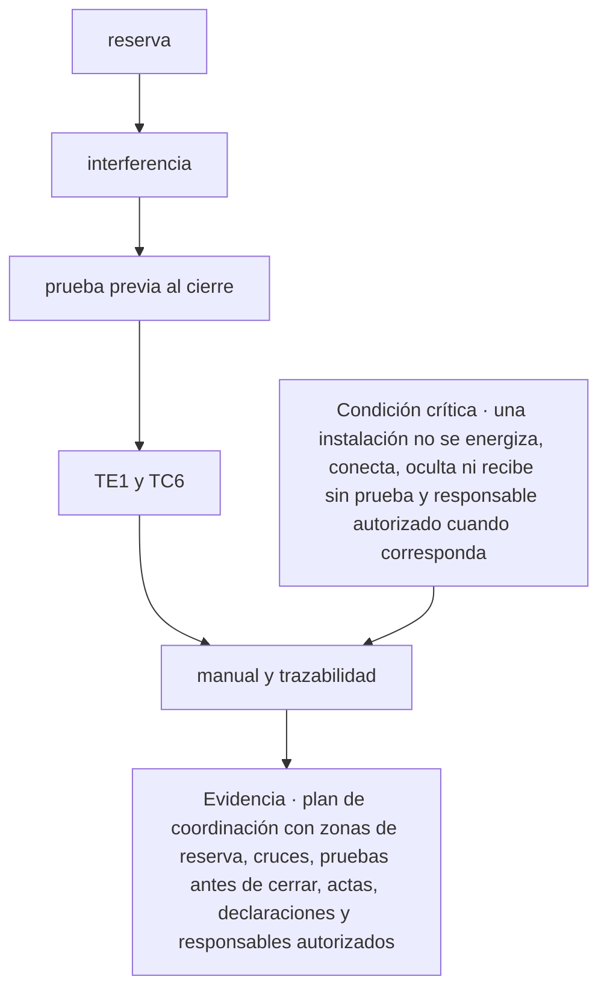
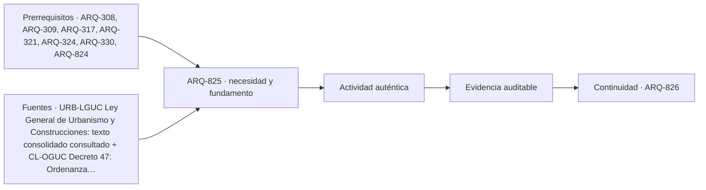

# ARQ-825 · Instalaciones empotradas y visibles, interferencias, pruebas y certificados

**Parte 83 · Aplicación para propietarios · Chile · Edición 2026.10.**

Material educativo. Enseña a organizar, contratar, comparar y verificar; no entrega licencia, firma, cálculo, dirección, autorización ni inspección profesional. Toda aplicación real debe revalidarse para región, comuna, predio, fecha, actuación y condiciones de la obra.

**Prerrequisitos recomendados:** `ARQ-308`, `ARQ-309`, `ARQ-317`, `ARQ-321`, `ARQ-324`, `ARQ-330`. La entrada inmediata es `ARQ-824`; la continuidad es `ARQ-826`.

## Pregunta central

¿Cómo puede una persona propietaria abordar **instalaciones empotradas y visibles, interferencias, pruebas y certificados**, producir plan de coordinación con zonas de reserva, cruces, pruebas antes de cerrar, actas, declaraciones y responsables autorizados y demostrar que una instalación no se energiza, conecta, oculta ni recibe sin prueba y responsable autorizado cuando corresponda?

**Fallo crítico de esta clase:** una instalación no se energiza, conecta, oculta ni recibe sin prueba y responsable autorizado cuando corresponda.

## Problema y resultado observable

Esta clase existe porque el conocimiento disciplinar ya cubierto en `ARQ-308`, `ARQ-309`, `ARQ-317`, `ARQ-321`, `ARQ-324`, `ARQ-330` no forma por sí solo una secuencia doméstica de decisión. Dentro de **Construcción, control de gastos, recepción y mantenimiento**, la tarea es seguir la obra mediante hitos verificables de seguridad, calidad, costo y cambio hasta formar una carpeta de recepción y mantenimiento. El lector no ejecuta trabajos reservados o peligrosos: construye un expediente que permita contratar, preguntar, comparar, detener y exigir evidencia.

Al terminar podrás identificar entradas y desconocidos, separar requisito de preferencia, comparar tres escenarios, asignar responsabilidades y producir **plan de coordinación con zonas de reserva, cruces, pruebas antes de cerrar, actas, declaraciones y responsables autorizados**. La entrega se incorpora al **libro de control de obra, carpeta de cierre y plan de mantenimiento para ambos casos** y debe poder ser revisada sin explicación oral adicional.

## Lectura de antecedentes y vocabulario

Lee primero el documento que posee autoridad: certificado, permiso, plano aprobado, especificación, cotización, contrato, acta o informe. Registra emisor, destinatario, predio, fecha, revisión, alcance y anexos. Después compara el documento con la realidad observable sin corregirlo silenciosamente. Una discrepancia se convierte en pregunta y responsable, no en una cifra inventada.

En esta clase, **requisito confirmado** significa que existe una fuente competente vigente y aplicable al caso; **verificar en DOM / especialista** significa que la clasificación o solución depende de autoridad o competencia; **supuesto didáctico** permite calcular o comparar dentro del ejercicio, pero no viajar a una obra real. **Precio de catálogo**, **precio cotizado**, **precio pagado** y **estimación** se registran por separado.

Para cualquier documento de costo se usa CLP como moneda de registro. Si se añade UF, debe conservar fecha de valor y fuente oficial. El IVA se mantiene como campo configurable porque la base, inclusión y tratamiento dependen del documento. La sensibilidad de 10 % a 20 % es una hipótesis pedagógica y nunca una tarifa, garantía o sustituto de estudiar riesgos.

## Desarrollo paso a paso

### 1. Reserva

En **ARQ-825**, reserva se trabaja como una operación comprobable y no como una etiqueta. La entrada es el encargo y los antecedentes disponibles; se anotan origen, fecha, responsable, unidad y estado de cada dato. Después se ejecuta una comparación o verificación visible y se entrega una salida utilizable por interferencia. Cuando falta información se escribe `PENDIENTE` junto con quién puede resolverla y qué decisión permanece detenida. Este tratamiento impide que una ausencia adopte el valor cero o que una hipótesis se vuelva requisito por repetición.

La revisión de reserva conserva al menos dos alternativas con el mismo alcance. Se comprueba qué cambia en plazo, costo, seguridad, habitabilidad, permiso, construcción y mantenimiento. Una ventaja no compensa una condición crítica: si **una instalación no se energiza, conecta, oculta ni recibe sin prueba y responsable autorizado cuando corresponda**, la decisión se reabre aunque la opción parezca económica o rápida. La comparación debe permitir que otra persona repita el razonamiento sin depender de una explicación oral del autor.

El propietario puede organizar documentos, formular preguntas, comparar ofertas y observar si la evidencia prometida existe. No puede asumir por ello atribuciones de arquitectura, cálculo, construcción, prevención o instalaciones reguladas. En reserva, la entrega debe indicar quién propone, quién revisa, quién autoriza, quién ejecuta y quién conserva el registro. Esa asignación forma parte del aprendizaje porque una tarea técnicamente correcta sin responsable o versión sigue siendo incontrolable.
### 2. Interferencia

En **ARQ-825**, interferencia se trabaja como una operación comprobable y no como una etiqueta. La entrada es reserva; se anotan origen, fecha, responsable, unidad y estado de cada dato. Después se ejecuta una comparación o verificación visible y se entrega una salida utilizable por prueba previa al cierre. Cuando falta información se escribe `PENDIENTE` junto con quién puede resolverla y qué decisión permanece detenida. Este tratamiento impide que una ausencia adopte el valor cero o que una hipótesis se vuelva requisito por repetición.

La revisión de interferencia conserva al menos dos alternativas con el mismo alcance. Se comprueba qué cambia en plazo, costo, seguridad, habitabilidad, permiso, construcción y mantenimiento. Una ventaja no compensa una condición crítica: si **una instalación no se energiza, conecta, oculta ni recibe sin prueba y responsable autorizado cuando corresponda**, la decisión se reabre aunque la opción parezca económica o rápida. La comparación debe permitir que otra persona repita el razonamiento sin depender de una explicación oral del autor.

El propietario puede organizar documentos, formular preguntas, comparar ofertas y observar si la evidencia prometida existe. No puede asumir por ello atribuciones de arquitectura, cálculo, construcción, prevención o instalaciones reguladas. En interferencia, la entrega debe indicar quién propone, quién revisa, quién autoriza, quién ejecuta y quién conserva el registro. Esa asignación forma parte del aprendizaje porque una tarea técnicamente correcta sin responsable o versión sigue siendo incontrolable.
### 3. Prueba previa al cierre

En **ARQ-825**, prueba previa al cierre se trabaja como una operación comprobable y no como una etiqueta. La entrada es interferencia; se anotan origen, fecha, responsable, unidad y estado de cada dato. Después se ejecuta una comparación o verificación visible y se entrega una salida utilizable por TE1 y TC6. Cuando falta información se escribe `PENDIENTE` junto con quién puede resolverla y qué decisión permanece detenida. Este tratamiento impide que una ausencia adopte el valor cero o que una hipótesis se vuelva requisito por repetición.

La revisión de prueba previa al cierre conserva al menos dos alternativas con el mismo alcance. Se comprueba qué cambia en plazo, costo, seguridad, habitabilidad, permiso, construcción y mantenimiento. Una ventaja no compensa una condición crítica: si **una instalación no se energiza, conecta, oculta ni recibe sin prueba y responsable autorizado cuando corresponda**, la decisión se reabre aunque la opción parezca económica o rápida. La comparación debe permitir que otra persona repita el razonamiento sin depender de una explicación oral del autor.

El propietario puede organizar documentos, formular preguntas, comparar ofertas y observar si la evidencia prometida existe. No puede asumir por ello atribuciones de arquitectura, cálculo, construcción, prevención o instalaciones reguladas. En prueba previa al cierre, la entrega debe indicar quién propone, quién revisa, quién autoriza, quién ejecuta y quién conserva el registro. Esa asignación forma parte del aprendizaje porque una tarea técnicamente correcta sin responsable o versión sigue siendo incontrolable.
### 4. Te1 y tc6

En **ARQ-825**, TE1 y TC6 se trabaja como una operación comprobable y no como una etiqueta. La entrada es prueba previa al cierre; se anotan origen, fecha, responsable, unidad y estado de cada dato. Después se ejecuta una comparación o verificación visible y se entrega una salida utilizable por manual y trazabilidad. Cuando falta información se escribe `PENDIENTE` junto con quién puede resolverla y qué decisión permanece detenida. Este tratamiento impide que una ausencia adopte el valor cero o que una hipótesis se vuelva requisito por repetición.

La revisión de TE1 y TC6 conserva al menos dos alternativas con el mismo alcance. Se comprueba qué cambia en plazo, costo, seguridad, habitabilidad, permiso, construcción y mantenimiento. Una ventaja no compensa una condición crítica: si **una instalación no se energiza, conecta, oculta ni recibe sin prueba y responsable autorizado cuando corresponda**, la decisión se reabre aunque la opción parezca económica o rápida. La comparación debe permitir que otra persona repita el razonamiento sin depender de una explicación oral del autor.

El propietario puede organizar documentos, formular preguntas, comparar ofertas y observar si la evidencia prometida existe. No puede asumir por ello atribuciones de arquitectura, cálculo, construcción, prevención o instalaciones reguladas. En TE1 y TC6, la entrega debe indicar quién propone, quién revisa, quién autoriza, quién ejecuta y quién conserva el registro. Esa asignación forma parte del aprendizaje porque una tarea técnicamente correcta sin responsable o versión sigue siendo incontrolable.
### 5. Manual y trazabilidad

En **ARQ-825**, manual y trazabilidad se trabaja como una operación comprobable y no como una etiqueta. La entrada es TE1 y TC6; se anotan origen, fecha, responsable, unidad y estado de cada dato. Después se ejecuta una comparación o verificación visible y se entrega una salida utilizable por la evidencia verificable. Cuando falta información se escribe `PENDIENTE` junto con quién puede resolverla y qué decisión permanece detenida. Este tratamiento impide que una ausencia adopte el valor cero o que una hipótesis se vuelva requisito por repetición.

La revisión de manual y trazabilidad conserva al menos dos alternativas con el mismo alcance. Se comprueba qué cambia en plazo, costo, seguridad, habitabilidad, permiso, construcción y mantenimiento. Una ventaja no compensa una condición crítica: si **una instalación no se energiza, conecta, oculta ni recibe sin prueba y responsable autorizado cuando corresponda**, la decisión se reabre aunque la opción parezca económica o rápida. La comparación debe permitir que otra persona repita el razonamiento sin depender de una explicación oral del autor.

El propietario puede organizar documentos, formular preguntas, comparar ofertas y observar si la evidencia prometida existe. No puede asumir por ello atribuciones de arquitectura, cálculo, construcción, prevención o instalaciones reguladas. En manual y trazabilidad, la entrega debe indicar quién propone, quién revisa, quién autoriza, quién ejecuta y quién conserva el registro. Esa asignación forma parte del aprendizaje porque una tarea técnicamente correcta sin responsable o versión sigue siendo incontrolable.

## Mapa específico de la decisión

El diagrama no representa una secuencia ejecutiva de construcción. Permite localizar dónde falta evidencia o autoridad en **instalaciones empotradas y visibles, interferencias, pruebas y certificados**. La flecha de condición crítica entra antes del cierre para que pueda detener el proceso.

## Aplicación al caso CASA-NUEVA-80

**Estado del caso:** supuesto didáctico. La casa nueva reserva recorridos y registros desde el proyecto, evitando perforaciones tardías y manteniendo documentos para recepción. La localización, la comuna, el instrumento territorial, el CIP, el suelo, los servicios y los precios deben reemplazarse por antecedentes reales antes de cualquier decisión.

El expediente aplica reserva, interferencia y prueba previa al cierre sobre una vivienda nueva de 80 m². El escenario económico conserva la misma necesidad con soluciones simples; el estándar equilibra inversión, durabilidad y mantenimiento; el de mayor desempeño justifica cada incremento mediante una métrica o evidencia. Ninguno puede rebajar permiso, estabilidad, seguridad, salubridad o responsabilidades.

El propietario prepara preguntas, ordena documentos y comprueba que las alternativas sean comparables. El arquitecto y los especialistas desarrollan y suscriben los proyectos de su competencia; la DOM y otros organismos actúan dentro de sus atribuciones. Si una respuesta altera el alcance, se actualizan cantidades, presupuesto, cronograma y versión del expediente.

## Aplicación al caso AMPLIACION-24

**Estado del caso:** supuesto didáctico. La ampliación identifica redes activas, programa cortes y verifica empalmes. Toda modificación conserva referencia a la instalación original y su declaración cuando corresponda. Se distingue siempre la ampliación de un nivel de la hipótesis de segundo piso; esta última no contiene instrucciones de refuerzo y queda detenida hasta diagnóstico y proyecto estructural profesional.

La aplicación debe considerar construcción adosada, compatibilidad con la estructura existente, techumbre y evacuación de aguas, medianeros, humedad, redes activas, residentes, polvo, ruido, cortes, demolición selectiva y recuperación de terminaciones. Permiso y recepción históricos son antecedentes a comprobar: que la vivienda exista o figure en una cotización no demuestra su legalidad.

Cuando un recinto existente pasa a cocina, baño o dormitorio, se revisan uso, habitabilidad, ventilación, instalaciones, estructura, accesibilidad y autorización. Las bifurcaciones rural, zona de riesgo, patrimonio y copropiedad se registran como consultas específicas; no se fuerza un único procedimiento ni costo.

## Comparación de los dos expedientes

| Variable | CASA-NUEVA-80 | AMPLIACION-24 | Comprobación antes de usar |
|---|---|---|---|
| Punto de partida | Terreno hipotético urbanizado; comuna, CIP y servicios por verificar | Vivienda existente ocupada; permiso, recepción, estructura y redes por verificar | Antecedente fechado y responsable competente |
| Aplicación de reserva | Se documenta desde cero y se coordina con el predio | Se compara existente / propuesto sin asumir legalidad previa | Registro de dato, hipótesis y discrepancia |
| Escenario económico | Prioriza suficiencia y simplicidad, sin rebajar condiciones críticas | Reduce intervención y reposición, sin improvisar conexiones | Alcance igual o diferencias expresas |
| Escenario estándar | Equilibra inversión inicial, durabilidad y mantenimiento | Coordina encuentros y continuidad de uso | Cotizaciones equivalentes y fecha |
| Mayor desempeño | Mejora envolvente, control, durabilidad o mantenibilidad demostrable | Mejora el conjunto sin trasladar patologías a lo existente | Métrica, ensayo o criterio verificable |
| Contingencia didáctica | 10 %, 15 % y 20 % como sensibilidad, no tarifa universal | 10 %, 15 % y 20 %, con mayor atención a condiciones ocultas | Fórmula separada del costo base |
| Puerta de detención | Falta de factibilidad, permiso, competencia o financiamiento | Daño, incompatibilidad, ocupación insegura o antecedente histórico no resuelto | Acta GO / REDISEÑAR / DETENER |

La tabla conserva el mismo método, pero no iguala parámetros. La ampliación puede costar más por metro cuadrado por protección, demoliciones, encuentros, baja escala y trabajo con redes o residentes. La casa nueva puede concentrar mayores costos exteriores, urbanización, estudios y habilitaciones. Cualquier cifra requiere fuente, fecha, unidad, IVA, transporte, stock y alcance.

## Caso numérico y práctica guiada

Coordina quince cruces entre estructura, agua, alcantarillado, electricidad, gas y ventilación. Registra prioridad, responsable, revisión y prueba antes de cerrar.

Trabaja en una hoja que conserve fórmula y unidades. Realiza una segunda comprobación independiente: suma por capítulos frente a suma por partidas, cantidad geométrica frente a compra, o presupuesto frente a flujo, según corresponda. Redondea solo al final y explica el criterio. Si falta un precio real, escribe `HIPOTÉTICO` y deja una celda editable para cotización local.

La práctica se completa en cuatro rondas. Primero registra datos y desconocidos. Después construye tres alternativas equivalentes o declara sus diferencias. Luego pide a otra persona que reconstruya una operación y ubique el punto de detención. Finalmente corrige la entrega y conserva ambas versiones con la objeción que produjo el cambio.

## Uso permitido de IA y verificación independiente

La IA puede convertir necesidades en checklist, explicar vocabulario, comparar exclusiones, buscar inconsistencias entre versiones y redactar preguntas para la DOM o profesionales. En ARQ-825, guarda instrucción, salida original, revisión humana, fuente contrastada y cambio realizado. No uses una respuesta generada como precio vigente, permiso, dimensionamiento, criterio de seguridad, declaración TE1/TC6, certificado o aceptación de obra.

Verifica de forma independiente números, unidades y citas. Un cálculo simple se repite con otra fórmula o suma manual; un requisito se contrasta con la fuente oficial y el expediente específico; una decisión técnica se remite al profesional competente. Si la respuesta de IA contradice una fuente o no puede citarla, queda como pregunta y no como conclusión.

## Ejercicio independiente

Aplica el método a un tercer caso: una reparación o ampliación de superficie distinta en otra comuna hipotética. Produce plan de coordinación con zonas de reserva, cruces, pruebas antes de cerrar, actas, declaraciones y responsables autorizados. Cambia al menos dos supuestos y muestra qué celdas, documentos y decisiones deben revisarse. Incluye una alternativa que se detenga por falta de evidencia y explica por qué no puede rescatarse mediante un promedio.

Entrega un índice de archivos, una página de síntesis y los anexos necesarios. Otra persona debe localizar la fuente de una afirmación, repetir una operación, distinguir lo confirmado de lo supuesto y saber quién debe resolver cada pendiente. No se evalúa la apariencia si la cadena documental está rota.

## Errores típicos y recuperación

- **Cerrar demasiado pronto:** en ARQ-825, una apariencia convincente no demuestra manual y trazabilidad. Vuelve al primer dato sin origen o al primer cambio sin autorización.
- **Copiar el caso trabajado:** las superficies 80 m² y 24 m² son hipótesis didácticas. Repite reserva y interferencia para otro predio antes de transferir el método.
- **Mezclar presupuesto y caja:** el costo total, el compromiso, el pago y el financiamiento disponible son estados distintos. Registra fecha y base de cada uno.
- **Usar IA como autoridad:** una salida de IA puede ordenar preguntas o detectar omisiones, pero no firma, calcula, inspecciona, declara ni autoriza instalaciones empotradas y visibles, interferencias, pruebas y certificados.
- **Perder la versión:** una cotización, plano, formulario o instrucción sin revisión y fecha puede corresponder a otro alcance. Conserva reemplazos y deja obsoletos visibles.
- **Normalizar un peligro:** Una instalación no se energiza, conecta, oculta ni recibe sin prueba y responsable autorizado cuando corresponda. Detén la actividad y deriva la decisión a la persona competente.

Para recuperar, vuelve al expediente después de 24–48 horas. Reconstruye de memoria **reserva → interferencia → prueba previa al cierre → TE1 y TC6 → manual y trazabilidad** y compáralo con la versión guardada. Corrige una unidad, una responsabilidad y una condición de detención. Después transfiere el método entre CASA-NUEVA-80 y AMPLIACION-24 sin copiar sus cifras.

## Evaluación por evidencias

La entrega se acepta cuando responde la pregunta central, contiene plan de coordinación con zonas de reserva, cruces, pruebas antes de cerrar, actas, declaraciones y responsables autorizados, distingue confirmado / verificar / supuesto, compara escenarios con fronteras explícitas y permite repetir al menos una operación. Debe asignar responsables, registrar fuente y fecha, conservar una revisión sustantiva y demostrar que **una instalación no se energiza, conecta, oculta ni recibe sin prueba y responsable autorizado cuando corresponda**.

Se usa la rúbrica común, con umbral 80/100 y ninguna dimensión bajo 60 %. Sin embargo, una condición crítica de permiso, estructura, instalación, seguridad, salubridad o financiamiento mantiene la evidencia pendiente aunque el promedio supere el umbral.

## Checklist de aprobación

- [ ] Reserva: dato, fuente, fecha, responsable, alternativa y condición de revisión.
- [ ] Interferencia: dato, fuente, fecha, responsable, alternativa y condición de revisión.
- [ ] Prueba previa al cierre: dato, fuente, fecha, responsable, alternativa y condición de revisión.
- [ ] Te1 y tc6: dato, fuente, fecha, responsable, alternativa y condición de revisión.
- [ ] Manual y trazabilidad: dato, fuente, fecha, responsable, alternativa y condición de revisión.
- [ ] CASA-NUEVA-80 y AMPLIACION-24 tienen aplicaciones separadas y trazables.
- [ ] Los tres escenarios conservan alcance comparable o declaran diferencias.
- [ ] Todo precio es cotizado con fecha y fuente o está marcado HIPOTÉTICO.
- [ ] El expediente conserva versiones, objeciones, responsables y condición de reapertura.
- [ ] Ninguna actividad atribuye al propietario una firma, cálculo, instalación o autorización profesional.

## Continuidad

`ARQ-826` recibe la evidencia de esta clase, no sus cifras. El siguiente paso debe volver a comprobar predio, fecha, versión, alcance y responsable. Si una condición nueva invalida manual y trazabilidad, el expediente vuelve al punto correspondiente y registra el cambio.

<!-- pedagogia-2026:inicio -->
## Decisión pedagógica y posición curricular

### Por qué existe

Esta clase existe para resolver una necesidad concreta del recorrido: ¿Cómo puede una persona propietaria abordar instalaciones empotradas y visibles, interferencias, pruebas y certificados , producir plan de coordinación con zonas de reserva, cruces, pruebas antes de cerrar, actas, declaraciones y responsables autorizados y demostrar que una instalación no se energiza, conecta, oculta ni recibe sin prueba y responsable autorizado cuando corresponda? Fallo crítico de esta clase: una instalación no se energiza, conecta, oculta ni recibe sin prueba y responsable autorizado cuando corresponda.

### Por qué está exactamente aquí

Ocupa el lugar 5 de la Parte 83. Se estudia después de ARQ-824 · Envolvente: techumbre, aislación, impermeabilización, vanos y escurrimientos porque usa esa base para responder «¿Cómo puede una persona propietaria abordar instalaciones empotradas y visibles, interferencias, pruebas y certificados , producir plan de coordinación con zonas de reserva, cruces, pruebas antes de cerrar, actas, declaraciones y responsables autorizados y demostrar que una instalación no se energiza, conecta, oculta ni recibe sin prueba y responsable autorizado cuando corresponda? Fallo crítico de esta clase: una instalación no se energiza, conecta, oculta ni recibe sin prueba y responsable autorizado cuando corresponda.». Se ubica antes de ARQ-826 · Terminaciones: revestimientos, pisos, carpinterías, baños, cocina y accesibilidad porque la evidencia producida aquí debe estar disponible para ese paso.

- **Prerrequisitos:** `ARQ-308`, `ARQ-309`, `ARQ-317`, `ARQ-321`, `ARQ-324`, `ARQ-330`, `ARQ-824`
- **Capacidad que introduce:** Esta clase existe porque el conocimiento disciplinar ya cubierto en ARQ-308 , ARQ-309 , ARQ-317 , ARQ-321 , ARQ-324 , ARQ-330 no forma por sí solo una secuencia doméstica de decisión. Dentro de Construcción, control de gastos, recepción y mantenimiento , la tarea es seguir la obra mediante hitos verificables de seguridad, calidad, costo y cambio hasta formar una carpeta de recepción y mantenimiento. El lector no ejecuta trabajos reservados o peligrosos: construye un expediente que permita contratar, preguntar, comparar, detener y exigir evidencia.
- **Clases o experiencias que dependen de ella:** `ARQ-826`

El diagrama permite comprobar una relación que el texto lineal oculta con facilidad: esta clase recibe capacidades previas, toma decisiones apoyadas por fuentes, exige una experiencia y produce evidencia que habilita trabajo posterior. No representa un procedimiento de obra.

## Resultado observable, evidencia y evaluación

1. Identificar y delimitar las condiciones necesarias para responder la pregunta central de instalaciones empotradas y visibles, interferencias, pruebas y certificados.
2. Producir y comprobar la evidencia declarada por la clase: Esta clase existe porque el conocimiento disciplinar ya cubierto en ARQ-308 , ARQ-309 , ARQ-317 , ARQ-321 , ARQ-324 , ARQ-330 no forma por sí solo una secuencia doméstica de decisión. Dentro de Construcción, control de gastos, recepción y mantenimiento , la tarea es seguir la obra mediante hitos verificables de seguridad, calidad, costo y cambio hasta formar una carpeta de recepción y mantenimiento. El lector no ejecuta trabajos reservados o peligrosos: construye un expediente que permita contratar, preguntar, comparar, detener y exigir evidencia.
3. Justificar una decisión de instalaciones empotradas y visibles, interferencias, pruebas y certificados mediante fuentes, supuestos, alternativas y límites explícitos.

## Actividad, evidencia y criterio de aceptación

**Actividad:** Coordina quince cruces entre estructura, agua, alcantarillado, electricidad, gas y ventilación. Registra prioridad, responsable, revisión y prueba antes de cerrar. Trabaja en una hoja que conserve fórmula y unidades.

**Evidencia mínima:** Esta clase existe porque el conocimiento disciplinar ya cubierto en ARQ-308 , ARQ-309 , ARQ-317 , ARQ-321 , ARQ-324 , ARQ-330 no forma por sí solo una secuencia doméstica de decisión. Dentro de Construcción, control de gastos, recepción y mantenimiento , la tarea es seguir la obra mediante hitos verificables de seguridad, calidad, costo y cambio hasta formar una carpeta de recepción y mantenimiento. El lector no ejecuta trabajos reservados o peligrosos: construye un expediente que permita contratar, preguntar, comparar, detener y exigir evidencia.

**Archivo sugerido:** `evidence/ARQ-825/evidencia.md`.

**Criterio de aceptación:** la entrega se acepta cuando:

- La entrega responde explícitamente a la pregunta: ¿Cómo puede una persona propietaria abordar instalaciones empotradas y visibles, interferencias, pruebas y certificados , producir plan de coordinación con zonas de reserva, cruces, pruebas antes de cerrar, actas, declaraciones y responsables autorizados y demostrar que una instalación no se energiza, conecta, oculta ni recibe sin prueba y responsable autorizado cuando corresponda? Fallo crítico de esta clase: una instalación no se energiza, conecta, oculta ni recibe sin prueba y responsable autorizado cuando corresponda.
- La actividad conserva las fronteras del caso y permite reconstruir el procedimiento: Coordina quince cruces entre estructura, agua, alcantarillado, electricidad, gas y ventilación. Registra prioridad, responsable, revisión y prueba antes de cerrar. Trabaja en una hoja que conserve fórmula y unidades.
- Cada afirmación externa puede seguirse hasta una fuente, su alcance consultado y su límite.
- La evidencia deja disponible una entrada comprobable para ARQ-826.
- - Cerrar demasiado pronto: en ARQ-825, una apariencia convincente no demuestra manual y trazabilidad. Vuelve al primer dato sin origen o al primer cambio sin autorización.

La [rúbrica común](../../docs/RUBRICA_COMUN.md) complementa estos criterios; no los reemplaza. Una entrega puede superar un promedio y continuar pendiente si oculta una condición crítica.

## Trazabilidad de las decisiones

| # | Decisión o fundamento | Fuente utilizada | Aplicación y límite en esta clase |
|---:|---|---|---|
| 1 | marco nacional, competencias, responsabilidades, regla general de permiso, base de derechos municipales, control de obra y recepción. | [URB-LGUC Ley General de Urbanismo y Construcciones: texto consolidado…](https://www.bcn.cl/leychile/navegar?idNorma=13560) | Consulta: texto vigente consultado; artículos 1, 4, 5, 9, 16–18, 116, 127, 130 y 143–145 según la afirmación de la clase. Límite: no identifica por sí sola el procedimiento completo del predio ni reemplaza OGUC, instrumento territorial, circulares, formularios, DOM o asesoría profesional. Fecha de |
| 2 | procedimientos, formularios, condiciones técnicas y categorías reglamentarias citadas por MINVU. | [CL-OGUC Decreto 47: Ordenanza General de Urbanismo y Construcciones](https://www.bcn.cl/leychile/navegar?idNorma=8201) | Consulta: texto oficial localizado; artículos 1.4.3, 1.6.4, 4.1.10 y 5.1.4 se deben revalidar en el expediente concreto. Límite: la clase no asegura vigencia de una redacción aislada ni determina aplicabilidad sin fecha, predio, actuación y revisión competente. Fecha de |
| 3 | localiza Formularios Únicos Nacionales y distingue actuaciones del solicitante y de la DOM. | [[[CL-DOM-FORMS]] Formularios de trámites de Direcciones de Obras…](https://www.minvu.gob.cl/elementos-tecnicos/formularios-de-tramites-direcciones-de-obras-municipales-dom/) | Consulta: página oficial y familias de certificados, obras menores y obras de edificación disponibles en la fecha de consulta. Límite: un formulario no prueba que el caso cumpla condiciones, que el expediente esté completo ni que la autoridad lo apruebe. Fecha de |
| 4 | diferencia solicitudes, declaraciones juradas, modificaciones y recepción de categorías de obra menor. | [[[CL-DOM-MINOR]] Formularios de permisos de obras menores](https://www.minvu.gob.cl/elementos-tecnicos/formularios/formularios-de-permisos-de-obra-menor/) | Consulta: listado oficial de ampliación hasta 100 m², modificaciones y regímenes especiales, con referencias a OGUC 5.1.4 y LGUC 166. Límite: la superficie no concede exención automática; ruralidad, copropiedad, patrimonio, riesgo, estructura y otras leyes pueden cambiar el expediente. Fecha de |

La tabla permite auditar las relaciones; la explicación, el caso y la práctica de la clase siguen siendo la documentación principal.

## Autoevaluación, recuperación y continuidad

### Errores diagnósticos

Antes de avanzar, comprueba si puedes reconstruir cada resultado sin mirar la solución, señalar qué evidencia lo sostiene y nombrar una condición que obligaría a revisar tu decisión. Conserva la primera versión, la objeción recibida y la revisión.

**Conexión siguiente:** La continuidad inmediata es ARQ-826 · Terminaciones: revestimientos, pisos, carpinterías, baños, cocina y accesibilidad; conserva el método y vuelve a verificar datos y límites.
<!-- pedagogia-2026:fin -->

## Fuentes y alcance de uso

### [[CL-LGUC]] Ley General de Urbanismo y Construcciones, DFL 458

Biblioteca del Congreso Nacional de Chile. [https://www.bcn.cl/leychile/navegar?idNorma=13560](https://www.bcn.cl/leychile/navegar?idNorma=13560)

**Consulta:** texto vigente consultado; artículos 1, 4, 5, 9, 16–18, 116, 127, 130 y 143–145 según la afirmación de la clase. **Apoyo:** marco nacional, competencias, responsabilidades, regla general de permiso, base de derechos municipales, control de obra y recepción. **Límite:** no identifica por sí sola el procedimiento completo del predio ni reemplaza OGUC, instrumento territorial, circulares, formularios, DOM o asesoría profesional. **Fecha de consulta:** 12 de octubre de 2026.

### [[CL-OGUC]] Ordenanza General de Urbanismo y Construcciones, DS 47

Biblioteca del Congreso Nacional de Chile. [https://www.bcn.cl/leychile/navegar?idNorma=8201](https://www.bcn.cl/leychile/navegar?idNorma=8201)

**Consulta:** texto oficial localizado; artículos 1.4.3, 1.6.4, 4.1.10 y 5.1.4 se deben revalidar en el expediente concreto. **Apoyo:** procedimientos, formularios, condiciones técnicas y categorías reglamentarias citadas por MINVU. **Límite:** la clase no asegura vigencia de una redacción aislada ni determina aplicabilidad sin fecha, predio, actuación y revisión competente. **Fecha de consulta:** 12 de octubre de 2026.

### [[CL-DOM-FORMS]] Formularios de trámites de Direcciones de Obras Municipales

Ministerio de Vivienda y Urbanismo de Chile. [https://www.minvu.gob.cl/elementos-tecnicos/formularios-de-tramites-direcciones-de-obras-municipales-dom/](https://www.minvu.gob.cl/elementos-tecnicos/formularios-de-tramites-direcciones-de-obras-municipales-dom/)

**Consulta:** página oficial y familias de certificados, obras menores y obras de edificación disponibles en la fecha de consulta. **Apoyo:** localiza Formularios Únicos Nacionales y distingue actuaciones del solicitante y de la DOM. **Límite:** un formulario no prueba que el caso cumpla condiciones, que el expediente esté completo ni que la autoridad lo apruebe. **Fecha de consulta:** 12 de octubre de 2026.

### [[CL-DOM-MINOR]] Formularios de permisos de obras menores

Ministerio de Vivienda y Urbanismo de Chile. [https://www.minvu.gob.cl/elementos-tecnicos/formularios/formularios-de-permisos-de-obra-menor/](https://www.minvu.gob.cl/elementos-tecnicos/formularios/formularios-de-permisos-de-obra-menor/)

**Consulta:** listado oficial de ampliación hasta 100 m², modificaciones y regímenes especiales, con referencias a OGUC 5.1.4 y LGUC 166. **Apoyo:** diferencia solicitudes, declaraciones juradas, modificaciones y recepción de categorías de obra menor. **Límite:** la superficie no concede exención automática; ruralidad, copropiedad, patrimonio, riesgo, estructura y otras leyes pueden cambiar el expediente. **Fecha de consulta:** 12 de octubre de 2026.

### [[CL-DOM-BUILD]] Formularios de obras de edificación

Ministerio de Vivienda y Urbanismo de Chile. [https://www.minvu.gob.cl/elementos-tecnicos/formularios/formularios-de-permisos-de-edificacion/](https://www.minvu.gob.cl/elementos-tecnicos/formularios/formularios-de-permisos-de-edificacion/)

**Consulta:** listado oficial de obra nueva, ampliación mayor a 100 m², alteración, reparación y reconstrucción. **Apoyo:** ubica solicitudes de anteproyecto, permiso, modificación, recepción y comprobantes de declaraciones juradas. **Límite:** la selección final depende del régimen vigente y de la clasificación realizada con profesional competente y DOM. **Fecha de consulta:** 12 de octubre de 2026.

### [[CL-CIP]] Formularios de certificados y Certificado de Informaciones Previas

Ministerio de Vivienda y Urbanismo de Chile. [https://www.minvu.gob.cl/elementos-tecnicos/formularios/0-certificados-y-otros/](https://www.minvu.gob.cl/elementos-tecnicos/formularios/0-certificados-y-otros/)

**Consulta:** solicitud y formato oficial de CIP, certificados de número, afectación y copropiedad disponibles. **Apoyo:** identifica la familia documental para solicitar y registrar información normativa del predio. **Límite:** el ejemplo educativo no es un certificado emitido, no fija deslindes y no reemplaza lectura profesional del instrumento territorial. **Fecha de consulta:** 12 de octubre de 2026.

### [[CL-SEC]] e-Declarador SEC

Superintendencia de Electricidad y Combustibles de Chile. [https://www.sec.cl/e-declarador/](https://www.sec.cl/e-declarador/)

**Consulta:** servicio oficial y descripción de TE1 para instalaciones eléctricas interiores y TC6 para instalaciones interiores de gas. **Apoyo:** confirma que e-Declarador está dirigido a instaladores y profesionales autorizados y localiza los trámites aplicables. **Límite:** la mención de TE1 o TC6 no determina que ambos correspondan en todo proyecto ni habilita al propietario para diseñar, ejecutar o declarar la instalación. **Fecha de consulta:** 12 de octubre de 2026.

### [[CL-THERMAL]] Nueva Reglamentación Térmica

Ministerio de Vivienda y Urbanismo de Chile. [https://www.minvu.gob.cl/nueva-reglamentacion-termica/](https://www.minvu.gob.cl/nueva-reglamentacion-termica/)

**Consulta:** resumen oficial de la modificación del artículo 4.1.10 OGUC publicada el 27 de mayo de 2024 y vigente desde el 28 de noviembre de 2025. **Apoyo:** documenta nueve zonas y nuevas exigencias de envolvente, ventanas, puertas, sobrecimientos y condensación. **Límite:** la página de síntesis no sustituye el texto normativo, sus transitorios, la zonificación del predio ni el cálculo del proyecto. **Fecha de consulta:** 12 de octubre de 2026.
