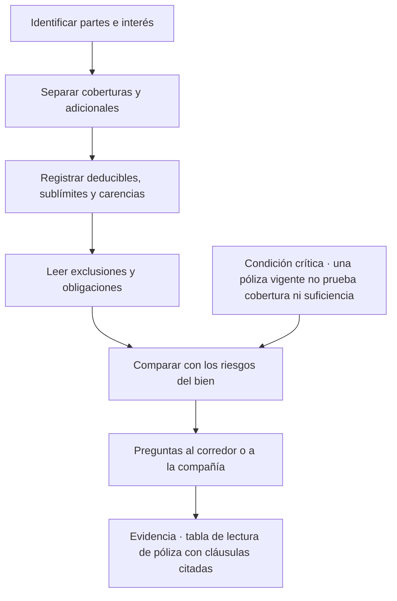
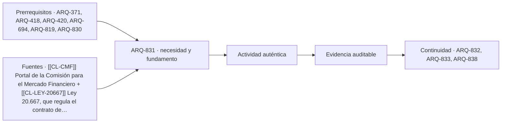

# ARQ-831 · Seguros de inmuebles y obra: contrato, coberturas, exclusiones y límites

**Parte 84 · Evaluación de inmuebles, seguros y eventos catastróficos · Chile · Edición 2026.10.**

Material educativo. Enseña a leer y comparar contratos de seguro como instrumentos de gestión del riesgo; no es asesoría de seguros, legal ni financiera, no determina primas y no reemplaza a un corredor de seguros, a la compañía ni a un abogado. El alcance de cada cobertura depende de la póliza concreta.

**Prerrequisitos recomendados:** `ARQ-371`, `ARQ-418`, `ARQ-420`, `ARQ-694`, `ARQ-819`. La entrada inmediata es `ARQ-830`; la continuidad es `ARQ-832`.

## Pregunta central

¿Qué cubre realmente una póliza de un inmueble o de una obra, qué deja fuera y qué debe hacer la persona asegurada para que la cobertura exista cuando ocurra el daño?

**Fallo crítico de esta clase:** una póliza vigente no demuestra que el daño esté cubierto, que la suma asegurada alcance ni que el riesgo siga siendo el que se declaró al contratar.

## Problema y resultado observable

En el programa, ARQ-694 y ARQ-819 nombran el seguro como parte de la distribución de responsabilidades, pero ninguna clase abre una póliza y la lee cláusula por cláusula. Quien evalúa un inmueble, administra una copropiedad o prepara una obra suele oír frases como «está asegurado» o «tiene seguro de incendio». Esa frase no contesta nada útil: no dice qué eventos cubre, hasta qué monto, con qué retención, con qué exclusiones ni quién puede reclamar.

Al terminar podrás separar las partes de un contrato de seguro, distinguir coberturas principales de adicionales, localizar en una póliza real o modelo las exclusiones, los límites y las obligaciones de la persona asegurada, y producir una **tabla de lectura de póliza** de una página que permita decidir qué preguntas llevar a un corredor de seguros, a la compañía o a un abogado. No producirás una recomendación de contratación: la decisión de comprar, cambiar o retener corresponde a quien tiene interés en el bien y asume el riesgo.

## Fundamentos y vocabulario del contrato

Un seguro es un contrato por el cual una parte, el asegurador, se obliga a indemnizar un daño o pagar una suma si ocurre un evento incierto, a cambio de una prima. Para leerlo conviene fijar primero los sujetos. El **contratante** es quien celebra el contrato y paga; el **asegurado** es quien sufre la pérdida y tiene derecho a la indemnización; el **beneficiario** es quien recibe el pago, que puede ser otra persona o una institución, como el banco acreedor en un crédito hipotecario. A veces las tres figuras coinciden y a veces no, y la diferencia importa en el momento del siniestro. El **corredor de seguros** intermedia; no es la compañía y su explicación verbal no modifica las condiciones escritas.

El **riesgo** asegurado es el evento futuro e incierto descrito en la póliza. El **interés asegurable** es el vínculo económico entre la persona y el bien: se asegura lo que se pierde si ocurre el daño. Un arrendatario no tiene el mismo interés que el propietario sobre el edificio, pero sí lo tiene sobre sus mejoras y sobre su responsabilidad. La **suma asegurada** es el límite máximo que la compañía se compromete a pagar, no el valor del bien ni lo que pagará en un siniestro cualquiera. La **prima** es el precio. El **deducible** es la parte del daño que queda a cargo de la persona asegurada, expresada como monto, porcentaje del daño o porcentaje de la suma. Un **sublímite** reduce la cobertura para una causa o rubro concreto aunque la suma total sea mayor. Una **exclusión** retira de la cobertura causas, bienes o circunstancias. Una **carencia** es un periodo inicial sin cobertura para ciertos eventos.

El contrato se compone de **condiciones generales**, **condiciones particulares** y **endosos**. Las generales son el texto marco de la compañía, las particulares individualizan bien, vigencia, suma y deducibles, y los endosos modifican lo anterior. Cuando hay contradicción, la persona que lee debe preguntar cuál texto prevalece en lugar de suponer. Por último, la **declaración del riesgo** es la información que el asegurado entrega al contratar y la **agravación** es un cambio posterior —una ampliación, un cambio de uso, un local comercial en una casa— que puede exigir aviso. Qué consecuencias tiene omitir o falsear esa información lo define el contrato y la ley aplicable; requiere revisión jurídica especializada y no se resuelve en esta clase.

## Coberturas que no deben confundirse

La palabra «seguro» agrupa productos muy distintos. El **seguro de incendio** protege el bien contra el fuego y, según la póliza, contra eventos asociados; suele ofrecerse con **adicionales** que se contratan por separado, como sismo, inundación, daños por agua o robo. Por eso una póliza que dice cubrir incendio no cubre automáticamente un terremoto, un aluvión ni una filtración. Los créditos hipotecarios suelen exigir seguros asociados, y la entidad financiera suele figurar como beneficiaria hasta el monto de la deuda; esa práctica debe verificarse en cada contrato y no se supone.

El **seguro de todo riesgo construcción** protege la obra durante su ejecución, con coberturas sobre materiales, equipos y obra gruesa frente a daños súbitos, y suele distinguir lo que cubre del retraso del cronograma, que muchas veces queda fuera o se trata en una cobertura aparte. La **responsabilidad civil** cubre el daño que el asegurado causa a terceros, por ejemplo un transeúnte lesionado o un vecino dañado por una excavación. La **responsabilidad civil profesional** cubre errores u omisiones en el ejercicio de un oficio técnico; no la asegura el propietario sino el profesional. Los **bienes comunes de una copropiedad** tienen seguros propios contratados por la administración; el propietario de una unidad no está cubierto por ellos en su interior salvo que la póliza lo diga. La **interrupción de actividad** o pérdida de ingresos protege la renta que se deja de percibir, y exige que el daño material esté cubierto y que se cumplan plazos y condiciones.

Un criterio de lectura sirve para todos: cada cobertura responde a cuatro preguntas. Qué bien, qué causa, qué monto y qué plazo. Si falta alguna de las cuatro respuestas, la cobertura no está comprendida.

## Método de lectura en cinco pasadas

La primera pasada identifica el **encabezado**: partes, bien asegurado con su dirección y rol, vigencia y moneda. Se comprueba que el bien descrito sea el que se evalúa y que la vigencia cubra la fecha de interés. La segunda extrae **coberturas y adicionales** en una lista con su suma. La tercera registra **deducibles, sublímites y carencias**, que son los números que más sorprenden después de un daño. La cuarta lee **exclusiones y condiciones suspensivas**: causas excluidas, bienes no asegurados, requisitos de mantenimiento, medidas de protección exigidas. La quinta busca las **obligaciones de la persona asegurada**: avisar cambios, conservar el bien, denunciar el siniestro en un plazo, no alterar la evidencia, permitir inspecciones. El resultado es una tabla de diez a veinte filas con un campo de página y cláusula para cada dato, de modo que otra persona pueda verificar la lectura.

## Mapa específico de la decisión

El diagrama localiza dónde se rompe la cadena: un riesgo del bien que no aparece en ninguna cobertura, una cobertura cuya suma no alcanza, una obligación que la persona no puede cumplir. No indica qué contratar.

## Caso resuelto: lectura de una póliza simulada

Una vivienda de 90 m² en una ciudad costera tiene un seguro de incendio con adicional de sismo contratado junto con el crédito hipotecario. La tabla de lectura muestra: suma asegurada de CLP 60.000.000 para el edificio; sismo con deducible del 2 % de la suma, es decir CLP 1.200.000; incendio con deducible fijo de CLP 300.000; exclusión de daños causados por inundación o marejada, salvo que se contrate el adicional correspondiente; un sublímite de CLP 5.000.000 para daños por agua. Todas las cifras son **HIPOTÉTICAS** y sirven solo para practicar la lectura.

Con esa tabla, tres preguntas aparecen de inmediato. Primero, el inmueble está en un borde costero: una marejada o un tsunami podrían ser la causa de daño más relevante y la póliza los excluye, de modo que la persona debe preguntar si existe cobertura y a qué costo, o aceptar que retiene ese riesgo. Segundo, el sublímite de agua es bajo frente al costo plausible de reparar una cubierta y cielos; conviene preguntar si es negociable. Tercero, el deducible de sismo del 2 % obliga a prever una reserva: ante un daño de CLP 10.000.000, el primer millón doscientos mil queda a cargo del propietario. Esa lectura no recomienda comprar nada. Ordena el diálogo con quien sí puede asesorar.

## Práctica guiada

Obtén una póliza real propia o un modelo de condiciones generales publicado por una compañía y por la Comisión para el Mercado Financiero. Si usas una póliza real, trabaja sin compartirla. Completa la tabla de cinco pasadas con cláusulas citadas. Marca cada fila como **leída**, **ambigua** o **pendiente de consulta**. Redacta tres preguntas dirigidas al corredor y dos dirigidas a un abogado. Usa el portal de la CMF para localizar si existe un seguro contratado a nombre de una persona fallecida o representada y para ubicar la información de atención ciudadana; el sitio cambia, por lo que registra la fecha de tu consulta.

## Ejercicio independiente

Toma dos pólizas modelo diferentes para el mismo tipo de inmueble y compara su tabla de lectura. Identifica una cobertura presente en una y ausente en la otra, un deducible que se expresa de forma distinta y una exclusión que cambia el significado de «incendio». Después redacta un párrafo de cierre que diga qué decisión de contratación **no** puedes tomar solo con esa comparación y qué especialista debe intervenir. Entrega la tabla, el párrafo y la lista de preguntas con fecha y fuente.

## Qué dice la ley chilena sobre el contrato de seguro

Desde el 1 de diciembre de 2013 los contratos de seguro deben ajustarse al Título VIII del Libro II del Código de Comercio, reemplazado por la Ley 20.667. Las citas que siguen provienen de una lectura asistida del texto de esa ley (extraído con una herramienta automática) y de una nota educativa de la Comisión para el Mercado Financiero; **no se leyó la versión consolidada vigente artículo por artículo**, así que cada numeral debe verificarse en la edición actual antes de usarlo.

- **Definición (art. 512).** Por el contrato se transfieren al asegurador uno o más riesgos a cambio de una prima, y el asegurador se obliga a indemnizar el daño o a pagar la prestación pactada. Esta frase ordena la lectura: transferir un riesgo no es eliminarlo.
- **Interés asegurable (arts. 520, 546 y 589).** Debe existir al momento del siniestro. Si cesa durante la vigencia, el contrato termina y corresponde devolver la prima no devengada. En un seguro de bienes el interés debe ser lícito y valorable en dinero. Por eso un comprador que aún no es dueño, o un arrendatario respecto del edificio, tiene una posición distinta a la del propietario.
- **Declaración del riesgo (arts. 524 n.º 1 y 525).** La persona asegurada debe responder con veracidad las preguntas del asegurador; si éste no preguntó, no puede invocar errores u omisiones sobre lo que no preguntó. Antes de un siniestro, un error grave e inexcusable permite al asegurador rescindir; uno menor permite proponer ajustes. Después de un siniestro, una declaración inexacta importante puede liberar al asegurador o reducir el pago en proporción a la prima. Estas sanciones no operan si el asegurador conocía o debía conocer la situación.
- **Agravación del riesgo (art. 526).** Los aumentos sustanciales del riesgo deben comunicarse dentro de cinco días desde que la persona los conoce; el asegurador dispone de plazos para rescindir o proponer nuevas condiciones. Una ampliación, un cambio de uso o una actividad comercial en una vivienda son ejemplos que deben consultarse con el corredor **antes** de ejecutarlos.
- **Normas imperativas.** La CMF explica que las disposiciones son obligatorias salvo que el contrato otorgue mejores condiciones al asegurado, y que no se aplican a ciertos seguros de daños contratados individualmente por personas jurídicas con prima anual superior a 200 UF ni a los de casco y transporte marítimo y aéreo. El contrato puede probarse por cualquier medio admisible con principio de prueba por escrito (por ejemplo, correos).
- **Retracto.** En contratos celebrados a distancia el asegurado puede retractarse dentro de diez días desde que recibe la póliza, con devolución de prima.
- **Pluralidad de seguros.** Si varios seguros cubren el mismo bien, la persona puede reclamar la pérdida a cualquiera de los aseguradores y recuperar el saldo de los demás, sin superar el valor del bien.
- **Controversias.** El arbitraje es la vía por defecto, pero para reclamaciones por menos de 10.000 UF el asegurado puede acudir a la justicia ordinaria.

Lo que esta clase **no** hace es interpretar cómo se aplica cada regla a una póliza concreta. Esa tarea pertenece a un abogado.

## Segundo caso resuelto: póliza de copropiedad

Un edificio de 24 departamentos tiene un seguro contratado por la administración con cobertura de incendio sobre bienes comunes, un adicional de sismo y responsabilidad civil. Un propietario cree que su departamento «está asegurado por el edificio». La tabla de lectura de póliza, con cláusulas citadas, muestra tres cosas: la cobertura se describe sobre «bienes comunes» y una cláusula de definiciones enumera estructura, fachadas, cubierta y ascensores, pero **no menciona terminaciones interiores ni bienes de cada unidad**; el deducible por sismo se expresa como porcentaje de la suma asegurada de todo el edificio, de modo que un daño localizado puede quedar íntegramente bajo el deducible; y la responsabilidad civil cubre a la comunidad frente a terceros, no al propietario por lo que ocurra dentro de su unidad.

La conclusión es una lista de preguntas, no un veredicto. Al administrador: ¿qué define la póliza como bien común y qué como bien particular? A un corredor: ¿existe una póliza individual que cubra terminaciones y contenido? ¿Cómo se compone el deducible cuando el daño afecta un solo piso? A un abogado: ¿qué significan las exclusiones para una filtración originada en un departamento superior? Las cifras de este caso son hipotéticas y se omiten deliberadamente: el ejercicio es de lectura, no de cálculo.

## Autoevaluación con solución razonada

1. *Una póliza dice «incendio y adicionales». ¿Cubre sismo?* No se puede responder sin la lista de adicionales de las condiciones particulares. Si no figura, no está contratado.
2. *El corredor aseguró verbalmente que el seguro cubre inundación. ¿Qué haces?* Pides que lo confirme por escrito y buscas la cobertura en la póliza; lo no escrito no se puede exigir con la misma facilidad.
3. *Amplías la casa en 20 m². ¿Qué conviene preguntar y cuándo?* Si el cambio aumenta sustancialmente el riesgo, el contrato y la ley prevén un aviso en plazo breve; se pregunta antes de ejecutar la obra y se registra la respuesta.
4. *¿Por qué el interés asegurable importa en una promesa de compraventa?* Porque la persona que aún no es dueña puede no tener el interés exigido en el momento del siniestro; se consulta cómo se transfiere o cuándo comienza la cobertura.
5. *¿Qué cambia si el seguro es de una persona jurídica con prima anual alta?* La CMF indica que algunas reglas imperativas no se aplican en ciertos seguros entre personas jurídicas; se verifica la excepción con un abogado antes de suponer que rige el mínimo legal.

## Errores típicos y recuperación

- **Leer solo las condiciones particulares:** el resumen de una página omite exclusiones y obligaciones que están en las generales. Vuelve a las cinco pasadas.
- **Confundir suma con valor:** una suma asegurada alta no garantiza que alcance para reconstruir. Se analiza en ARQ-832.
- **Suponer adicionales:** que la póliza hipotecaria exista no significa que incluya sismo o inundación. Busca la cobertura en la lista y su deducible.
- **Tomar la explicación verbal como contrato:** lo que no está escrito en la póliza o en un endoso no se puede exigir. Pide la respuesta por escrito.
- **Ignorar la agravación:** una ampliación, un nuevo uso o una actividad comercial puede cambiar el riesgo. Registra los cambios y pregunta si exigen aviso.
- **Tratar el seguro como sustituto de prevención:** transferir una pérdida no reduce su probabilidad. La prevención sigue siendo necesaria.

Para recuperar, repite la lectura después de 48 horas sin mirar la tabla y compara. Corrige una cláusula mal citada y un número mal transcrito.

## Evaluación por evidencias

La entrega se acepta si responde la pregunta central con una tabla de lectura completa, cláusulas citadas por página, separación entre coberturas principales y adicionales, deducibles y sublímites registrados con unidad, exclusiones y obligaciones identificadas, preguntas derivadas dirigidas al profesional correcto y una frase explícita de límite: la persona no recomienda ni selecciona un seguro. Se usa la rúbrica común con umbral 80/100 y ninguna dimensión bajo 60 %. Si falta la identificación del interés asegurable o se afirma una cobertura sin cláusula, la evidencia permanece pendiente aunque el promedio supere el umbral.

## Continuidad

`ARQ-832` toma la tabla de lectura y la contrasta con el valor de reconstrucción del bien. La relación entre suma asegurada, valor y deducible determina si la cobertura alcanza. `ARQ-833` retoma las obligaciones de la persona asegurada cuando ocurre un siniestro.

<!-- pedagogia-2026:inicio -->
## Decisión pedagógica y posición curricular

### Por qué existe

Esta clase existe para resolver una necesidad concreta del recorrido: ¿Qué cubre realmente una póliza de un inmueble o de una obra, qué deja fuera y qué debe hacer la persona asegurada para que la cobertura exista cuando ocurra el daño? Fallo crítico de esta clase: una póliza vigente no demuestra que el daño esté cubierto, que la suma asegurada alcance ni que el riesgo siga siendo el que se declaró al contratar.

### Por qué está exactamente aquí

Abre la Parte 84 porque plantea primero el problema «¿Qué cubre realmente una póliza de un inmueble o de una obra, qué deja fuera y qué debe hacer la persona asegurada para que la cobertura exista cuando ocurra el daño? Fallo crítico de esta clase: una póliza vigente no demuestra que el daño esté cubierto, que la suma asegurada alcance ni que el riesgo siga siendo el que se declaró al contratar.». La transición desde ARQ-830 · Término de obra, certificados, recepción definitiva, garantías y mantenimiento conserva métodos de evidencia y límites, pero no traslada parámetros del bloque anterior. Establece la pregunta y el producto base que ARQ-832 · Valor de reconstrucción, infraseguro y pérdida esperada frente a escenario extremo desarrollará a continuación.

- **Prerrequisitos:** `ARQ-371`, `ARQ-418`, `ARQ-420`, `ARQ-694`, `ARQ-819`, `ARQ-830`
- **Capacidad que introduce:** En el programa, ARQ-694 y ARQ-819 nombran el seguro como parte de la distribución de responsabilidades, pero ninguna clase abre una póliza y la lee cláusula por cláusula. Quien evalúa un inmueble, administra una copropiedad o prepara una obra suele oír frases como «está asegurado» o «tiene seguro de incendio». Esa frase no contesta nada útil: no dice qué eventos cubre, hasta qué monto, con qué retención, con qué exclusiones ni quién puede reclamar.
- **Clases o experiencias que dependen de ella:** `ARQ-832`, `ARQ-833`, `ARQ-838`

El diagrama permite comprobar una relación que el texto lineal oculta con facilidad: esta clase recibe capacidades previas, toma decisiones apoyadas por fuentes, exige una experiencia y produce evidencia que habilita trabajo posterior. No representa un procedimiento de obra.

## Resultado observable, evidencia y evaluación

1. Identificar y delimitar las condiciones necesarias para responder la pregunta central de seguros de inmuebles y obra: contrato, coberturas, exclusiones y límites.
2. Producir y comprobar la evidencia declarada por la clase: En el programa, ARQ-694 y ARQ-819 nombran el seguro como parte de la distribución de responsabilidades, pero ninguna clase abre una póliza y la lee cláusula por cláusula. Quien evalúa un inmueble, administra una copropiedad o prepara una obra suele oír frases como «está asegurado» o «tiene seguro de incendio». Esa frase no contesta nada útil: no dice qué eventos cubre, hasta qué monto, con qué retención, con qué exclusiones ni quién puede reclamar.
3. Justificar una decisión de seguros de inmuebles y obra: contrato, coberturas, exclusiones y límites mediante fuentes, supuestos, alternativas y límites explícitos.

## Actividad, evidencia y criterio de aceptación

**Actividad:** Obtén una póliza real propia o un modelo de condiciones generales publicado por una compañía y por la Comisión para el Mercado Financiero. Si usas una póliza real, trabaja sin compartirla. Completa la tabla de cinco pasadas con cláusulas citadas.

**Evidencia mínima:** En el programa, ARQ-694 y ARQ-819 nombran el seguro como parte de la distribución de responsabilidades, pero ninguna clase abre una póliza y la lee cláusula por cláusula. Quien evalúa un inmueble, administra una copropiedad o prepara una obra suele oír frases como «está asegurado» o «tiene seguro de incendio». Esa frase no contesta nada útil: no dice qué eventos cubre, hasta qué monto, con qué retención, con qué exclusiones ni quién puede reclamar.

**Archivo sugerido:** `evidence/ARQ-831/evidencia.md`.

**Criterio de aceptación:** la entrega se acepta cuando:

- La entrega responde explícitamente a la pregunta: ¿Qué cubre realmente una póliza de un inmueble o de una obra, qué deja fuera y qué debe hacer la persona asegurada para que la cobertura exista cuando ocurra el daño? Fallo crítico de esta clase: una póliza vigente no demuestra que el daño esté cubierto, que la suma asegurada alcance ni que el riesgo siga siendo el que se declaró al contratar.
- La actividad conserva las fronteras del caso y permite reconstruir el procedimiento: Obtén una póliza real propia o un modelo de condiciones generales publicado por una compañía y por la Comisión para el Mercado Financiero. Si usas una póliza real, trabaja sin compartirla. Completa la tabla de cinco pasadas con cláusulas citadas.
- Cada afirmación externa puede seguirse hasta una fuente, su alcance consultado y su límite.
- La evidencia deja disponible una entrada comprobable para ARQ-832.
- 1. Una póliza dice «incendio y adicionales».

La [rúbrica común](../../docs/RUBRICA_COMUN.md) complementa estos criterios; no los reemplaza. Una entrega puede superar un promedio y continuar pendiente si oculta una condición crítica.

## Trazabilidad de las decisiones

| # | Decisión o fundamento | Fuente utilizada | Aplicación y límite en esta clase |
|---:|---|---|---|
| 1 | ubica al organismo supervisor y los servicios públicos para consultar seguros contratados y orientar tras temporales. | [[[CL-CMF]] Portal de la Comisión para el Mercado Financiero](https://www.cmfchile.cl/) | Consulta: página principal y accesos visibles a «Conoce tus seguros», «Temporales en regiones», estadísticas del mercado de seguros y atención ciudadana. Límite: no se leyó ninguna circular ni norma de seguros; la existencia de un servicio no describe su procedimiento ni garantiza cobertura. Fecha de |
| 2 | respalda las reglas sobre definición del contrato, interés asegurable, declaración y agravación del riesgo, infraseguro, aviso del siniestro y prescripción. | [[[CL-LEY-20667]] Ley 20.667, que regula el contrato de seguro](https://www.bcn.cl/leychile/navegar?idNorma=1050848) | Consulta: texto de la ley obtenido por la exportación XML de LeyChile y resumido con una herramienta automática; artículos 512, 520, 524–526, 541, 546, 552–553, 558, 571 y 589 según la afirmación de la clase. Límite: lectura asistida y no íntegra; no se contrastó con la versión consolidada vigente ni con modificaciones posteriores, y no se leyó el reglamento de liquidadores; cada numeral debe verificarse antes de usarlo y su aplicación a una póliza concreta corresponde a un abogado. Fecha de |
| 3 | explica en lenguaje no técnico las reglas de prueba del contrato, retracto, pluralidad de seguros, prescripción y vía de controversias. | [[[CL-CMF-EDUCA]] Código de Comercio, nota de CMF Educa](https://www.cmfchile.cl/educa/621/w3-article-13977.html) | Consulta: nota educativa sobre el nuevo Título VIII del Libro II del Código de Comercio, con derechos del asegurado, normas imperativas y excepciones. Límite: es divulgación institucional y no reemplaza el texto legal ni una asesoría; no se contrastó cada afirmación con el artículo. Fecha de |

La tabla permite auditar las relaciones; la explicación, el caso y la práctica de la clase siguen siendo la documentación principal.

## Autoevaluación, recuperación y continuidad

### Errores diagnósticos

Antes de avanzar, comprueba si puedes reconstruir cada resultado sin mirar la solución, señalar qué evidencia lo sostiene y nombrar una condición que obligaría a revisar tu decisión. Conserva la primera versión, la objeción recibida y la revisión.

**Conexión siguiente:** La continuidad inmediata es ARQ-832 · Valor de reconstrucción, infraseguro y pérdida esperada frente a escenario extremo; conserva el método y vuelve a verificar datos y límites.
<!-- pedagogia-2026:fin -->

## Fuentes y alcance de uso

### [[CL-CMF]] Portal de la Comisión para el Mercado Financiero

Comisión para el Mercado Financiero de Chile. [https://www.cmfchile.cl/](https://www.cmfchile.cl/)

**Consulta:** página principal y accesos visibles a «Conoce tus seguros», «Temporales en regiones», estadísticas del mercado de seguros y atención ciudadana. **Apoyo:** ubica al organismo supervisor y los servicios públicos para consultar seguros contratados y orientar tras temporales. **Límite:** no se leyó ninguna circular ni norma de seguros; la existencia de un servicio no describe su procedimiento ni garantiza cobertura. **Fecha de consulta:** 30 de octubre de 2026.

### [[CL-LEY-20667]] Ley 20.667, que regula el contrato de seguro

Biblioteca del Congreso Nacional de Chile. [https://www.bcn.cl/leychile/navegar?idNorma=1050848](https://www.bcn.cl/leychile/navegar?idNorma=1050848)

**Consulta:** texto de la ley obtenido por la exportación XML de LeyChile y resumido con una herramienta automática; artículos 512, 520, 524–526, 541, 546, 552–553, 558, 571 y 589 según la afirmación de la clase. **Apoyo:** respalda las reglas sobre definición del contrato, interés asegurable, declaración y agravación del riesgo, infraseguro, aviso del siniestro y prescripción. **Límite:** lectura asistida y no íntegra; no se contrastó con la versión consolidada vigente ni con modificaciones posteriores, y no se leyó el reglamento de liquidadores; cada numeral debe verificarse antes de usarlo y su aplicación a una póliza concreta corresponde a un abogado. **Fecha de consulta:** 30 de octubre de 2026.

### [[CL-CMF-EDUCA]] Código de Comercio, nota de CMF Educa

Comisión para el Mercado Financiero de Chile. [https://www.cmfchile.cl/educa/621/w3-article-13977.html](https://www.cmfchile.cl/educa/621/w3-article-13977.html)

**Consulta:** nota educativa sobre el nuevo Título VIII del Libro II del Código de Comercio, con derechos del asegurado, normas imperativas y excepciones. **Apoyo:** explica en lenguaje no técnico las reglas de prueba del contrato, retracto, pluralidad de seguros, prescripción y vía de controversias. **Límite:** es divulgación institucional y no reemplaza el texto legal ni una asesoría; no se contrastó cada afirmación con el artículo. **Fecha de consulta:** 30 de octubre de 2026.
