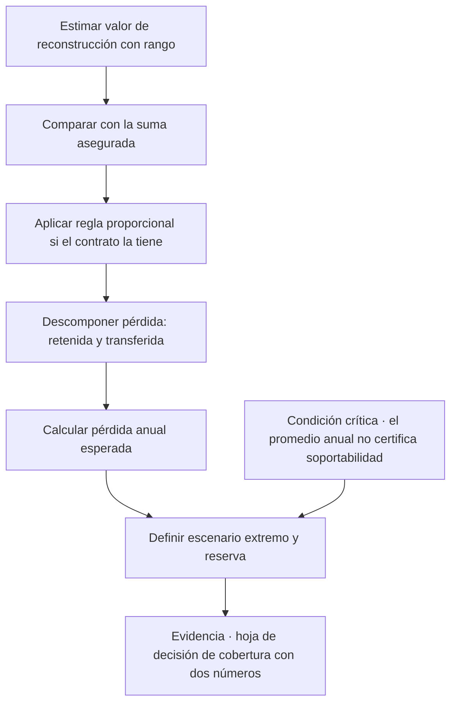
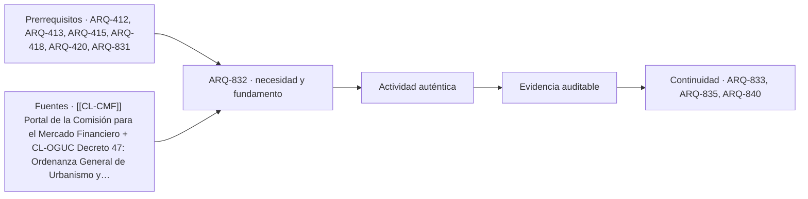

# ARQ-832 · Valor de reconstrucción, infraseguro y pérdida esperada frente a escenario extremo

**Parte 84 · Evaluación de inmuebles, seguros y eventos catastróficos · Chile · Edición 2026.10.**

Material educativo. Enseña a comparar cifras de cobertura y de pérdida con supuestos explícitos; no calcula primas, no tasa inmuebles y no sustituye a un tasador, a un corredor de seguros ni a un especialista en riesgo. Todo monto de la clase es **HIPOTÉTICO** hasta que se cite con fecha, región, fuente e impuestos.

**Prerrequisitos recomendados:** `ARQ-412`, `ARQ-413`, `ARQ-415`, `ARQ-418`, `ARQ-420`, `ARQ-831`. La entrada inmediata es `ARQ-831`; la continuidad es `ARQ-833`.

## Pregunta central

¿Alcanza la suma asegurada para reconstruir el bien, y cómo se comparan una pérdida anual esperada pequeña y un escenario extremo que supera la capacidad de pago de quien lo soporta?

**Fallo crítico de esta clase:** un promedio anual bajo no demuestra que el escenario extremo sea soportable.

## Problema y resultado observable

Una persona puede tener un seguro vigente y estar, aun así, mal protegida por dos razones distintas. La primera es que la suma asegurada no coincide con lo que costaría reconstruir hoy, con precios de hoy y con las exigencias de hoy. La segunda es que el riesgo se evalúa por su promedio, y el promedio oculta la cola: un evento que ocurre rara vez pero que, cuando ocurre, destruye el bien y el patrimonio asociado. ARQ-418 y ARQ-420 enseñan costo de ciclo de vida y sensibilidad; esta clase los aplica a una pregunta concreta de transferencia y retención del riesgo.

Al terminar podrás estimar un valor de reconstrucción con supuestos declarados, calcular el efecto de un infraseguro con una regla proporcional cuando el contrato la contemple, descomponer una pérdida en retención y transferencia, y presentar dos números lado a lado —la pérdida anual esperada y la pérdida del escenario extremo— sin dejar que uno tape al otro. La evidencia es una **hoja de decisión de cobertura** con fórmulas visibles y una conclusión limitada al modelo.

## Valor de reconstrucción y valor de mercado

El **valor de reconstrucción** es el costo de volver a construir un bien equivalente en el mismo lugar, con materiales y procesos actuales, incluyendo demolición de escombros, honorarios, permisos y las exigencias normativas vigentes. El **valor de mercado** es el precio al que se transaría el inmueble y depende de ubicación, demanda y suelo; el suelo no se destruye en un incendio y por eso no forma parte del valor de reconstrucción. Confundirlos produce errores en ambos sentidos: asegurar por valor de mercado puede significar pagar de más por el suelo, y asegurar por el avalúo fiscal o por el valor de compra de hace años puede dejar la suma muy por debajo del costo actual.

Para estimar el valor de reconstrucción se parte de la superficie construida, medida con el criterio que corresponda (ARQ-412), se aplica un costo por metro cuadrado que debe tener fecha, región, calidad constructiva y fuente, y se agregan partidas que no están en el costo por metro cuadrado: demolición y retiro, proyectos y honorarios, derechos municipales y contingencia (ARQ-415). El resultado es una cifra con un rango, no un número exacto. Un costo por metro cuadrado publicado por una fuente de mercado describe un tipo de obra y no una vivienda concreta; la fuente debe indicar qué incluye.

## Infraseguro, sobreseguro y regla proporcional

Hay **infraseguro** cuando la suma asegurada es menor que el valor que debió asegurarse. Muchos contratos prevén que, en ese caso, la indemnización se reduzca en proporción: la persona asegurada soporta la diferencia como si fuera su propio asegurador por la parte no cubierta. Si el contrato tiene esa regla, la fórmula es sencilla:

indemnización = daño × (suma asegurada ÷ valor de reconstrucción), antes de deducible y sujeta a la suma máxima.

El **sobreseguro** ocurre cuando la suma excede el valor; el exceso no suele generar mayor indemnización y sí mayor prima. Tampoco todos los contratos aplican la regla proporcional, ni la aplican igual; qué ocurre con tu póliza lo dice el contrato y no esta clase. Por eso el ejercicio de esta clase es practicar la lectura de la cláusula y comprobar su efecto, no afirmarlo.

## Pérdida anual esperada y escenario extremo

La **pérdida anual esperada** es la suma, sobre los eventos posibles, de la probabilidad anual de cada evento por su pérdida. Es un instrumento útil para comparar medidas de mitigación y para pensar en primas, porque repartido en muchos años el costo de un riesgo se vuelve un monto anual. Su límite es que promedia. Un evento con una probabilidad anual de 1 % y una pérdida de CLP 100.000.000 aporta CLP 1.000.000 por año al promedio, pero la persona no experimenta un millón por año: experimenta cero durante años y cien millones en un solo momento.

Por eso se presentan dos números. El primero es la pérdida anual esperada, que guía la comparación entre alternativas. El segundo es la **pérdida del escenario extremo** razonable, que guía la pregunta de supervivencia: ¿puede la persona asumir esta pérdida, con qué reserva, con qué seguro y con qué plazo de recuperación? Las probabilidades de un evento natural no se inventan; deben provenir de fuentes oficiales o de estudios y, cuando no existan, la clase pide trabajar con **escenarios** en vez de probabilidades. Ordenar escenarios de menor a mayor gravedad y preguntar cuál es el más grave que se está dispuesto a soportar sin ayuda es una forma honesta de decidir con incertidumbre.

## Mapa específico de la decisión

## Caso resuelto con cifras hipotéticas

Una vivienda de 90 m² construidos. Supuestos **HIPOTÉTICOS**: costo de construcción CLP 850.000/m² (fecha: octubre de 2026, región por definir, calidad estándar), más 12 % por demolición, honorarios y permisos, más 10 % de contingencia. Valor de reconstrucción: 90 × 850.000 = 76.500.000; × 1,12 = 85.680.000; × 1,10 = 94.248.000. La póliza asegura CLP 60.000.000. La razón suma/valor es 60.000.000 ÷ 94.248.000 = 0,6366.

Si ocurre un daño de CLP 20.000.000 y el contrato aplica regla proporcional, la indemnización antes de deducible sería 20.000.000 × 0,6366 = 12.732.000. El deducible hipotético de CLP 300.000 la reduce a 12.432.000 si se aplica después. La persona retiene 7.568.000, es decir 38 % del daño, aunque «tenía seguro». Con una suma de 94.000.000 la retención sería solo el deducible.

Para el escenario extremo se supone destrucción total por un evento raro: el daño es 94.248.000; la indemnización máxima es la suma asegurada, 60.000.000; la persona retiene 34.248.000 y debe además pagar el saldo del crédito si lo hubiera. La **pérdida anual esperada** depende de probabilidades que aquí no se afirman; el ejercicio exige que se escoja un valor ilustrativo y se lo rotule como supuesto. La conclusión del modelo no es «contrata más» sino «la hoja muestra una retención de 34 millones en el escenario extremo; la decisión y su costo requieren un corredor de seguros y la lectura de la cláusula proporcional».

## Práctica guiada

Elige un inmueble didáctico de superficie conocida. Estima tres valores de reconstrucción (bajo, medio y alto) cambiando el costo por metro cuadrado, el recargo de demolición y honorarios y la contingencia. Anota fecha y fuente de cada costo, o márcalo **HIPOTÉTICO**. Calcula la razón suma/valor para tres sumas aseguradas. Construye una tabla de tres escenarios de daño (parcial, severo, total) con la indemnización por escenario, con y sin regla proporcional, y con deducible fijo o porcentual. Realiza un control independiente: recalcula un escenario con otra fórmula o con suma manual y concilia la diferencia.

## Ejercicio independiente

Compara dos alternativas para el mismo bien: una con suma asegurada alta y prima mayor, y otra con suma menor y una reserva propia equivalente. Usa un horizonte de diez años y una tasa de descuento declarada. Presenta, para cada alternativa, la pérdida anual esperada del modelo, la retención en el escenario extremo y la reserva necesaria. Concluye en una frase qué alternativa sería más sensible a un cambio de precios de construcción, y señala qué dato externo cambiaría tu conclusión. Entrega la hoja con fórmulas visibles.

## Errores típicos y recuperación

- **Asegurar por avalúo o por precio de compra:** se corrige estimando el valor de reconstrucción con rango y fecha.
- **Incluir el suelo en la suma:** el suelo no se reconstruye; sepáralo.
- **Usar la pérdida esperada como si fuera la pérdida que ocurrirá:** presenta siempre el escenario extremo junto al promedio.
- **Inventar probabilidades:** si no hay fuente, trabaja con escenarios y rótulo de supuesto.
- **Asumir la regla proporcional sin leer la cláusula:** algunos contratos no la aplican o la aplican de otro modo.
- **Olvidar la inflación de la construcción:** una suma correcta hace años puede estar desactualizada hoy; registra la fecha de la estimación.

Para recuperar, vuelve a la hoja después de dos días, reconstruye de memoria el flujo valor → razón → indemnización → retención y corrige una unidad y una fecha.

## Evaluación por evidencias

La entrega se acepta si responde la pregunta central, muestra el valor de reconstrucción con rango y fuentes o rótulo HIPOTÉTICO, calcula la razón suma/valor y el efecto de la regla proporcional como hipótesis condicionada a la cláusula, presenta pérdida esperada y escenario extremo por separado, permite repetir una operación y declara qué decisión no puede tomarse con el modelo. Con la rúbrica común, umbral 80/100 y ninguna dimensión bajo 60 %. Si se presenta una probabilidad sin fuente o una conclusión basada solo en el promedio, la evidencia permanece pendiente.

## Continuidad

`ARQ-833` examina qué ocurre después del evento: cómo se documenta el estado previo y el daño para que la indemnización pueda sustentarse. `ARQ-840` usa las cifras de esta clase en la carpeta de evaluación inmobiliaria.

<!-- pedagogia-2026:inicio -->
## Decisión pedagógica y posición curricular

### Por qué existe

Esta clase existe para resolver una necesidad concreta del recorrido: ¿Alcanza la suma asegurada para reconstruir el bien, y cómo se comparan una pérdida anual esperada pequeña y un escenario extremo que supera la capacidad de pago de quien lo soporta? Fallo crítico de esta clase: un promedio anual bajo no demuestra que el escenario extremo sea soportable.

### Por qué está exactamente aquí

Ocupa el lugar 2 de la Parte 84. Se estudia después de ARQ-831 · Seguros de inmuebles y obra: contrato, coberturas, exclusiones y límites porque usa esa base para responder «¿Alcanza la suma asegurada para reconstruir el bien, y cómo se comparan una pérdida anual esperada pequeña y un escenario extremo que supera la capacidad de pago de quien lo soporta? Fallo crítico de esta clase: un promedio anual bajo no demuestra que el escenario extremo sea soportable.». Se ubica antes de ARQ-833 · Siniestro, evidencia y reclamación: antes, durante y después del daño porque la evidencia producida aquí debe estar disponible para ese paso.

- **Prerrequisitos:** `ARQ-412`, `ARQ-413`, `ARQ-415`, `ARQ-418`, `ARQ-420`, `ARQ-831`
- **Capacidad que introduce:** Una persona puede tener un seguro vigente y estar, aun así, mal protegida por dos razones distintas. La primera es que la suma asegurada no coincide con lo que costaría reconstruir hoy, con precios de hoy y con las exigencias de hoy. La segunda es que el riesgo se evalúa por su promedio, y el promedio oculta la cola: un evento que ocurre rara vez pero que, cuando ocurre, destruye el bien y el patrimonio asociado.
- **Clases o experiencias que dependen de ella:** `ARQ-833`, `ARQ-835`, `ARQ-840`

El diagrama permite comprobar una relación que el texto lineal oculta con facilidad: esta clase recibe capacidades previas, toma decisiones apoyadas por fuentes, exige una experiencia y produce evidencia que habilita trabajo posterior. No representa un procedimiento de obra.

## Resultado observable, evidencia y evaluación

1. Identificar y delimitar las condiciones necesarias para responder la pregunta central de valor de reconstrucción, infraseguro y pérdida esperada frente a escenario extremo.
2. Producir y comprobar la evidencia declarada por la clase: Una persona puede tener un seguro vigente y estar, aun así, mal protegida por dos razones distintas. La primera es que la suma asegurada no coincide con lo que costaría reconstruir hoy, con precios de hoy y con las exigencias de hoy. La segunda es que el riesgo se evalúa por su promedio, y el promedio oculta la cola: un evento que ocurre rara vez pero que, cuando ocurre, destruye el bien y el patrimonio asociado.
3. Justificar una decisión de valor de reconstrucción, infraseguro y pérdida esperada frente a escenario extremo mediante fuentes, supuestos, alternativas y límites explícitos.

## Actividad, evidencia y criterio de aceptación

**Actividad:** Elige un inmueble didáctico de superficie conocida. Estima tres valores de reconstrucción (bajo, medio y alto) cambiando el costo por metro cuadrado, el recargo de demolición y honorarios y la contingencia. Anota fecha y fuente de cada costo, o márcalo HIPOTÉTICO .

**Evidencia mínima:** Una persona puede tener un seguro vigente y estar, aun así, mal protegida por dos razones distintas. La primera es que la suma asegurada no coincide con lo que costaría reconstruir hoy, con precios de hoy y con las exigencias de hoy. La segunda es que el riesgo se evalúa por su promedio, y el promedio oculta la cola: un evento que ocurre rara vez pero que, cuando ocurre, destruye el bien y el patrimonio asociado.

**Archivo sugerido:** `evidence/ARQ-832/evidencia.md`.

**Criterio de aceptación:** la entrega se acepta cuando:

- La entrega responde explícitamente a la pregunta: ¿Alcanza la suma asegurada para reconstruir el bien, y cómo se comparan una pérdida anual esperada pequeña y un escenario extremo que supera la capacidad de pago de quien lo soporta? Fallo crítico de esta clase: un promedio anual bajo no demuestra que el escenario extremo sea soportable.
- La actividad conserva las fronteras del caso y permite reconstruir el procedimiento: Elige un inmueble didáctico de superficie conocida. Estima tres valores de reconstrucción (bajo, medio y alto) cambiando el costo por metro cuadrado, el recargo de demolición y honorarios y la contingencia. Anota fecha y fuente de cada costo, o márcalo HIPOTÉTICO .
- Cada afirmación externa puede seguirse hasta una fuente, su alcance consultado y su límite.
- La evidencia deja disponible una entrada comprobable para ARQ-833.
- - Asegurar por avalúo o por precio de compra: se corrige estimando el valor de reconstrucción con rango y fecha. - Incluir el suelo en la suma: el suelo no se reconstruye; sepáralo.

La [rúbrica común](../../docs/RUBRICA_COMUN.md) complementa estos criterios; no los reemplaza. Una entrega puede superar un promedio y continuar pendiente si oculta una condición crítica.

## Trazabilidad de las decisiones

| # | Decisión o fundamento | Fuente utilizada | Aplicación y límite en esta clase |
|---:|---|---|---|
| 1 | ubica al supervisor y las estadísticas públicas para contrastar supuestos del mercado. | [[[CL-CMF]] Portal de la Comisión para el Mercado Financiero](https://www.cmfchile.cl/) | Consulta: página principal y accesos visibles a información de seguros y estadísticas del mercado de seguros. Límite: no se consultó ninguna cifra de primas ni de siniestralidad; los montos de la clase son hipotéticos. Fecha de |
| 2 | referencia para distinguir superficies y exigencias vigentes que afectan el costo de reconstruir. | [CL-OGUC Decreto 47: Ordenanza General de Urbanismo y Construcciones](https://www.bcn.cl/leychile/navegar?idNorma=8201) | Consulta: texto oficial localizado; los criterios de superficie edificada y las exigencias aplicables a una reconstrucción deben revalidarse en el expediente concreto. Límite: la clase no cita numerales ni versión; una redacción aislada no determina aplicabilidad sin predio, actuación y fecha. Fecha de |

La tabla permite auditar las relaciones; la explicación, el caso y la práctica de la clase siguen siendo la documentación principal.

## Autoevaluación, recuperación y continuidad

### Errores diagnósticos

Antes de avanzar, comprueba si puedes reconstruir cada resultado sin mirar la solución, señalar qué evidencia lo sostiene y nombrar una condición que obligaría a revisar tu decisión. Conserva la primera versión, la objeción recibida y la revisión.

**Conexión siguiente:** La continuidad inmediata es ARQ-833 · Siniestro, evidencia y reclamación: antes, durante y después del daño; conserva el método y vuelve a verificar datos y límites.
<!-- pedagogia-2026:fin -->

## Fuentes y alcance de uso

### [[CL-CMF]] Portal de la Comisión para el Mercado Financiero

Comisión para el Mercado Financiero de Chile. [https://www.cmfchile.cl/](https://www.cmfchile.cl/)

**Consulta:** página principal y accesos visibles a información de seguros y estadísticas del mercado de seguros. **Apoyo:** ubica al supervisor y las estadísticas públicas para contrastar supuestos del mercado. **Límite:** no se consultó ninguna cifra de primas ni de siniestralidad; los montos de la clase son hipotéticos. **Fecha de consulta:** 30 de octubre de 2026.

### [[CL-OGUC]] Ordenanza General de Urbanismo y Construcciones, DS 47

Biblioteca del Congreso Nacional de Chile. [https://www.bcn.cl/leychile/navegar?idNorma=8201](https://www.bcn.cl/leychile/navegar?idNorma=8201)

**Consulta:** texto oficial localizado; los criterios de superficie edificada y las exigencias aplicables a una reconstrucción deben revalidarse en el expediente concreto. **Apoyo:** referencia para distinguir superficies y exigencias vigentes que afectan el costo de reconstruir. **Límite:** la clase no cita numerales ni versión; una redacción aislada no determina aplicabilidad sin predio, actuación y fecha. **Fecha de consulta:** 12 de octubre de 2026, registro heredado de ARQ-801–830.
