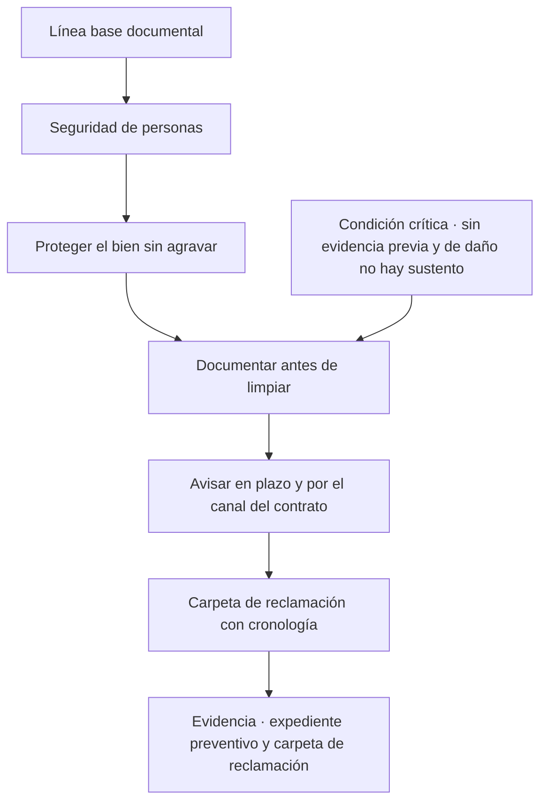
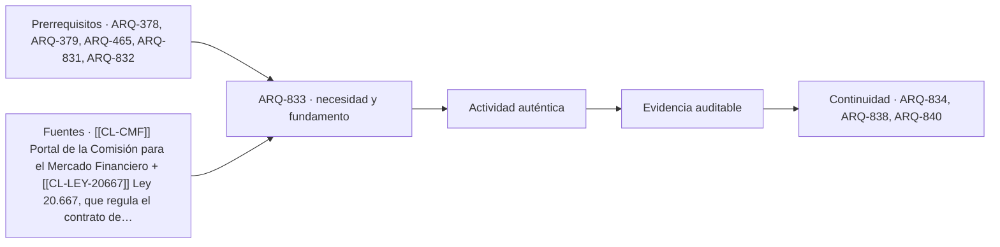

# ARQ-833 · Siniestro, evidencia y reclamación: antes, durante y después del daño

**Parte 84 · Evaluación de inmuebles, seguros y eventos catastróficos · Chile · Edición 2026.10.**

Material educativo. Enseña a preparar y ordenar evidencia y a formular preguntas ante un siniestro; no es asesoría jurídica ni de seguros, no sustituye a un liquidador, a un abogado ni a un profesional que inspeccione daños, y no garantiza ninguna indemnización.

**Prerrequisitos recomendados:** `ARQ-378`, `ARQ-379`, `ARQ-465`, `ARQ-831`, `ARQ-832`. La entrada inmediata es `ARQ-832`; la continuidad es `ARQ-834`.

## Pregunta central

¿Qué evidencia debe existir antes del evento, qué debe hacerse durante y justo después, y cómo se ordena una reclamación para que el daño y la cobertura puedan sustentarse?

**Fallo crítico de esta clase:** sin evidencia del estado previo y del daño, ni el mejor contrato permite sustentar una indemnización.

## Problema y resultado observable

Una póliza describe qué se cubre; el siniestro obliga a probar que el daño ocurrió, que ocurrió por una causa cubierta, que el bien estaba en el estado declarado y que el asegurado cumplió sus obligaciones. En la práctica muchos reclamos se complican no por falta de cobertura sino por falta de evidencia: fotografías sin fecha, documentos perdidos, reparaciones de urgencia que borraron el daño o avisos fuera de plazo. ARQ-378 enseña inspección y restricciones después de un evento y ARQ-465 enseña trazabilidad de garantías; esta clase une esas capacidades con el proceso de reclamación.

Al terminar podrás armar un **expediente preventivo** de un inmueble (antes del evento), un **protocolo de las primeras 72 horas** (después del evento) y una **carpeta de reclamación** con cronología, evidencias y preguntas dirigidas. No resolverás una disputa; identificarás qué pregunta corresponde al liquidador, qué al abogado y qué a un ingeniero.

## Antes del evento: línea base documental

La **línea base** es la prueba de cómo estaba el bien. Incluye planos, permisos y recepción, escrituras, el contrato de seguro con sus endosos, un inventario de bienes valiosos con fotografía y valor, fotografías con fecha de cada recinto, de la cubierta, de las instalaciones y del entorno, las facturas de reparaciones y mantenimiento (ARQ-464), y los certificados de instalaciones. Cada archivo se guarda con nombre que incluya fecha y recinto y en al menos dos soportes. La línea base cumple una función doble: permite demostrar el estado previo y permite distinguir un daño nuevo de una patología antigua. Una fisura que aparece en una fotografía anterior no es un daño del evento; una que no aparece es una hipótesis que debe evaluar un profesional.

También forma parte de la línea base el **registro de obligaciones del contrato**: plazos de aviso, medidas de protección exigidas (por ejemplo, conservar un sistema de detección o un cierre), condiciones de mantenimiento y nombre y contacto de corredor y compañía. Saber esto antes evita descubrir una exigencia tras el daño.

## Durante y justo después: seguridad primero, evidencia después

La primera prioridad es la seguridad de las personas y se rige por las instrucciones de las autoridades de emergencia; ninguna evidencia justifica exponerse a un peligro. Una vez controlada la situación, el **protocolo de las primeras 72 horas** sigue cuatro pasos. Primero, **proteger el bien** de un daño mayor con medidas razonables y baratas (cerrar un paso de agua, cubrir una abertura), documentando qué se hizo y por qué, porque la mayoría de los contratos exige evitar el agravamiento y algunos regulan el reembolso de esas medidas. Segundo, **documentar** con fotografías y video los daños antes de limpiar o reparar, con planos generales y detalles, incluyendo una referencia de escala y fecha. Tercero, **avisar** a la compañía o al corredor dentro del plazo del contrato, por el canal que la póliza señala, guardando constancia del envío. Cuarto, **conservar** los elementos dañados cuando sea razonable, hasta que se inspeccionen o se autorice su retiro.

Una regla de prudencia es no firmar documentos que se entiendan a medias ni aceptar un finiquito sin lectura y asesoría. Otra es no iniciar reparaciones definitivas sin comunicar a la compañía cuando el contrato exige inspección previa; las reparaciones de urgencia son distintas y se registran. Después de un sismo, un temporal o un incendio, la municipalidad y los organismos competentes pueden establecer restricciones de uso o evaluaciones; la decisión de habitar o no un edificio dañado no se toma a ojo (ARQ-378).

## La reclamación: orden, cronología y límites

La compañía puede designar un **liquidador**, que inspecciona, valora el daño y propone una liquidación. La persona asegurada tiene derecho a conocer el informe y a plantear observaciones; qué plazos, formas y recursos existen lo determinan el contrato y la ley, y requieren revisión jurídica específica. En un sistema con supervisor, existen también canales de consulta y reclamo ante la Comisión para el Mercado Financiero, cuyo portal ofrece información para quienes han sido afectados por temporales y para consultar seguros contratados.

La **carpeta de reclamación** tiene cinco secciones: cronología con fecha y hora, evidencia del estado previo, evidencia del daño, cálculo del daño con cotizaciones comparables y registro de comunicaciones (quién, cuándo, por qué canal, qué se dijo). Cada documento lleva un número que se cita en la cronología. La carpeta no pretende ser un alegato; es una base ordenada que otra persona —un liquidador, un abogado, un perito— pueda usar. El **cálculo del daño** distingue reparación, reposición y mejoras: reponer un elemento por otro equivalente no es lo mismo que mejorarlo, y la diferencia suele quedar fuera de la indemnización.

## Mapa específico de la decisión

## Caso resuelto: temporal que daña una cubierta

Una vivienda, con una póliza de incendio y adicionales cuyos detalles no se conocen, sufre durante un sistema frontal intenso la pérdida de parte de la cubierta y filtraciones en dos dormitorios. El 12 de julio, antes del evento, existen fotografías fechadas de los cielos y de la cubierta tomadas en una inspección de mantenimiento. Durante el temporal la persona cubre provisionalmente la abertura con lonas, fotografía el daño antes de hacerlo y guarda la factura de la lona. Avisa por el canal de la póliza en menos de 24 horas y conserva el comprobante.

La carpeta incluye la cronología, las fotografías previas y posteriores, una cotización hipotética de reparación de CLP 4.800.000 de un maestro y una segunda de CLP 5.600.000 de otra empresa, y la lectura de la póliza hecha según ARQ-831. La lectura muestra una duda: no está claro si la póliza cubre el daño por viento o por lluvia que ingresa. La pregunta correspondiente se envía por escrito a la compañía y se lleva a un abogado la cláusula ambigua. La persona no afirma que la póliza cubra ni que no cubra: ordena los hechos y formula la pregunta. Las cifras son hipotéticas.

## Práctica guiada

Construye la línea base de una vivienda didáctica o la tuya: lista de documentos con ubicación, inventario fotográfico por recinto con nombres con fecha y cronograma de revisión anual. Redacta una hoja de una página con el protocolo de las primeras 72 horas adaptado a tu bien, con los teléfonos del corredor y la compañía y el plazo de aviso que figura en tu póliza o el que debes preguntar. Simula un siniestro: otra persona te entrega fotografías de un daño hipotético y tú armas la cronología y la lista de documentos que faltan.

## Ejercicio independiente

Elige un evento documentado por una fuente oficial (por ejemplo, un sistema frontal con balance de SENAPRED) y redacta qué evidencia habría necesitado una persona afectada para sustentar un reclamo: qué habría debido existir antes, qué debía registrar durante y qué tendría que conservar después. Identifica tres decisiones que no debería tomar sin asesoría (firmar un finiquito, retirar escombros, iniciar una reparación definitiva) y a quién derivar cada una.

## Qué dice la ley sobre el aviso, la prueba y los plazos

Según la lectura asistida de la Ley 20.667 (a verificar en la edición vigente): la persona asegurada debe avisar el siniestro **tan pronto como sea posible** una vez que lo conoce, acreditar su ocurrencia y describir con veracidad sus circunstancias y consecuencias (art. 524 n.º 7 y 8); la historia de la ley atribuye al asegurado la carga de probar la ocurrencia, circunstancias y consecuencias del siniestro. Las acciones del contrato prescriben en cuatro años contados desde que la obligación se hace exigible, y la denuncia del siniestro **interrumpe** la prescripción que corre contra el asegurado, que vuelve a correr cuando el asegurador comunica su decisión (art. 541); ninguna cláusula puede acortar ese plazo. La ley no fija un número de días para la denuncia de un siniestro de bienes (el art. 524 exige avisar «tan pronto sea posible»), no regula el procedimiento de liquidación ni establece un plazo para pagar; el art. 543 solo trata las controversias sobre la procedencia o el monto de una indemnización, que van a un árbitro o, bajo 10.000 UF, a elección del asegurado a la justicia ordinaria. Los plazos de la liquidación están en el reglamento de los auxiliares del comercio de seguros (Decreto Supremo 1055 de 2012, Hacienda), cuya versión de 2015 se leyó íntegra en su fuente oficial: el informe de liquidación debe emitirse dentro del más breve plazo y sin exceder **45 días corridos** desde la denuncia, con excepciones de 90 días corridos para ciertos seguros individuales con prima anual superior a 100 UF y de 180 para siniestros marítimos (art. 23); ante diferencias de criterio el liquidador puede emitir un preinforme, que admite observaciones por escrito en 5 días (art. 24); el liquidador no puede pedir un finiquito antes de emitir el informe o de responder una impugnación (art. 25); el asegurado y la compañía disponen de **10 días** para impugnar el informe, que debe responderse en 6 días, y en liquidación directa la compañía debe pagar en 6 días si determina la procedencia y el monto (art. 26); las notificaciones se hacen al correo indicado en la denuncia (art. 30); y, salvo que se indique lo contrario, los plazos del reglamento son de días hábiles (art. 29), mientras que los de liquidación del art. 23 son corridos. Esa versión es de 2015: **verifica en la BCN o en la CMF si el decreto fue modificado**. La CMF advierte además que el fraude de seguros, incluido inflar una pérdida o provocarla, está sancionado penalmente.

Esa combinación tiene una consecuencia pedagógica: la evidencia no es un trámite, es la forma de cumplir la carga de la prueba. Quien no puede acreditar el estado previo ni el daño no pierde su derecho por una regla abstracta, pero sí enfrenta una discusión más difícil y más lenta.

## Plantilla de cronología

Una cronología útil tiene cinco columnas: **fecha y hora**, **qué ocurrió** (hecho observable, sin juicios), **evidencia** (número del documento o fotografía), **quién lo informó** y **qué se hizo** (medida de protección, aviso, solicitud). Un ejemplo hipotético: «12 jul, 21:40 · el viento arranca tres planchas de la cubierta · foto 14 y 15 · vecina que llama · se cubre la abertura con lona; compra de lona, boleta 3.201». La numeración permite que el expediente sea citado en cualquier conversación posterior. Se registra también **lo que no se pudo hacer** y por qué, porque explica diferencias entre la evidencia y lo ocurrido.

## Segundo caso resuelto: daño con varias seguridades

Datos **HIPOTÉTICOS**. Una casa sufre la caída de un árbol del vecino durante un temporal. Hay tres posibles vías: el seguro propio de la casa (si cubre el evento), el seguro de responsabilidad civil del vecino (si lo tiene y si hubo culpa, que no se presume aquí) y un seguro de la copropiedad si el árbol está en un espacio común. La persona dueña no decide cuál aplica: reúne la evidencia común (fotografías con fecha, ubicación del árbol, poda previa si existía, cotizaciones de reparación) y consulta al corredor. La CMF señala que, cuando hay varios seguros que cubren el mismo bien, el asegurado puede reclamar a cualquiera y recuperar el saldo de los demás sin superar el valor del bien; cómo aplica eso al caso lo determina un abogado.

Al comparar dos cotizaciones, CLP 3.900.000 y CLP 4.600.000, la carpeta registra el alcance de cada una (¿incluye retiro del árbol y reposición de cielos?) antes de decidir cuál sirve de referencia. Una cotización más barata con alcance menor no es una referencia comparable.

## Autoevaluación con solución razonada

1. *¿Por qué fotografiar antes de limpiar?* Porque el daño desaparece como evidencia y la carga de probar recae en quien reclama.
2. *¿Qué efecto tiene la denuncia sobre el plazo de prescripción?* Según la ley leída, interrumpe la prescripción que corre contra el asegurado; no sustituye al plazo contractual de aviso, que se consulta en la póliza.
3. *Una reparación de urgencia, ¿es una mejora?* No necesariamente; se registra como medida de protección con su boleta, y la mejora se separa en el cálculo.
4. *¿Qué conviene preguntar al liquidador?* Qué documentos faltan, qué cobertura aplica a cada partida y en qué plazo comunicará su informe; se pide por escrito.
5. *¿Por qué no se firma un finiquito sin asesoría?* Porque puede cerrar el reclamo; la lectura y el tiempo para consultar forman parte de proteger el derecho.

## Errores típicos y recuperación

- **Limpiar antes de fotografiar:** el daño desaparece como evidencia. Documenta primero.
- **Avisar tarde o por un canal equivocado:** usa el canal de la póliza y guarda el comprobante.
- **No tener línea base:** sin ella no se distingue daño nuevo de deterioro antiguo.
- **Mezclar reparación y mejora:** separa en el cálculo lo que repone y lo que mejora.
- **Aceptar un documento sin asesoría:** una firma puede cerrar un reclamo; pide lectura y tiempo.
- **Tratar la clase como asesoría jurídica:** plazos, formas y recursos requieren revisión especializada.

Para recuperar, repasa tu carpeta a las 48 horas, completa un dato faltante y asigna a cada pendiente su responsable.

## Evaluación por evidencias

La entrega se acepta si responde la pregunta central con una línea base, un protocolo de 72 horas y una carpeta de reclamación simulada, con evidencia fechada, cronología coherente, separación entre reparación y mejora, preguntas dirigidas a liquidador, abogado o ingeniero según corresponda y una declaración de límites. Con la rúbrica común, umbral 80/100 y ninguna dimensión bajo 60 %. Si la carpeta afirma que un daño está cubierto o que una indemnización corresponde, la evidencia permanece pendiente.

## Continuidad

`ARQ-834` enseña a leer un evento catastrófico y sus balances, para no confundir pronóstico, alerta, observación e impacto al documentar un reclamo o una evaluación. `ARQ-840` incorpora la línea base y el protocolo en la carpeta inmobiliaria.

<!-- pedagogia-2026:inicio -->
## Decisión pedagógica y posición curricular

### Por qué existe

Esta clase existe para resolver una necesidad concreta del recorrido: ¿Qué evidencia debe existir antes del evento, qué debe hacerse durante y justo después, y cómo se ordena una reclamación para que el daño y la cobertura puedan sustentarse? Fallo crítico de esta clase: sin evidencia del estado previo y del daño, ni el mejor contrato permite sustentar una indemnización.

### Por qué está exactamente aquí

Ocupa el lugar 3 de la Parte 84. Se estudia después de ARQ-832 · Valor de reconstrucción, infraseguro y pérdida esperada frente a escenario extremo porque usa esa base para responder «¿Qué evidencia debe existir antes del evento, qué debe hacerse durante y justo después, y cómo se ordena una reclamación para que el daño y la cobertura puedan sustentarse? Fallo crítico de esta clase: sin evidencia del estado previo y del daño, ni el mejor contrato permite sustentar una indemnización.». Se ubica antes de ARQ-834 · Leer un evento catastrófico: pronóstico, alerta, observación e impacto porque la evidencia producida aquí debe estar disponible para ese paso.

- **Prerrequisitos:** `ARQ-378`, `ARQ-379`, `ARQ-465`, `ARQ-831`, `ARQ-832`
- **Capacidad que introduce:** Una póliza describe qué se cubre; el siniestro obliga a probar que el daño ocurrió, que ocurrió por una causa cubierta, que el bien estaba en el estado declarado y que el asegurado cumplió sus obligaciones. En la práctica muchos reclamos se complican no por falta de cobertura sino por falta de evidencia: fotografías sin fecha, documentos perdidos, reparaciones de urgencia que borraron el daño o avisos fuera de plazo. ARQ-378 enseña inspección y restricciones después de un evento y ARQ-465 enseña trazabilidad de garantías; esta clase une esas capacidades con el proceso de reclamación.
- **Clases o experiencias que dependen de ella:** `ARQ-834`, `ARQ-838`, `ARQ-840`

El diagrama permite comprobar una relación que el texto lineal oculta con facilidad: esta clase recibe capacidades previas, toma decisiones apoyadas por fuentes, exige una experiencia y produce evidencia que habilita trabajo posterior. No representa un procedimiento de obra.

## Resultado observable, evidencia y evaluación

1. Identificar y delimitar las condiciones necesarias para responder la pregunta central de siniestro, evidencia y reclamación: antes, durante y después del daño.
2. Producir y comprobar la evidencia declarada por la clase: Una póliza describe qué se cubre; el siniestro obliga a probar que el daño ocurrió, que ocurrió por una causa cubierta, que el bien estaba en el estado declarado y que el asegurado cumplió sus obligaciones. En la práctica muchos reclamos se complican no por falta de cobertura sino por falta de evidencia: fotografías sin fecha, documentos perdidos, reparaciones de urgencia que borraron el daño o avisos fuera de plazo. ARQ-378 enseña inspección y restricciones después de un evento y ARQ-465 enseña trazabilidad de garantías; esta clase une esas capacidades con el proceso de reclamación.
3. Justificar una decisión de siniestro, evidencia y reclamación: antes, durante y después del daño mediante fuentes, supuestos, alternativas y límites explícitos.

## Actividad, evidencia y criterio de aceptación

**Actividad:** Construye la línea base de una vivienda didáctica o la tuya: lista de documentos con ubicación, inventario fotográfico por recinto con nombres con fecha y cronograma de revisión anual. Redacta una hoja de una página con el protocolo de las primeras 72 horas adaptado a tu bien, con los teléfonos del corredor y la compañía y el plazo de aviso que figura en tu póliza o el que debes preguntar. Simula un siniestro: otra persona te entrega fotografías de un daño hipotético y tú armas la cronología y la lista de documentos que faltan.

**Evidencia mínima:** Una póliza describe qué se cubre; el siniestro obliga a probar que el daño ocurrió, que ocurrió por una causa cubierta, que el bien estaba en el estado declarado y que el asegurado cumplió sus obligaciones. En la práctica muchos reclamos se complican no por falta de cobertura sino por falta de evidencia: fotografías sin fecha, documentos perdidos, reparaciones de urgencia que borraron el daño o avisos fuera de plazo. ARQ-378 enseña inspección y restricciones después de un evento y ARQ-465 enseña trazabilidad de garantías; esta clase une esas capacidades con el proceso de reclamación.

**Archivo sugerido:** `evidence/ARQ-833/evidencia.md`.

**Criterio de aceptación:** la entrega se acepta cuando:

- La entrega responde explícitamente a la pregunta: ¿Qué evidencia debe existir antes del evento, qué debe hacerse durante y justo después, y cómo se ordena una reclamación para que el daño y la cobertura puedan sustentarse? Fallo crítico de esta clase: sin evidencia del estado previo y del daño, ni el mejor contrato permite sustentar una indemnización.
- La actividad conserva las fronteras del caso y permite reconstruir el procedimiento: Construye la línea base de una vivienda didáctica o la tuya: lista de documentos con ubicación, inventario fotográfico por recinto con nombres con fecha y cronograma de revisión anual. Redacta una hoja de una página con el protocolo de las primeras 72 horas adaptado a tu bien, con los teléfonos del corredor y la compañía y el plazo de aviso que figura en tu póliza o el que debes preguntar. Simula un siniestro: otra persona te entrega fotografías de un daño hipotético y tú armas la cronología y la lista de documentos que faltan.
- Cada afirmación externa puede seguirse hasta una fuente, su alcance consultado y su límite.
- La evidencia deja disponible una entrada comprobable para ARQ-834.
- 1. ¿Por qué fotografiar antes de limpiar?

La [rúbrica común](../../docs/RUBRICA_COMUN.md) complementa estos criterios; no los reemplaza. Una entrega puede superar un promedio y continuar pendiente si oculta una condición crítica.

## Trazabilidad de las decisiones

| # | Decisión o fundamento | Fuente utilizada | Aplicación y límite en esta clase |
|---:|---|---|---|
| 1 | ubica servicios públicos para consultar seguros contratados y orientarse tras temporales. | [[[CL-CMF]] Portal de la Comisión para el Mercado Financiero](https://www.cmfchile.cl/) | Consulta: página principal y accesos visibles a «Conoce tus seguros», «Temporales en regiones» y atención ciudadana. Límite: no se leyó el procedimiento de reclamo ni sus plazos; la existencia de un servicio no garantiza resultado. Fecha de |
| 2 | respalda las reglas sobre definición del contrato, interés asegurable, declaración y agravación del riesgo, infraseguro, aviso del siniestro y prescripción. | [[[CL-LEY-20667]] Ley 20.667, que regula el contrato de seguro](https://www.bcn.cl/leychile/navegar?idNorma=1050848) | Consulta: texto de la ley obtenido por la exportación XML de LeyChile y resumido con una herramienta automática; artículos 512, 520, 524–526, 541, 546, 552–553, 558, 571 y 589 según la afirmación de la clase. Límite: lectura asistida y no íntegra; no se contrastó con la versión consolidada vigente ni con modificaciones posteriores, y no se leyó el reglamento de liquidadores; cada numeral debe verificarse antes de usarlo y su aplicación a una póliza concreta corresponde a un abogado. Fecha de |
| 3 | explica en lenguaje no técnico las reglas de prueba del contrato, retracto, pluralidad de seguros, prescripción y vía de controversias. | [[[CL-CMF-EDUCA]] Código de Comercio, nota de CMF Educa](https://www.cmfchile.cl/educa/621/w3-article-13977.html) | Consulta: nota educativa sobre el nuevo Título VIII del Libro II del Código de Comercio, con derechos del asegurado, normas imperativas y excepciones. Límite: es divulgación institucional y no reemplaza el texto legal ni una asesoría; no se contrastó cada afirmación con el artículo. Fecha de |
| 4 | respalda los plazos de liquidación, preinforme, impugnación y pago y la prohibición de pedir finiquito antes del informe. | [[[CL-DS-1055]] Decreto Supremo 1055 de 2012, reglamento de los…](https://www.cmfchile.cl/transparencia/documentos/Decreto_1055_Reglamento_Auxiliares_201511.pdf) | Consulta: PDF de 14 páginas, generado por la BCN en noviembre de 2015, leído mediante extracción de texto; artículos 23 a 26, 29 y 30. Límite: versión de 2015; no se contrastó con la edición vigente ni con circulares de la CMF, y sus plazos se aplican a siniestros según fecha de denuncia y tipo de seguro. Fecha de |

La tabla permite auditar las relaciones; la explicación, el caso y la práctica de la clase siguen siendo la documentación principal.

## Autoevaluación, recuperación y continuidad

### Errores diagnósticos

Antes de avanzar, comprueba si puedes reconstruir cada resultado sin mirar la solución, señalar qué evidencia lo sostiene y nombrar una condición que obligaría a revisar tu decisión. Conserva la primera versión, la objeción recibida y la revisión.

**Conexión siguiente:** La continuidad inmediata es ARQ-834 · Leer un evento catastrófico: pronóstico, alerta, observación e impacto; conserva el método y vuelve a verificar datos y límites.
<!-- pedagogia-2026:fin -->

## Fuentes y alcance de uso

### [[CL-CMF]] Portal de la Comisión para el Mercado Financiero

Comisión para el Mercado Financiero de Chile. [https://www.cmfchile.cl/](https://www.cmfchile.cl/)

**Consulta:** página principal y accesos visibles a «Conoce tus seguros», «Temporales en regiones» y atención ciudadana. **Apoyo:** ubica servicios públicos para consultar seguros contratados y orientarse tras temporales. **Límite:** no se leyó el procedimiento de reclamo ni sus plazos; la existencia de un servicio no garantiza resultado. **Fecha de consulta:** 30 de octubre de 2026.

### [[CL-LEY-20667]] Ley 20.667, que regula el contrato de seguro

Biblioteca del Congreso Nacional de Chile. [https://www.bcn.cl/leychile/navegar?idNorma=1050848](https://www.bcn.cl/leychile/navegar?idNorma=1050848)

**Consulta:** texto de la ley obtenido por la exportación XML de LeyChile y resumido con una herramienta automática; artículos 512, 520, 524–526, 541, 546, 552–553, 558, 571 y 589 según la afirmación de la clase. **Apoyo:** respalda las reglas sobre definición del contrato, interés asegurable, declaración y agravación del riesgo, infraseguro, aviso del siniestro y prescripción. **Límite:** lectura asistida y no íntegra; no se contrastó con la versión consolidada vigente ni con modificaciones posteriores, y no se leyó el reglamento de liquidadores; cada numeral debe verificarse antes de usarlo y su aplicación a una póliza concreta corresponde a un abogado. **Fecha de consulta:** 30 de octubre de 2026.

### [[CL-CMF-EDUCA]] Código de Comercio, nota de CMF Educa

Comisión para el Mercado Financiero de Chile. [https://www.cmfchile.cl/educa/621/w3-article-13977.html](https://www.cmfchile.cl/educa/621/w3-article-13977.html)

**Consulta:** nota educativa sobre el nuevo Título VIII del Libro II del Código de Comercio, con derechos del asegurado, normas imperativas y excepciones. **Apoyo:** explica en lenguaje no técnico las reglas de prueba del contrato, retracto, pluralidad de seguros, prescripción y vía de controversias. **Límite:** es divulgación institucional y no reemplaza el texto legal ni una asesoría; no se contrastó cada afirmación con el artículo. **Fecha de consulta:** 30 de octubre de 2026.

### [[CL-DS-1055]] Decreto Supremo 1055 de 2012, reglamento de los auxiliares del comercio de seguros

Ministerio de Hacienda, publicado por la Comisión para el Mercado Financiero. [https://www.cmfchile.cl/transparencia/documentos/Decreto_1055_Reglamento_Auxiliares_201511.pdf](https://www.cmfchile.cl/transparencia/documentos/Decreto_1055_Reglamento_Auxiliares_201511.pdf)

**Consulta:** PDF de 14 páginas, generado por la BCN en noviembre de 2015, leído mediante extracción de texto; artículos 23 a 26, 29 y 30. **Apoyo:** respalda los plazos de liquidación, preinforme, impugnación y pago y la prohibición de pedir finiquito antes del informe. **Límite:** versión de 2015; no se contrastó con la edición vigente ni con circulares de la CMF, y sus plazos se aplican a siniestros según fecha de denuncia y tipo de seguro. **Fecha de consulta:** 30 de octubre de 2026.
