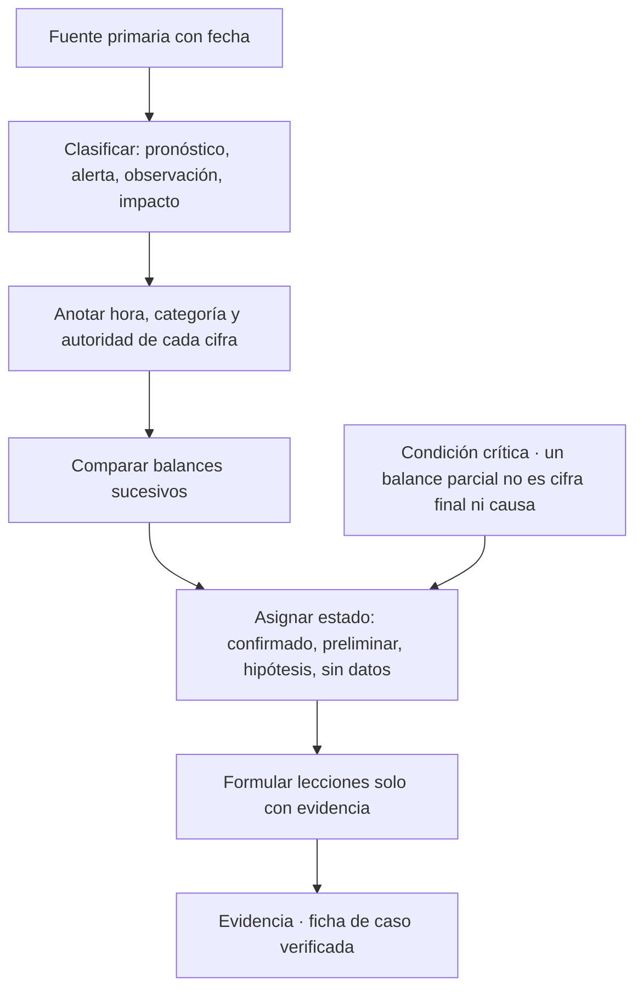
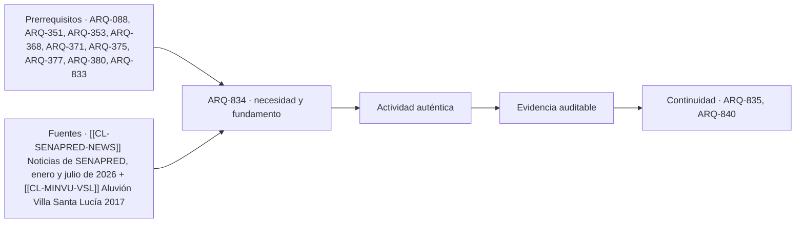

# ARQ-834 · Leer un evento catastrófico: pronóstico, alerta, observación e impacto

**Parte 84 · Evaluación de inmuebles, seguros y eventos catastróficos · Chile · Edición 2026.10.**

Material educativo. Enseña a leer comunicados y balances oficiales y a construir fichas de caso con estados de verificación; no es un informe técnico del evento, no atribuye causas constructivas ni responsabilidades y no sustituye los estudios de las instituciones competentes.

**Prerrequisitos recomendados:** `ARQ-088`, `ARQ-351`, `ARQ-353`, `ARQ-368`, `ARQ-371`, `ARQ-375`, `ARQ-377`, `ARQ-380`. La entrada inmediata es `ARQ-833`; la continuidad es `ARQ-835`.

## Pregunta central

¿Cómo se lee un evento catastrófico a partir de fuentes oficiales para distinguir qué se pronosticó, qué se alertó, qué se midió y qué daño se confirmó, sin convertir un balance parcial en cifra final ni en explicación de la causa?

**Fallo crítico de esta clase:** un balance parcial no puede leerse como cifra final ni como causa del daño.

## Problema y resultado observable

La información sobre un evento llega en capas que se mezclan: el pronóstico de la víspera, los avisos y alertas de las instituciones, las mediciones, los balances de damnificados que cambian cada día, las notas de prensa que resumen y las opiniones sobre responsabilidades. Quien aprende de un evento, o quien evalúa un inmueble expuesto a eventos similares, necesita una disciplina de lectura que mantenga cada capa en su lugar. La biblioteca de casos del repositorio (cases/catastrofes-chile) aplica esa disciplina; esta clase la enseña.

Al terminar podrás clasificar cada afirmación de un comunicado en pronóstico, alerta, observación o impacto, anotar la hora y el estado de cada cifra, seguir cómo evolucionan los balances entre una fecha y otra, redactar una ficha de caso con estados `CONFIRMADO`, `PRELIMINAR`, `HIPÓTESIS` y `SIN_DATOS` y señalar qué evidencia faltaría para atribuir una causa. La evidencia es una **ficha de caso verificada** con fuentes citadas.

## Las cuatro capas de información

El **pronóstico** es una estimación de lo que puede ocurrir; lo emite el servicio meteorológico u otra institución técnica y tiene incertidumbre. La **alerta** es una decisión institucional con niveles definidos —en Chile, el sistema de protección civil usa alertas temprana preventiva, amarilla y roja para incidentes locales o regionales— que moviliza recursos y mensajes a la población; depende del pronóstico, pero también de la vulnerabilidad y de la capacidad de respuesta. La **observación** es una medición: precipitación acumulada, temperatura, altura de ola, magnitud de un sismo. El **impacto** es el daño confirmado: personas fallecidas, lesionadas o damnificadas, viviendas destruidas o con daño, infraestructura afectada, servicios interrumpidos.

Cada capa responde a una pregunta distinta y no permite deducir las otras. Que se haya emitido una alerta no prueba que el daño fue grande; que el daño haya sido grande no prueba que el pronóstico fuera erróneo; que haya llovido mucho no explica por sí solo por qué una vivienda falló. Una buena lectura mantiene las capas separadas y solo después estudia sus relaciones.

## Los balances cambian: lectura temporal de las cifras

Un hallazgo de la biblioteca de casos ilustra por qué importa. En enero de 2026, los comunicados oficiales de SENAPRED sobre los incendios forestales en Ñuble y Biobío reportaron cifras distintas según la fecha. El 18 de enero se informó de 16 personas fallecidas y de un estado de catástrofe declarado; el 19 de enero, de 20 fallecidos y 7.079 damnificados, con 536 viviendas destruidas; el 22 de enero, de 21 fallecidos, 20.278 damnificados y 817 viviendas destruidas. No son errores: son balances que se actualizan a medida que se completa el catastro y se identifican las víctimas. Quien cita una de esas cifras sin la fecha, y sin decir que es un balance, informa mal.

La regla práctica es anotar siempre **quién informa, cuándo y qué categoría usa**. «Damnificados», «afectados» y «personas albergadas» no son sinónimos; «vivienda destruida» y «vivienda con daño mayor» tampoco. Dos fuentes pueden diferir porque miden lo distinto. Cuando las cifras de una fuente y otra no coinciden, se registran ambas con su fecha y se marca la diferencia como pendiente, no se promedia.

## De la ficha de caso a la lección técnica

La ficha de caso del repositorio tiene veinte campos y se llena con estados. Un campo con respaldo en un comunicado oficial se marca `PRELIMINAR` si es un balance parcial o `CONFIRMADO` si es un informe de cierre de la autoridad competente. Un campo que es una conjetura razonable se marca `HIPÓTESIS` y se redacta como pregunta de investigación. Un campo sin fuente se marca `SIN_DATOS`. La ficha no inventa víctimas, costos, causas ni responsabilidades.

La **lección técnica** aparece solo cuando la evidencia la permite. De un balance de damnificados no se obtiene una lección sobre un material; para eso hace falta una inspección de las construcciones afectadas. De un registro de precipitación puede obtenerse una lección sobre la exposición de un tipo de cubierta o de un sistema de drenaje solo si se conocen los detalles constructivos. La clase insiste en este límite porque es el error más frecuente: pasar de «hubo muchos daños» a «este sistema constructivo falla».

Un caso adicional enseña otra precaución. Sobre el aluvión de Villa Santa Lucía (2017), SENAPRED describe, según los resultados consultados, un desprendimiento de roca sobre un glaciar y los reportes de otras fuentes lo atribuyen al desprendimiento de parte del glaciar; esa diferencia de descripción entre fuentes oficiales se registra y se resuelve leyendo el informe técnico de SERNAGEOMIN, no escogiendo la versión que parezca más clara. La ficha mantiene la contradicción como pendiente hasta contrastar el documento.

## Mapa específico de la decisión

## Caso resuelto: sistema frontal de julio de 2026

Dos comunicados de SENAPRED permiten ejercitar la lectura. El del 8 de julio informa alerta amarilla en La Araucanía, Los Ríos y Los Lagos; lluvias de hasta unos 180 mm en algunos sectores; 56 viviendas con daño menor; tres personas albergadas y dos desplazadas; suspensión de clases en 104 escuelas de La Araucanía; y limitación de acceso a una ruta en Puerto Varas. El del 17 de julio, un balance parcial con tres fallecidos, 79 damnificados, 466 albergados, cinco viviendas destruidas, 96 con daño mayor, 700 con daño menor y 330 en evaluación; más de 257 mil clientes sin energía; avisos, alertas y alarmas entre Atacama y Biobío; y la confirmación de que no se informaban evacuaciones ni declaraciones de emergencia en ese comunicado.

La clasificación es la siguiente. La alerta amarilla, la suspensión de clases y la limitación de acceso son **decisiones**. Los 180 mm son una **observación** que, según el texto, se alcanzó «en algunos sectores»; no se informa de qué estación proviene ni de qué período. Las 56 viviendas con daño menor y las cifras del 17 de julio son **impacto preliminar**, con fecha y categorías distintas. No se informa causa constructiva alguna. La ficha del caso registra además lo que no existe: mediciones completas, vulnerabilidades comprobadas, costos, seguros. La conclusión permitida es «hubo un sistema frontal con impactos en viviendas, electricidad y conectividad, con un balance parcial a esa fecha». La conclusión prohibida es «las viviendas con daño mayor fallaron por su cubierta».

## Práctica guiada

Elige un evento con al menos dos comunicados oficiales de fechas distintas. Extrae todas las cifras en una tabla con columnas fuente, fecha, hora si existe, categoría, valor y capa (pronóstico, alerta, observación, impacto). Marca qué cifras cambiaron entre una fecha y otra y qué categorías no coinciden. Redacta la ficha con estados y una lista de datos que faltan. Pide a otra persona que reconstruya una cifra hasta su fuente.

## Ejercicio independiente

Toma una nota de prensa sobre un evento y reconstruye, buscando las fuentes oficiales, cuáles de sus afirmaciones se pueden confirmar, cuáles son preliminares, cuáles son hipótesis y cuáles no tienen respaldo. Escribe una versión corregida de la nota con los estados indicados y una lista de tres preguntas de investigación que una inspección técnica podría contestar. Entrega la tabla, la versión corregida y las fuentes con fecha de consulta.

## Errores típicos y recuperación

- **Citar una cifra sin fecha:** los balances cambian; toda cifra lleva fecha y categoría.
- **Sumar balances de fuentes distintas:** pueden medir cosas diferentes.
- **Pasar de daño a causa:** una causa constructiva exige inspección técnica.
- **Tomar una nota de prensa como fuente primaria:** busca el comunicado oficial.
- **Rellenar vacíos con memoria:** lo que no está en la fuente es `SIN_DATOS`.
- **Resolver la contradicción entre fuentes por preferencia:** se registra y se contrasta con el informe técnico.

Para recuperar, repite la clasificación de las mismas cifras al día siguiente sin mirar tu tabla y concilia las diferencias.

## Evaluación por evidencias

La entrega se acepta si responde la pregunta central, clasifica cada afirmación en su capa, registra fecha y autoridad de cada cifra, muestra la evolución de los balances, asigna estados de verificación, distingue lección técnica de hipótesis y declara los límites de transferencia del caso. Con la rúbrica común, umbral 80/100 y ninguna dimensión bajo 60 %. Si aparece una cifra sin fuente o una causa sin evidencia, la evidencia permanece pendiente.

## Continuidad

`ARQ-835` pasa del evento al valor: cómo un riesgo conocido y una exposición documentada pueden afectar, como hipótesis, el valor de un inmueble. `ARQ-840` incorpora esta lectura en la carpeta de evaluación.

<!-- pedagogia-2026:inicio -->
## Decisión pedagógica y posición curricular

### Por qué existe

Esta clase existe para resolver una necesidad concreta del recorrido: ¿Cómo se lee un evento catastrófico a partir de fuentes oficiales para distinguir qué se pronosticó, qué se alertó, qué se midió y qué daño se confirmó, sin convertir un balance parcial en cifra final ni en explicación de la causa? Fallo crítico de esta clase: un balance parcial no puede leerse como cifra final ni como causa del daño.

### Por qué está exactamente aquí

Ocupa el lugar 4 de la Parte 84. Se estudia después de ARQ-833 · Siniestro, evidencia y reclamación: antes, durante y después del daño porque usa esa base para responder «¿Cómo se lee un evento catastrófico a partir de fuentes oficiales para distinguir qué se pronosticó, qué se alertó, qué se midió y qué daño se confirmó, sin convertir un balance parcial en cifra final ni en explicación de la causa? Fallo crítico de esta clase: un balance parcial no puede leerse como cifra final ni como causa del daño.». Se ubica antes de ARQ-835 · Valor, plusvalía y depreciación de un inmueble: factores y límites de la tasación porque la evidencia producida aquí debe estar disponible para ese paso.

- **Prerrequisitos:** `ARQ-088`, `ARQ-351`, `ARQ-353`, `ARQ-368`, `ARQ-371`, `ARQ-375`, `ARQ-377`, `ARQ-380`, `ARQ-833`
- **Capacidad que introduce:** La información sobre un evento llega en capas que se mezclan: el pronóstico de la víspera, los avisos y alertas de las instituciones, las mediciones, los balances de damnificados que cambian cada día, las notas de prensa que resumen y las opiniones sobre responsabilidades. Quien aprende de un evento, o quien evalúa un inmueble expuesto a eventos similares, necesita una disciplina de lectura que mantenga cada capa en su lugar. La biblioteca de casos del repositorio (cases/catastrofes-chile) aplica esa disciplina; esta clase la enseña.
- **Clases o experiencias que dependen de ella:** `ARQ-835`, `ARQ-840`

El diagrama permite comprobar una relación que el texto lineal oculta con facilidad: esta clase recibe capacidades previas, toma decisiones apoyadas por fuentes, exige una experiencia y produce evidencia que habilita trabajo posterior. No representa un procedimiento de obra.

## Resultado observable, evidencia y evaluación

1. Identificar y delimitar las condiciones necesarias para responder la pregunta central de leer un evento catastrófico: pronóstico, alerta, observación e impacto.
2. Producir y comprobar la evidencia declarada por la clase: La información sobre un evento llega en capas que se mezclan: el pronóstico de la víspera, los avisos y alertas de las instituciones, las mediciones, los balances de damnificados que cambian cada día, las notas de prensa que resumen y las opiniones sobre responsabilidades. Quien aprende de un evento, o quien evalúa un inmueble expuesto a eventos similares, necesita una disciplina de lectura que mantenga cada capa en su lugar. La biblioteca de casos del repositorio (cases/catastrofes-chile) aplica esa disciplina; esta clase la enseña.
3. Justificar una decisión de leer un evento catastrófico: pronóstico, alerta, observación e impacto mediante fuentes, supuestos, alternativas y límites explícitos.

## Actividad, evidencia y criterio de aceptación

**Actividad:** Elige un evento con al menos dos comunicados oficiales de fechas distintas. Extrae todas las cifras en una tabla con columnas fuente, fecha, hora si existe, categoría, valor y capa (pronóstico, alerta, observación, impacto). Marca qué cifras cambiaron entre una fecha y otra y qué categorías no coinciden.

**Evidencia mínima:** La información sobre un evento llega en capas que se mezclan: el pronóstico de la víspera, los avisos y alertas de las instituciones, las mediciones, los balances de damnificados que cambian cada día, las notas de prensa que resumen y las opiniones sobre responsabilidades. Quien aprende de un evento, o quien evalúa un inmueble expuesto a eventos similares, necesita una disciplina de lectura que mantenga cada capa en su lugar. La biblioteca de casos del repositorio (cases/catastrofes-chile) aplica esa disciplina; esta clase la enseña.

**Archivo sugerido:** `evidence/ARQ-834/evidencia.md`.

**Criterio de aceptación:** la entrega se acepta cuando:

- La entrega responde explícitamente a la pregunta: ¿Cómo se lee un evento catastrófico a partir de fuentes oficiales para distinguir qué se pronosticó, qué se alertó, qué se midió y qué daño se confirmó, sin convertir un balance parcial en cifra final ni en explicación de la causa? Fallo crítico de esta clase: un balance parcial no puede leerse como cifra final ni como causa del daño.
- La actividad conserva las fronteras del caso y permite reconstruir el procedimiento: Elige un evento con al menos dos comunicados oficiales de fechas distintas. Extrae todas las cifras en una tabla con columnas fuente, fecha, hora si existe, categoría, valor y capa (pronóstico, alerta, observación, impacto). Marca qué cifras cambiaron entre una fecha y otra y qué categorías no coinciden.
- Cada afirmación externa puede seguirse hasta una fuente, su alcance consultado y su límite.
- La evidencia deja disponible una entrada comprobable para ARQ-835.
- - Citar una cifra sin fecha: los balances cambian; toda cifra lleva fecha y categoría. - Sumar balances de fuentes distintas: pueden medir cosas diferentes.

La [rúbrica común](../../docs/RUBRICA_COMUN.md) complementa estos criterios; no los reemplaza. Una entrega puede superar un promedio y continuar pendiente si oculta una condición crítica.

## Trazabilidad de las decisiones

| # | Decisión o fundamento | Fuente utilizada | Aplicación y límite en esta clase |
|---:|---|---|---|
| 1 | respalda las cifras, alertas y medidas citadas, siempre como balances a la fecha. | [[[CL-SENAPRED-NEWS]] Noticias de SENAPRED, enero y julio de 2026](https://www.senapred.cl/noticias/) | Consulta: listado de noticias y los comunicados del 8, 13 y 17 de julio de 2026 y del 16, 18, 19 y 22 de enero y 27 de febrero de 2026, leídos mediante extracción automática de cada página. Límite: son comunicados institucionales, no informes técnicos ni balances de cierre; no se leyeron informes de la Dirección Meteorológica, la DGA ni evaluaciones de daño. Fecha de |
| 2 | ejemplo de un caso con decisión territorial documentada. | [[[CL-MINVU-VSL]] Aluvión Villa Santa Lucía 2017](https://www.minvu.gob.cl/reconstruccion/aluvion-villa-santa-lucia-2017/) | Consulta: página de reconstrucción del MINVU, con 21 fallecidos, un desaparecido y relocalización definitiva. Límite: no explica el mecanismo físico ni reproduce el informe técnico de SERNAGEOMIN, que no fue leído. Fecha de |

La tabla permite auditar las relaciones; la explicación, el caso y la práctica de la clase siguen siendo la documentación principal.

## Autoevaluación, recuperación y continuidad

### Errores diagnósticos

Antes de avanzar, comprueba si puedes reconstruir cada resultado sin mirar la solución, señalar qué evidencia lo sostiene y nombrar una condición que obligaría a revisar tu decisión. Conserva la primera versión, la objeción recibida y la revisión.

**Conexión siguiente:** La continuidad inmediata es ARQ-835 · Valor, plusvalía y depreciación de un inmueble: factores y límites de la tasación; conserva el método y vuelve a verificar datos y límites.
<!-- pedagogia-2026:fin -->

## Fuentes y alcance de uso

### [[CL-SENAPRED-NEWS]] Noticias de SENAPRED, enero y julio de 2026

Servicio Nacional de Prevención y Respuesta ante Desastres. [https://www.senapred.cl/noticias/](https://www.senapred.cl/noticias/)

**Consulta:** listado de noticias y los comunicados del 8, 13 y 17 de julio de 2026 y del 16, 18, 19 y 22 de enero y 27 de febrero de 2026, leídos mediante extracción automática de cada página. **Apoyo:** respalda las cifras, alertas y medidas citadas, siempre como balances a la fecha. **Límite:** son comunicados institucionales, no informes técnicos ni balances de cierre; no se leyeron informes de la Dirección Meteorológica, la DGA ni evaluaciones de daño. **Fecha de consulta:** 30 de octubre de 2026.

### [[CL-MINVU-VSL]] Aluvión Villa Santa Lucía 2017

Ministerio de Vivienda y Urbanismo de Chile. [https://www.minvu.gob.cl/reconstruccion/aluvion-villa-santa-lucia-2017/](https://www.minvu.gob.cl/reconstruccion/aluvion-villa-santa-lucia-2017/)

**Consulta:** página de reconstrucción del MINVU, con 21 fallecidos, un desaparecido y relocalización definitiva. **Apoyo:** ejemplo de un caso con decisión territorial documentada. **Límite:** no explica el mecanismo físico ni reproduce el informe técnico de SERNAGEOMIN, que no fue leído. **Fecha de consulta:** 30 de octubre de 2026.
