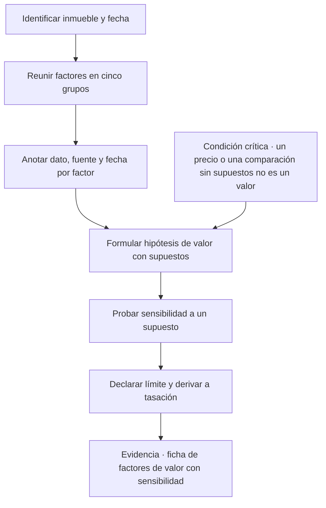
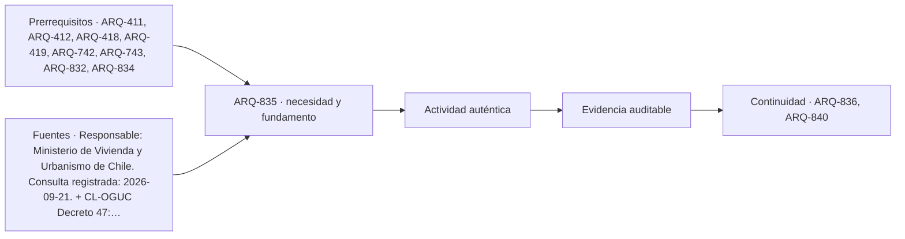

# ARQ-835 · Valor, plusvalía y depreciación de un inmueble: factores y límites de la tasación

**Parte 84 · Evaluación de inmuebles, seguros y eventos catastróficos · Chile · Edición 2026.10.**

Material educativo. Enseña a identificar factores que pueden afectar el valor de un inmueble y a formular hipótesis comprobables; no es una tasación, no fija precios, no sustituye a un tasador ni a un analista inmobiliario y no autoriza a un corredor a presentar un valor como definitivo. Toda cifra es **HIPOTÉTICA**.

**Prerrequisitos recomendados:** `ARQ-411`, `ARQ-412`, `ARQ-418`, `ARQ-419`, `ARQ-742`, `ARQ-743`, `ARQ-832`, `ARQ-834`. La entrada inmediata es `ARQ-834`; la continuidad es `ARQ-836`.

## Pregunta central

¿Qué factores del inmueble, del territorio y del riesgo pueden aumentar o reducir su valor, cómo se formulan esas hipótesis con supuestos comprobables y dónde termina lo que puede afirmar un corredor frente a lo que corresponde a una tasación?

**Fallo crítico de esta clase:** un precio de oferta, o una comparación sin supuestos, no es un valor, y ninguna lectura de mercado reemplaza una tasación.

## Problema y resultado observable

El corredor de propiedades convive con tres palabras que se usan como equivalentes y no lo son: precio, valor y costo. El **precio** es lo que se pide o se pagó en una operación concreta; el **valor** es una estimación fundada de lo que un inmueble podría transarse bajo ciertas condiciones; el **costo** es lo que se gasta en construir o reparar. Un inmueble puede tener un precio de oferta alto con un valor fundado más bajo, o un costo de reparación elevado que no se traslada al precio. ARQ-742 y ARQ-743 enseñan política de suelo y mercados de vivienda; ARQ-418 enseña ciclo de vida. Esta clase reúne esos factores en una lectura aplicada y declara su límite.

Al terminar podrás separar los factores que pueden afectar el valor en cinco grupos, formular una **hipótesis de valor** con supuestos que otra persona pueda comprobar, hacer una comparación de dos sectores sin ocultar diferencias, y redactar una advertencia para el cliente que diga qué parte de la conversación es una lectura y qué parte requiere un tasador. La evidencia es una **ficha de factores de valor** con fuente y sensibilidad.

## Cinco grupos de factores

El primer grupo es la **ubicación y el entorno**: conectividad con transporte, cercanía a equipamiento (salud, educación, comercio), calidad del espacio público, ruido, seguridad percibida y medida, y servicios. Cada uno se documenta con datos observables: distancia a una parada, tiempo de viaje en una hora definida, cantidad de equipamientos en un radio, nivel de ruido medido con un procedimiento. Una afirmación como «es un sector bueno» no es un dato.

El segundo grupo es la **condición urbanística**: uso de suelo, constructibilidad, alturas permitidas, afectaciones a utilidad pública, riesgo de cambio de norma, y regularidad de las construcciones (ARQ-837). Un terreno con mayor constructibilidad puede valer más, pero una afectación de ensanche puede reducir lo edificable. Estos datos provienen del certificado de informaciones previas y del instrumento de planificación, no de la conversación comercial.

El tercer grupo es la **condición física**: antigüedad, materialidad, estado de conservación, necesidad de reparaciones y mantenimiento, desempeño térmico y de humedad. Su efecto en el valor se conecta con el costo de reponer o corregir, que se estima en ARQ-839, y con las patologías que se leen en ARQ-836 y ARQ-838.

El cuarto grupo es el **riesgo y su gestión**: exposición a inundación, remoción en masa, incendio o tsunami; asegurabilidad y costo de seguros; medidas de mitigación existentes. Una exposición documentada puede influir en el valor de dos maneras que no deben confundirse: reduce lo que algunos compradores están dispuestos a pagar, y puede aumentar los costos de mantener el bien. Cuánto lo reduce en un mercado concreto es una pregunta empírica que se responde con datos de transacciones, no con una regla general. La clase pide formularla como hipótesis y rotular su evidencia.

El quinto grupo es el **ciclo de mercado y las expectativas**: tasas de interés, oferta nueva, políticas de suelo, proyectos de infraestructura anunciados. Aquí el riesgo de equivocarse es mayor porque las expectativas se mueven; un proyecto anunciado puede no ejecutarse. Se registra la fecha del anuncio, la fuente y el estado del proyecto.

## Plusvalía y depreciación: definiciones y límites

La **plusvalía** es el aumento de valor atribuible a causas externas al propietario, como una nueva infraestructura, un cambio de norma o el desarrollo del entorno; la **depreciación** es la pérdida de valor por desgaste, obsolescencia o deterioro del entorno. Distinguir la causa importa, porque algunas se pueden controlar mediante mantenimiento (desgaste), otras mediante adaptación (obsolescencia funcional) y otras no se controlan (cambios del entorno). En la discusión pública estas palabras se usan con carga política; en la clase se usan como categorías analíticas y cada afirmación debe tener un dato que la sostenga.

El límite es inequívoco. Una **tasación** es un trabajo profesional que sigue un método, aplica criterios, usa datos de comparables verificados, declara supuestos y asume la responsabilidad del tasador. El corredor puede organizar antecedentes, comparar ofertas visibles y explicar por qué dos inmuebles aparentemente similares podrían tener valores distintos; no debe presentar su estimación como tasación ni apoyar una decisión financiera de su cliente en un número sin respaldo. Cuándo una actuación requiere un tasador, por ejemplo para un crédito o para un proceso formal, lo define la entidad que la solicita.

## Mapa específico de la decisión

## Caso resuelto: comparación hipotética de dos sectores

Dos departamentos de 55 m² se ofrecen en sectores A y B. Precios de oferta **HIPOTÉTICOS**: A, CLP 98.000.000; B, CLP 86.000.000. Una lectura superficial dice que A «vale más». La ficha de factores revela: A está a 600 m de una estación de metro, B a 2,4 km del acceso más cercano; A tiene un nivel de ruido medido más alto durante el día; B está en una zona con antecedentes de anegamiento según el municipio; el edificio A tiene 35 años y requiere reparaciones de fachada, estimadas en una cuota de gastos comunes extraordinarios de CLP 1.200.000 por unidad; el edificio B tiene 8 años.

La diferencia de precio de CLP 12.000.000 puede estar explicada por conectividad y antigüedad en direcciones opuestas. Una hipótesis comprobable: «el diferencial de precio de A respecto de B se explica principalmente por conectividad». Para probarla se necesitan precios de transacciones comparables a distintas distancias de una estación, no ofertas. Otra hipótesis: «el riesgo de anegamiento en B explica una parte del menor precio»; para probarla se necesitan datos sobre el efecto observado en ese sector, y se comprueba que la afectación realmente existe en un mapa oficial. La clase no concluye cuál valor es mayor. Concluye qué datos faltan, qué se debe preguntar al municipio, al administrador del edificio y a un tasador, y qué advertencia debe recibir el cliente.

Una sensibilidad sencilla: si la reparación de fachada de A se financiara íntegramente por el comprador, el costo efectivo de A sube en CLP 1.200.000 y la brecha respecto de B sube de CLP 12.000.000 a CLP 13.200.000. Es un cálculo aritmético, no un juicio de valor.

## Práctica guiada

Escoge dos inmuebles didácticos. Completa la ficha de factores con dato, fuente y fecha por cada uno de los cinco grupos y marca los datos que faltan. Formula dos hipótesis de valor y, para cada una, la evidencia que la confirmaría y la que la refutaría. Realiza una sensibilidad cambiando un supuesto relevante. Redacta un párrafo para el cliente que distinga lo que se sabe, lo que se supone y lo que debe resolver un tasador.

## Ejercicio independiente

Analiza un proyecto de infraestructura anunciado en un sector. Reconstruye su estado a partir de fuentes oficiales, su fecha, su financiamiento declarado y su posible efecto en el valor como hipótesis. Identifica un escenario en que el proyecto no se ejecuta y calcula qué ocurre con la hipótesis. Entrega una página con fuentes y una advertencia para un cliente.

## Segundo caso resuelto: comparables con ajustes (hipotético)

Datos **HIPOTÉTICOS**. Se tiene el departamento A, de 55 m², ofrecido en CLP 98.000.000, es decir 1.781.818 por m², y el B, de 55 m², ofrecido en CLP 86.000.000, 1.563.636 por m². Un análisis ordenado no compara los totales, sino que identifica las diferencias entre ambos y decide, para cada una, si es un ajuste que se puede sostener con datos. La tabla siguiente muestra solo el **método**; los porcentajes son ilustrativos y un tasador los fundaría con transacciones comparables.

| Diferencia | Dirección sobre el precio de A frente a B | Dato que se necesitaría |
|---|---|---|
| conectividad: 600 m frente a 2,4 km de una estación | A más alto | precios de transacciones a distintas distancias de estaciones en el mismo mercado |
| antigüedad: 35 frente a 8 años | A más bajo | efecto de la antigüedad en precios de edificios comparables |
| ruido diurno más alto en A | A más bajo | mediciones con procedimiento declarado |
| anegamiento reportado en el sector de B | B más bajo | mapa oficial de anegamiento y efecto observado en transacciones |
| gasto común extraordinario de fachada en A | A más alto en costo efectivo | acta de la copropiedad con monto y calendario |

Con el gasto extraordinario de CLP 1.200.000 por unidad, el costo efectivo de A pasa de 98.000.000 a 99.200.000, y la brecha respecto de B **sube** de 12.000.000 a 13.200.000. La aritmética es sencilla; lo que la clase quiere que se vea es que un gasto pendiente que paga el comprador no reduce la diferencia: la amplía. El ejercicio no concluye cuál inmueble vale más.

## Qué preguntar y a quién

Al municipio: uso de suelo, afectaciones, proyectos aprobados en el entorno, antecedentes de anegamiento. A la administración de la copropiedad: actas, gastos extraordinarios aprobados y pendientes, estado de fondos de reserva. A un tasador: método, comparables y supuestos. A un corredor de seguros: si el riesgo documentado afecta la asegurabilidad o el costo. Una pregunta bien dirigida vale más que una afirmación sin respaldo, y el cliente la entiende.

## Autoevaluación con solución razonada

1. *Una publicación dice «excelente plusvalía». ¿Qué haces?* La tratas como un anuncio; buscas el dato (proyecto, fecha, estado) y la formulas como hipótesis.
2. *Dos inmuebles tienen el mismo precio por m². ¿Tienen el mismo valor?* No necesariamente: antigüedad, condición, riesgo y gastos pendientes cambian el valor sin cambiar el precio por m².
3. *¿Puede un corredor dar una cifra de valor?* Puede presentar un rango como lectura de mercado y rotulado como tal; no puede presentarlo como tasación ni como garantía.
4. *¿Cómo se trata una exposición a inundación en la hipótesis de valor?* Como una hipótesis con su evidencia; su magnitud depende del mercado y se prueba con transacciones, no con una regla general.
5. *¿Qué distingue plusvalía de depreciación en la ficha?* La causa: externa y de entorno, o interna y de desgaste; cambia qué se puede controlar.

## Errores típicos y recuperación

- **Usar el precio de oferta como valor:** una oferta es una pretensión, no una transacción.
- **Comparar inmuebles sin igualar supuestos:** superficie, antigüedad y condición cambian la comparación.
- **Atribuir un efecto de valor a un riesgo sin datos:** formula una hipótesis y rotula su evidencia.
- **Confundir plusvalía esperada con realizada:** un anuncio no es una obra terminada.
- **Presentar un cálculo propio como tasación:** declara que no lo es.
- **Ignorar costos futuros:** reparaciones, gastos extraordinarios y seguros pesan en el costo total.

Para recuperar, vuelve a la ficha a los dos días y completa la fuente de un dato que quedó sin respaldo.

## Evaluación por evidencias

La entrega se acepta si responde la pregunta central con una ficha de factores completa, hipótesis de valor comprobables con evidencia que las confirme o refute, una sensibilidad calculada, la distinción entre precio, valor y costo, una advertencia que derive a tasación y rótulo HIPOTÉTICO en toda cifra no citada. Con la rúbrica común, umbral 80/100 y ninguna dimensión bajo 60 %. Si se presenta un valor sin supuestos o se afirma el efecto de un riesgo sin datos, la evidencia permanece pendiente.

## Continuidad

`ARQ-836` desciende al inmueble: cómo se observa con método un bien existente y se registra lo visible sin atribuirle conclusiones que no corresponden. `ARQ-839` estima costos de reparación que alimentan las hipótesis de valor.

<!-- pedagogia-2026:inicio -->
## Decisión pedagógica y posición curricular

### Por qué existe

Esta clase existe para resolver una necesidad concreta del recorrido: ¿Qué factores del inmueble, del territorio y del riesgo pueden aumentar o reducir su valor, cómo se formulan esas hipótesis con supuestos comprobables y dónde termina lo que puede afirmar un corredor frente a lo que corresponde a una tasación? Fallo crítico de esta clase: un precio de oferta, o una comparación sin supuestos, no es un valor, y ninguna lectura de mercado reemplaza una tasación.

### Por qué está exactamente aquí

Ocupa el lugar 5 de la Parte 84. Se estudia después de ARQ-834 · Leer un evento catastrófico: pronóstico, alerta, observación e impacto porque usa esa base para responder «¿Qué factores del inmueble, del territorio y del riesgo pueden aumentar o reducir su valor, cómo se formulan esas hipótesis con supuestos comprobables y dónde termina lo que puede afirmar un corredor frente a lo que corresponde a una tasación? Fallo crítico de esta clase: un precio de oferta, o una comparación sin supuestos, no es un valor, y ninguna lectura de mercado reemplaza una tasación.». Se ubica antes de ARQ-836 · Inspección visual de un inmueble existente: ficha educativa y límites porque la evidencia producida aquí debe estar disponible para ese paso.

- **Prerrequisitos:** `ARQ-411`, `ARQ-412`, `ARQ-418`, `ARQ-419`, `ARQ-742`, `ARQ-743`, `ARQ-832`, `ARQ-834`
- **Capacidad que introduce:** El corredor de propiedades convive con tres palabras que se usan como equivalentes y no lo son: precio, valor y costo. El precio es lo que se pide o se pagó en una operación concreta; el valor es una estimación fundada de lo que un inmueble podría transarse bajo ciertas condiciones; el costo es lo que se gasta en construir o reparar. Un inmueble puede tener un precio de oferta alto con un valor fundado más bajo, o un costo de reparación elevado que no se traslada al precio.
- **Clases o experiencias que dependen de ella:** `ARQ-836`, `ARQ-840`

El diagrama permite comprobar una relación que el texto lineal oculta con facilidad: esta clase recibe capacidades previas, toma decisiones apoyadas por fuentes, exige una experiencia y produce evidencia que habilita trabajo posterior. No representa un procedimiento de obra.

## Resultado observable, evidencia y evaluación

1. Identificar y delimitar las condiciones necesarias para responder la pregunta central de valor, plusvalía y depreciación de un inmueble: factores y límites de la tasación.
2. Producir y comprobar la evidencia declarada por la clase: El corredor de propiedades convive con tres palabras que se usan como equivalentes y no lo son: precio, valor y costo. El precio es lo que se pide o se pagó en una operación concreta; el valor es una estimación fundada de lo que un inmueble podría transarse bajo ciertas condiciones; el costo es lo que se gasta en construir o reparar. Un inmueble puede tener un precio de oferta alto con un valor fundado más bajo, o un costo de reparación elevado que no se traslada al precio.
3. Justificar una decisión de valor, plusvalía y depreciación de un inmueble: factores y límites de la tasación mediante fuentes, supuestos, alternativas y límites explícitos.

## Actividad, evidencia y criterio de aceptación

**Actividad:** Escoge dos inmuebles didácticos. Completa la ficha de factores con dato, fuente y fecha por cada uno de los cinco grupos y marca los datos que faltan. Formula dos hipótesis de valor y, para cada una, la evidencia que la confirmaría y la que la refutaría.

**Evidencia mínima:** El corredor de propiedades convive con tres palabras que se usan como equivalentes y no lo son: precio, valor y costo. El precio es lo que se pide o se pagó en una operación concreta; el valor es una estimación fundada de lo que un inmueble podría transarse bajo ciertas condiciones; el costo es lo que se gasta en construir o reparar. Un inmueble puede tener un precio de oferta alto con un valor fundado más bajo, o un costo de reparación elevado que no se traslada al precio.

**Archivo sugerido:** `evidence/ARQ-835/evidencia.md`.

**Criterio de aceptación:** la entrega se acepta cuando:

- La entrega responde explícitamente a la pregunta: ¿Qué factores del inmueble, del territorio y del riesgo pueden aumentar o reducir su valor, cómo se formulan esas hipótesis con supuestos comprobables y dónde termina lo que puede afirmar un corredor frente a lo que corresponde a una tasación? Fallo crítico de esta clase: un precio de oferta, o una comparación sin supuestos, no es un valor, y ninguna lectura de mercado reemplaza una tasación.
- La actividad conserva las fronteras del caso y permite reconstruir el procedimiento: Escoge dos inmuebles didácticos. Completa la ficha de factores con dato, fuente y fecha por cada uno de los cinco grupos y marca los datos que faltan. Formula dos hipótesis de valor y, para cada una, la evidencia que la confirmaría y la que la refutaría.
- Cada afirmación externa puede seguirse hasta una fuente, su alcance consultado y su límite.
- La evidencia deja disponible una entrada comprobable para ARQ-836.
- 1. Una publicación dice «excelente plusvalía».

La [rúbrica común](../../docs/RUBRICA_COMUN.md) complementa estos criterios; no los reemplaza. Una entrega puede superar un promedio y continuar pendiente si oculta una condición crítica.

## Trazabilidad de las decisiones

| # | Decisión o fundamento | Fuente utilizada | Aplicación y límite en esta clase |
|---:|---|---|---|
| 1 | identifica el documento que informa uso de suelo y afectaciones, base de los factores urbanísticos. | [Responsable: Ministerio de Vivienda y Urbanismo de Chile. Consulta…](https://www.minvu.gob.cl/elementos-tecnicos/formularios/0-certificados-y-otros/) | Consulta: solicitud y formato oficial de CIP, certificados de número, afectación y copropiedad disponibles. Límite: el ejemplo educativo no es un certificado emitido y no reemplaza la lectura profesional del instrumento territorial. Fecha de |
| 2 | referencia a las condiciones urbanísticas que afectan lo edificable. | [CL-OGUC Decreto 47: Ordenanza General de Urbanismo y Construcciones](https://www.bcn.cl/leychile/navegar?idNorma=8201) | Consulta: texto oficial localizado; las normas de constructibilidad y uso deben revalidarse en el expediente concreto. Límite: la clase no cita numerales; no asegura vigencia de una redacción aislada ni determina aplicabilidad sin predio y fecha. Fecha de |

La tabla permite auditar las relaciones; la explicación, el caso y la práctica de la clase siguen siendo la documentación principal.

## Autoevaluación, recuperación y continuidad

### Errores diagnósticos

Antes de avanzar, comprueba si puedes reconstruir cada resultado sin mirar la solución, señalar qué evidencia lo sostiene y nombrar una condición que obligaría a revisar tu decisión. Conserva la primera versión, la objeción recibida y la revisión.

**Conexión siguiente:** La continuidad inmediata es ARQ-836 · Inspección visual de un inmueble existente: ficha educativa y límites; conserva el método y vuelve a verificar datos y límites.
<!-- pedagogia-2026:fin -->

## Fuentes y alcance de uso

### [[CL-CIP]] Formularios de certificados y Certificado de Informaciones Previas

Ministerio de Vivienda y Urbanismo de Chile. [https://www.minvu.gob.cl/elementos-tecnicos/formularios/0-certificados-y-otros/](https://www.minvu.gob.cl/elementos-tecnicos/formularios/0-certificados-y-otros/)

**Consulta:** solicitud y formato oficial de CIP, certificados de número, afectación y copropiedad disponibles. **Apoyo:** identifica el documento que informa uso de suelo y afectaciones, base de los factores urbanísticos. **Límite:** el ejemplo educativo no es un certificado emitido y no reemplaza la lectura profesional del instrumento territorial. **Fecha de consulta:** 12 de octubre de 2026, registro heredado de ARQ-801–830.

### [[CL-OGUC]] Ordenanza General de Urbanismo y Construcciones, DS 47

Biblioteca del Congreso Nacional de Chile. [https://www.bcn.cl/leychile/navegar?idNorma=8201](https://www.bcn.cl/leychile/navegar?idNorma=8201)

**Consulta:** texto oficial localizado; las normas de constructibilidad y uso deben revalidarse en el expediente concreto. **Apoyo:** referencia a las condiciones urbanísticas que afectan lo edificable. **Límite:** la clase no cita numerales; no asegura vigencia de una redacción aislada ni determina aplicabilidad sin predio y fecha. **Fecha de consulta:** 12 de octubre de 2026, registro heredado de ARQ-801–830.
