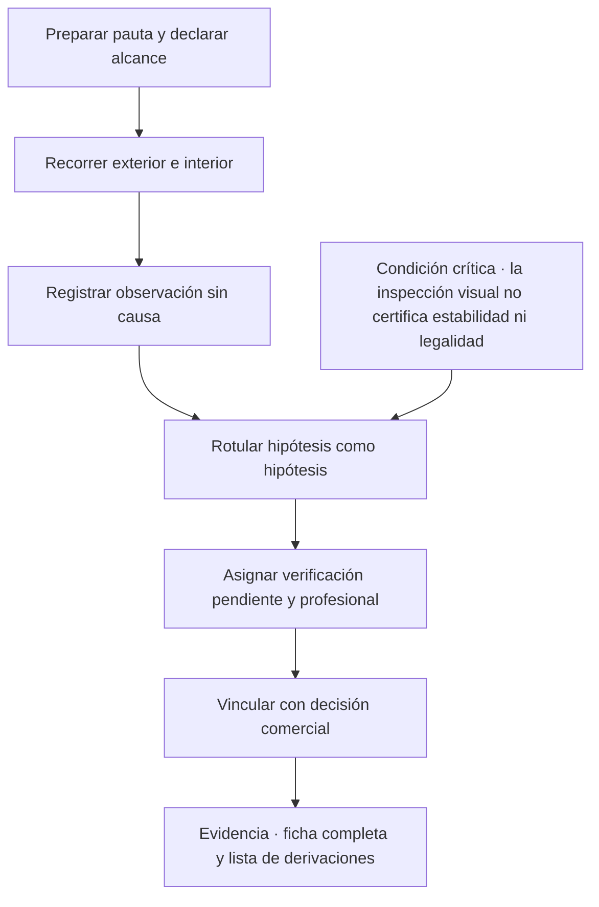
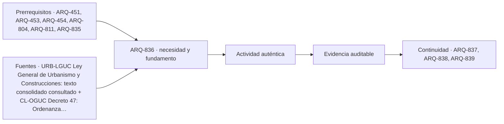

# ARQ-836 · Inspección visual de un inmueble existente: ficha educativa y límites

**Parte 84 · Evaluación de inmuebles, seguros y eventos catastróficos · Chile · Edición 2026.10.**

Material educativo. Enseña a observar y registrar un inmueble con método y a derivar lo que excede la observación; no es una inspección técnica, un peritaje ni una certificación, y nada de lo que se registre autoriza a declarar estabilidad estructural, legalidad o ausencia de riesgo.

**Prerrequisitos recomendados:** `ARQ-451`, `ARQ-453`, `ARQ-454`, `ARQ-804`, `ARQ-811`, `ARQ-835`. La entrada inmediata es `ARQ-835`; la continuidad es `ARQ-837`.

## Pregunta central

¿Cómo se observa un inmueble existente de modo que lo visible quede registrado sin interpretaciones prematuras, y qué decisión debe tomar quien observa cuando lo que ve excede lo que puede afirmar?

**Fallo crítico de esta clase:** una inspección visual informal no puede declarar estabilidad, legalidad ni ausencia de riesgo.

## Problema y resultado observable

Quien participa en una operación inmobiliaria visita muchos inmuebles. Mira, fotografía y conversa. Lo que ve influye en lo que dice, y lo que dice influye en lo que decide un cliente. El riesgo no está en mirar, sino en convertir una mirada en una conclusión: «no tiene problemas», «es sólido», «está todo en regla». ARQ-453 y ARQ-454 enseñan a diagnosticar patologías con método profesional; ARQ-804 enseña el levantamiento de la vivienda propia. Esta clase enseña la parte que le corresponde a quien no es profesional técnico: registrar con disciplina y derivar con claridad.

Al terminar podrás recorrer un inmueble con una pauta, llenar la **ficha de inspección educativa** de siete campos, separar lo que ves de lo que supones, graduar la urgencia de una derivación y redactar una nota para el cliente sin adjetivos que no puedas respaldar. La evidencia es una **ficha completa con fotografías referenciadas** y una lista de derivaciones.

## La ficha de siete campos

Cada hallazgo ocupa una fila con siete campos. La **observación visible** describe qué se ve, dónde, de qué tamaño y con qué aspecto, sin mencionar causa ni gravedad: «mancha oscura de unos 40 cm de ancho en el cielo del dormitorio norte, junto al encuentro con el muro exterior». La **evidencia documental** registra qué documento se relaciona con ese hallazgo: un plano, un permiso, una factura de reparación. La **hipótesis técnica** es una conjetura rotulada como tal y comienza siempre con «podría»: «podría estar asociada a una filtración de cubierta, a condensación o a una instalación». Es útil para decidir qué preguntar, nunca para afirmar. El **riesgo identificado** es la consecuencia posible si la hipótesis fuera cierta: deterioro de terminaciones, daño en un elemento estructural, riesgo eléctrico. La **verificación pendiente** nombra el estudio, ensayo o documento concreto que resolvería la duda: inspección de cubierta, medición de humedad, revisión de la instalación eléctrica. El **profesional al cual derivar** es la persona competente para esa verificación: arquitecto, ingeniero civil, inspector técnico, instalador autorizado, especialista en humedad. La **decisión comercial afectada** señala qué decisión del cliente depende de la verificación: negociar el precio, condicionar la compra, pedir un seguro, postergar una oferta.

La separación entre «observación» e «hipótesis» es la parte más difícil y más valiosa. Con práctica se nota que muchas frases de una visita mezclan las dos. «Hay una grieta estructural» es una hipótesis disfrazada de observación; la observación es «hay una grieta diagonal de 1 m en el muro del living, de unos 2 mm de ancho en su punto mayor». Quien no puede medir deja constancia de que no midió.

## Qué se recorre y en qué orden

Una pauta de recorrido evita olvidar zonas. Se comienza por el **exterior**: entorno inmediato, pendientes y escurrimiento hacia el inmueble, estado de la cubierta desde un punto seguro, fachadas, vanos, cierros y medianeros. Se continúa por el **interior** recinto a recinto, con la misma secuencia de revisión: cielos, muros, pisos, ventanas y puertas, instalaciones visibles (tableros, llaves de paso, artefactos), ventilación y signos de humedad. Se registran los **servicios y espacios técnicos**: tableros, medidores, calefón, estanque, ductos. Se anota el uso real de cada recinto, porque puede diferir del uso autorizado, tema que se trabaja en ARQ-837. Se toman fotografías con una referencia de escala y con la ubicación en un croquis.

Hay actividades que no se hacen: subir a una cubierta sin condiciones de seguridad, abrir tableros eléctricos, retirar revestimientos, perforar muros, probar instalaciones de gas sin el instalador. Una inspección que expone a la persona o altera el inmueble deja de ser una observación y se vuelve un riesgo.

## Qué puede y qué no puede afirmar una persona no profesional

Puede afirmar que algo se ve, se mide con un procedimiento declarado o falta en un documento. No puede afirmar la causa de una patología, la capacidad estructural de un elemento, la seguridad de una instalación, la regularidad de una construcción ni la ausencia de riesgos naturales. Tampoco puede afirmar que «no se ven problemas» como si fuera una garantía: lo correcto es «en la visita del día X, de duración Y, sin herramientas ni acceso a cubierta, no se observaron los siguientes hallazgos; no se evaluaron los siguientes elementos». La **declaración de alcance** de la inspección es parte de la ficha: cuándo, cuánto tiempo, qué recintos se vieron, qué no se pudo ver.

## Mapa específico de la decisión

## Caso resuelto: casa de 1985 con tres hallazgos

Una casa de albañilería de 1985, de un nivel, 78 m². En la visita del 14 de octubre, de 45 minutos, sin acceso a la cubierta ni al entretecho, se llena la ficha con tres hallazgos.

**Hallazgo 1.** Observación: fisura horizontal fina de unos 60 cm, en el encuentro de un muro con el cielo del pasillo. Evidencia documental: no hay planos ni permiso a la vista. Hipótesis: podría corresponder a retracción de materiales, a movimiento diferencial o a un encuentro mal resuelto. Riesgo: si se tratara de un movimiento, podría comprometer otros elementos. Verificación: inspección de un ingeniero civil o arquitecto. Derivar a: ingeniero civil estructural. Decisión: no condicionar nada por ahora, pero incluirla en la solicitud de inspección antes de la promesa.

**Hallazgo 2.** Observación: mancha de humedad con eflorescencia blanca en la base de un muro exterior del baño, de unos 30 por 50 cm. Evidencia: factura hipotética de una reparación de cañería de hace tres años. Hipótesis: podría ser humedad por capilaridad o una fuga. Riesgo: deterioro de terminaciones. Verificación: medición de humedad y revisión de la red por un especialista. Derivar a: especialista en humedad o gasfiter autorizado. Decisión: negociar considerando una partida de reparación.

**Hallazgo 3.** Observación: tablero eléctrico con ductos expuestos y sin tapa. Evidencia: no hay certificado de la instalación a la vista. Hipótesis: podría haber modificaciones no declaradas. Riesgo: riesgo eléctrico para las personas. Verificación: revisión por un instalador autorizado y, si corresponde, declaración de la instalación. Derivar a: instalador autorizado. Decisión: condicionar la entrega a la revisión.

La nota para el cliente dice: «La visita de 45 minutos, sin acceso a cubierta, registró tres hallazgos que no pueden evaluarse visualmente; se recomiendan tres verificaciones antes de decidir. Esta visita no certifica el estado ni la legalidad del inmueble».

## Práctica guiada

Recorre un inmueble didáctico o uno propio siguiendo la pauta, con una hora máxima. Completa la ficha con al menos seis hallazgos, cada uno con fotografía y ubicación en croquis. Revisa la ficha y reescribe cualquier observación que contenga causa o gravedad. Ordena las derivaciones por urgencia y justifica el orden. Pide a otra persona que lea tu nota para el cliente y señale una frase que respalde más de lo que la evidencia permite.

## Ejercicio independiente

Repite el recorrido en un inmueble de otra época o tipología y compara qué cambia en la ficha. Identifica un hallazgo que no pudo observarse porque no hubo acceso y formula cómo lo declararías. Redacta una declaración de alcance de cinco líneas que podrías incluir en una visita comercial. Entrega la ficha, las fotografías referenciadas y la declaración.

## Errores típicos y recuperación

- **Escribir «grieta estructural» en observación:** es una hipótesis; describe medidas y ubicación.
- **Omitir la declaración de alcance:** sin ella, la ausencia de hallazgos parece una garantía.
- **Fotografiar sin escala ni ubicación:** una fotografía sin referencias no sirve para derivar.
- **Alterar el inmueble para ver mejor:** no retires revestimientos ni abras tableros.
- **Derivar a un profesional equivocado:** cada verificación tiene un especialista; consulta en vez de adivinar.
- **Suavizar un riesgo por razones comerciales:** una ficha que oculta un riesgo traslada el daño al cliente.

Para recuperar, repasa la ficha a los dos días y reescribe una hipótesis que haya quedado como afirmación.

## Evaluación por evidencias

La entrega se acepta si responde la pregunta central con una ficha de siete campos completa, con observaciones sin causa, hipótesis rotuladas, verificaciones y profesionales nombrados, una declaración de alcance, fotografías referenciadas, una nota al cliente sin garantías y una lista de derivaciones ordenada. Con la rúbrica común, umbral 80/100 y ninguna dimensión bajo 60 %. Si la ficha afirma estabilidad, legalidad o ausencia de riesgo, la evidencia permanece pendiente.

## Continuidad

`ARQ-837` toma el campo «evidencia documental» y lo lleva al caso en que plano, permiso y realidad no coinciden. `ARQ-838` profundiza en humedad, fisuras y daño después de un sismo.

<!-- pedagogia-2026:inicio -->
## Decisión pedagógica y posición curricular

### Por qué existe

Esta clase existe para resolver una necesidad concreta del recorrido: ¿Cómo se observa un inmueble existente de modo que lo visible quede registrado sin interpretaciones prematuras, y qué decisión debe tomar quien observa cuando lo que ve excede lo que puede afirmar? Fallo crítico de esta clase: una inspección visual informal no puede declarar estabilidad, legalidad ni ausencia de riesgo.

### Por qué está exactamente aquí

Ocupa el lugar 6 de la Parte 84. Se estudia después de ARQ-835 · Valor, plusvalía y depreciación de un inmueble: factores y límites de la tasación porque usa esa base para responder «¿Cómo se observa un inmueble existente de modo que lo visible quede registrado sin interpretaciones prematuras, y qué decisión debe tomar quien observa cuando lo que ve excede lo que puede afirmar? Fallo crítico de esta clase: una inspección visual informal no puede declarar estabilidad, legalidad ni ausencia de riesgo.». Se ubica antes de ARQ-837 · Plano, permiso y realidad: ampliaciones no regularizadas y destino autorizado porque la evidencia producida aquí debe estar disponible para ese paso.

- **Prerrequisitos:** `ARQ-451`, `ARQ-453`, `ARQ-454`, `ARQ-804`, `ARQ-811`, `ARQ-835`
- **Capacidad que introduce:** Quien participa en una operación inmobiliaria visita muchos inmuebles. Mira, fotografía y conversa. Lo que ve influye en lo que dice, y lo que dice influye en lo que decide un cliente.
- **Clases o experiencias que dependen de ella:** `ARQ-837`, `ARQ-838`, `ARQ-839`

El diagrama permite comprobar una relación que el texto lineal oculta con facilidad: esta clase recibe capacidades previas, toma decisiones apoyadas por fuentes, exige una experiencia y produce evidencia que habilita trabajo posterior. No representa un procedimiento de obra.

## Resultado observable, evidencia y evaluación

1. Identificar y delimitar las condiciones necesarias para responder la pregunta central de inspección visual de un inmueble existente: ficha educativa y límites.
2. Producir y comprobar la evidencia declarada por la clase: Quien participa en una operación inmobiliaria visita muchos inmuebles. Mira, fotografía y conversa. Lo que ve influye en lo que dice, y lo que dice influye en lo que decide un cliente.
3. Justificar una decisión de inspección visual de un inmueble existente: ficha educativa y límites mediante fuentes, supuestos, alternativas y límites explícitos.

## Actividad, evidencia y criterio de aceptación

**Actividad:** Recorre un inmueble didáctico o uno propio siguiendo la pauta, con una hora máxima. Completa la ficha con al menos seis hallazgos, cada uno con fotografía y ubicación en croquis. Revisa la ficha y reescribe cualquier observación que contenga causa o gravedad.

**Evidencia mínima:** Quien participa en una operación inmobiliaria visita muchos inmuebles. Mira, fotografía y conversa. Lo que ve influye en lo que dice, y lo que dice influye en lo que decide un cliente.

**Archivo sugerido:** `evidence/ARQ-836/evidencia.md`.

**Criterio de aceptación:** la entrega se acepta cuando:

- La entrega responde explícitamente a la pregunta: ¿Cómo se observa un inmueble existente de modo que lo visible quede registrado sin interpretaciones prematuras, y qué decisión debe tomar quien observa cuando lo que ve excede lo que puede afirmar? Fallo crítico de esta clase: una inspección visual informal no puede declarar estabilidad, legalidad ni ausencia de riesgo.
- La actividad conserva las fronteras del caso y permite reconstruir el procedimiento: Recorre un inmueble didáctico o uno propio siguiendo la pauta, con una hora máxima. Completa la ficha con al menos seis hallazgos, cada uno con fotografía y ubicación en croquis. Revisa la ficha y reescribe cualquier observación que contenga causa o gravedad.
- Cada afirmación externa puede seguirse hasta una fuente, su alcance consultado y su límite.
- La evidencia deja disponible una entrada comprobable para ARQ-837.
- - Escribir «grieta estructural» en observación: es una hipótesis; describe medidas y ubicación. - Omitir la declaración de alcance: sin ella, la ausencia de hallazgos parece una garantía.

La [rúbrica común](../../docs/RUBRICA_COMUN.md) complementa estos criterios; no los reemplaza. Una entrega puede superar un promedio y continuar pendiente si oculta una condición crítica.

## Trazabilidad de las decisiones

| # | Decisión o fundamento | Fuente utilizada | Aplicación y límite en esta clase |
|---:|---|---|---|
| 1 | marco nacional de competencias, permiso y recepción que fundamenta qué documentos deben existir. | [URB-LGUC Ley General de Urbanismo y Construcciones: texto consolidado…](https://www.bcn.cl/leychile/navegar?idNorma=13560) | Consulta: texto vigente consultado; artículos 1, 4, 5, 9, 16–18, 116, 127, 130 y 143–145 según la afirmación de la clase. Límite: no identifica por sí sola el procedimiento completo del predio ni reemplaza OGUC, instrumento territorial, DOM o asesoría profesional. Fecha de |
| 2 | condiciones técnicas y categorías reglamentarias que dan contexto a lo que debe existir. | [CL-OGUC Decreto 47: Ordenanza General de Urbanismo y Construcciones](https://www.bcn.cl/leychile/navegar?idNorma=8201) | Consulta: texto oficial localizado; los artículos que se citen deben revalidarse en el expediente concreto. Límite: la clase no asegura vigencia de una redacción aislada ni determina aplicabilidad sin fecha, predio y actuación. Fecha de |

La tabla permite auditar las relaciones; la explicación, el caso y la práctica de la clase siguen siendo la documentación principal.

## Autoevaluación, recuperación y continuidad

### Errores diagnósticos

Antes de avanzar, comprueba si puedes reconstruir cada resultado sin mirar la solución, señalar qué evidencia lo sostiene y nombrar una condición que obligaría a revisar tu decisión. Conserva la primera versión, la objeción recibida y la revisión.

**Conexión siguiente:** La continuidad inmediata es ARQ-837 · Plano, permiso y realidad: ampliaciones no regularizadas y destino autorizado; conserva el método y vuelve a verificar datos y límites.
<!-- pedagogia-2026:fin -->

## Fuentes y alcance de uso

### [[CL-LGUC]] Ley General de Urbanismo y Construcciones, DFL 458

Biblioteca del Congreso Nacional de Chile. [https://www.bcn.cl/leychile/navegar?idNorma=13560](https://www.bcn.cl/leychile/navegar?idNorma=13560)

**Consulta:** texto vigente consultado; artículos 1, 4, 5, 9, 16–18, 116, 127, 130 y 143–145 según la afirmación de la clase. **Apoyo:** marco nacional de competencias, permiso y recepción que fundamenta qué documentos deben existir. **Límite:** no identifica por sí sola el procedimiento completo del predio ni reemplaza OGUC, instrumento territorial, DOM o asesoría profesional. **Fecha de consulta:** 12 de octubre de 2026, registro heredado de ARQ-801–830.

### [[CL-OGUC]] Ordenanza General de Urbanismo y Construcciones, DS 47

Biblioteca del Congreso Nacional de Chile. [https://www.bcn.cl/leychile/navegar?idNorma=8201](https://www.bcn.cl/leychile/navegar?idNorma=8201)

**Consulta:** texto oficial localizado; los artículos que se citen deben revalidarse en el expediente concreto. **Apoyo:** condiciones técnicas y categorías reglamentarias que dan contexto a lo que debe existir. **Límite:** la clase no asegura vigencia de una redacción aislada ni determina aplicabilidad sin fecha, predio y actuación. **Fecha de consulta:** 12 de octubre de 2026, registro heredado de ARQ-801–830.
