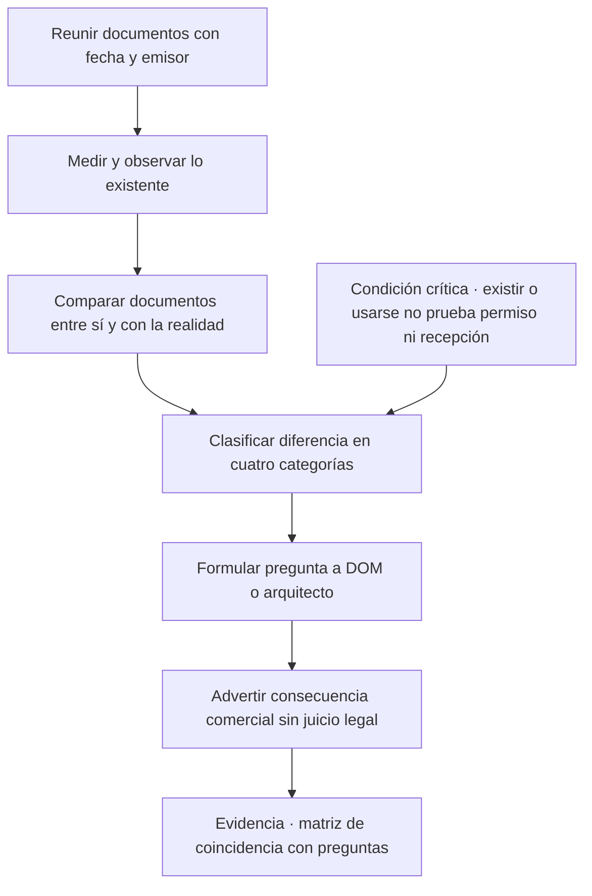
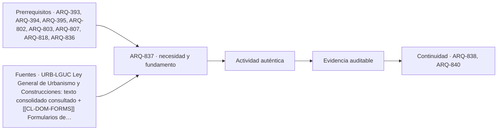

# ARQ-837 · Plano, permiso y realidad: ampliaciones no regularizadas y destino autorizado

**Parte 84 · Evaluación de inmuebles, seguros y eventos catastróficos · Chile · Edición 2026.10.**

Material educativo. Enseña a comparar documentos con lo observado y a formular preguntas a la autoridad competente; no determina si una construcción está regularizada, no interpreta un instrumento territorial con valor legal y no sustituye a un arquitecto, a un abogado ni a la Dirección de Obras Municipales (DOM). Los procedimientos reales deben verificarse en la fuente oficial vigente.

**Prerrequisitos recomendados:** `ARQ-393`, `ARQ-394`, `ARQ-395`, `ARQ-802`, `ARQ-803`, `ARQ-807`, `ARQ-818`, `ARQ-836`. La entrada inmediata es `ARQ-836`; la continuidad es `ARQ-838`.

## Pregunta central

¿Cómo se detecta y se describe la diferencia entre lo que dicen los planos y permisos de un inmueble y lo que existe en la realidad, y qué consecuencias y preguntas deben seguir sin afirmar que la construcción está o no está regularizada?

**Fallo crítico de esta clase:** que una construcción exista, se use o se venda no demuestra que esté permitida ni recibida.

## Problema y resultado observable

Una de las situaciones más frecuentes en una operación inmobiliaria es la vivienda que «tiene una ampliación»: un dormitorio agregado, un segundo nivel, una terraza techada, un local en la fachada. La construcción existe y se usa; los papeles, en cambio, pueden mostrar la superficie original, una ampliación con permiso pero sin recepción, o ninguna autorización. Un cliente que no lo sabe puede comprar un inmueble con superficie menor a la que cree, con limitaciones para financiar o asegurar, o con una obligación de regularizar. ARQ-802 y ARQ-803 enseñan a ordenar el expediente del propietario; ARQ-394 enseña permisos y recepciones. Esta clase resuelve el caso de comparación y diferencia.

Al terminar podrás construir una **matriz de coincidencia** entre documentos y realidad, clasificar cada diferencia en una de cuatro categorías de verificación, redactar las preguntas dirigidas a la DOM o a un arquitecto, y explicar al cliente por qué una diferencia importa comercialmente sin afirmar un juicio jurídico. La evidencia es la **matriz de coincidencia** con documentos citados y preguntas.

## Documentos que forman la historia del inmueble

La historia documental de una edificación incluye, como mínimo: el **título de dominio** y la inscripción que identifican el predio; el **rol de avalúo**, que es un registro fiscal y no prueba legalidad; el **permiso de edificación** y sus modificaciones; la **recepción final**, que acredita que lo construido fue recibido conforme a lo aprobado; los **planos aprobados**; los **certificados de instalaciones**; y el **certificado de informaciones previas** para el uso de suelo vigente. Cada documento prueba una cosa distinta. El avalúo puede incluir superficies que nunca tuvieron permiso porque se declararon para fines tributarios. Una escritura puede mencionar una superficie construida que no coincide con la recepcionada. Un plano sin timbre de aprobación no es un plano aprobado.

Cuando hay copropiedad, el reglamento y los planos de copropiedad tienen otra capa. Cuando la construcción es rural o está en zonas de interés especial, otras autoridades pueden intervenir. Esta clase no cubre todos los casos; los lista como derivaciones.

## Cuatro categorías de diferencia

La matriz de coincidencia compara lo que dice cada documento con lo observado en una visita y con otros documentos. Una diferencia puede clasificarse en **coincide**, **difiere en superficie o configuración**, **difiere en destino o uso** o **sin antecedente**. Si la superficie observada o medida es mayor que la recepcionada, existe una diferencia de superficie que puede corresponder a una ampliación. Si el recinto se usa como local comercial y la recepción dice vivienda, existe una diferencia de destino. Si no hay ningún documento que mencione un recinto, no hay antecedente. Para cada diferencia se escribe la pregunta que debe responder la autoridad o el profesional, no la respuesta.

La palabra «regularizada» merece cuidado. Que una construcción esté **regularizada** significa que cumplió un procedimiento ante la DOM que reconoce la edificación; el procedimiento y los requisitos dependen de la antigüedad, la superficie, el instrumento de planificación y las normas aplicables, y los formularios oficiales distinguen, por ejemplo, obras menores y obras de edificación. El MINVU publica los formularios de trámites de las DOM; su existencia no prueba que una construcción concreta cumpla las condiciones. Afirmar o negar que una construcción es regularizable corresponde a un arquitecto con la información completa y a la DOM.

## Consecuencias comerciales que deben advertirse

Una diferencia entre documentos y realidad puede afectar varias decisiones: la **superficie** que debe informarse, la **financiación** si la entidad financiera solo considera lo recepcionado, la **asegurabilidad** si la póliza describe una superficie distinta, la **venta** si el comprador exige la regularización como condición, y la **responsabilidad** por información. El deber de información de un corredor frente a su cliente y frente a la contraparte es un asunto jurídico que esta clase no resuelve y requiere revisión de un abogado especializado; lo que la clase sí exige es que el corredor **no oculte** una diferencia que conoce y **no afirme** una regularidad que no conoce.

Otra consecuencia práctica es el costo y el plazo de regularizar, que dependen de la situación y no pueden estimarse sin un arquitecto. La clase pide registrarlos como **pendientes** y usar rótulo HIPOTÉTICO si se ilustra con cifras.

## Mapa específico de la decisión

## Caso resuelto: casa de 72 m² con 28 m² adicionales

Datos **HIPOTÉTICOS**. Una casa pareada. La recepción final de 1998 indica 72 m² de superficie edificada, uso vivienda. El certificado de avalúo muestra 100 m². La escritura menciona 72 m². En la visita se miden aproximadamente 100 m²: el living ampliado hacia el patio (14 m²) y un dormitorio con baño en un entrepiso (14 m²). El tablero eléctrico es del año original.

La matriz de coincidencia muestra: superficie recepcionada 72 m², avalúo 100 m², escritura 72 m², observada 100 m². Hay una **diferencia de superficie** de 28 m² respecto de la recepción y la escritura, con coincidencia con el avalúo. El destino coincide con vivienda. No hay antecedente de permiso ni recepción para la ampliación. La hipótesis es «la ampliación no cuenta con permiso ni recepción». La pregunta para la DOM es «¿existen permisos de ampliación posteriores a 1998 para este predio y cuál es el procedimiento aplicable a la situación?». La pregunta para un arquitecto es «¿es posible regularizar, qué condiciones técnicas deben cumplirse, cuál sería el costo y el plazo?». La pregunta para el cliente es si la operación depende de esa regularización.

La advertencia comercial: «Los documentos muestran 72 m² recepcionados; la visita sugiere 100 m² existentes; la diferencia no tiene antecedente. No se afirma que esté regularizada ni que no pueda estarlo. Se recomienda consultar a la DOM y a un arquitecto antes de fijar la superficie informada o la condición de compra». Esa frase se puede defender.

## Práctica guiada

Con un expediente didáctico de cinco documentos, construye la matriz de coincidencia. Incluye al menos una diferencia de superficie, una de destino y un elemento sin antecedente. Para cada una escribe la pregunta, a quién va dirigida y qué decisión comercial depende de la respuesta. Revisa que ninguna frase afirme regularidad o irregularidad. Cuando uses los formularios del MINVU para identificar el trámite, anota la fecha de consulta.

## Ejercicio independiente

Toma un inmueble comercial hipotético con destino autorizado «oficina» y uso observado «consulta médica con sala de procedimientos». Construye la matriz y señala qué documentos adicionales podrían requerirse (por ejemplo, patentes, certificados de instalaciones, accesibilidad) como preguntas y no como afirmaciones. Indica qué parte de la conversación comercial se detiene hasta resolver la diferencia. Entrega la matriz con fuentes y fecha.

## Errores típicos y recuperación

- **Usar el avalúo como prueba de legalidad:** es un registro fiscal.
- **Confundir permiso con recepción:** el permiso autoriza construir; la recepción acredita lo construido.
- **Afirmar «regularizable»:** requiere arquitecto y DOM.
- **Ocultar una diferencia conocida:** transfiere el daño al cliente y a la contraparte.
- **Estimar costos de regularización sin base:** regístralos como pendientes.
- **Ignorar el destino:** el uso real puede cambiar la normativa aplicable.

Para recuperar, repite la matriz de un expediente después de dos días, sin mirar la anterior, y compara.

## Evaluación por evidencias

La entrega se acepta si responde la pregunta central con una matriz completa de documentos y realidad, diferencias clasificadas en cuatro categorías, preguntas dirigidas, consecuencias comerciales descritas sin juicio legal, fuentes oficiales citadas con fecha y una frase explícita de límite. Con la rúbrica común, umbral 80/100 y ninguna dimensión bajo 60 %. Si la entrega afirma o niega regularidad, la evidencia permanece pendiente.

## Continuidad

`ARQ-838` estudia los daños visibles que pueden coincidir con estas diferencias —humedad, fisuras, daño posterior a un sismo— y cómo derivarlos. `ARQ-840` integra la matriz de coincidencia en la carpeta de evaluación.

<!-- pedagogia-2026:inicio -->
## Decisión pedagógica y posición curricular

### Por qué existe

Esta clase existe para resolver una necesidad concreta del recorrido: ¿Cómo se detecta y se describe la diferencia entre lo que dicen los planos y permisos de un inmueble y lo que existe en la realidad, y qué consecuencias y preguntas deben seguir sin afirmar que la construcción está o no está regularizada? Fallo crítico de esta clase: que una construcción exista, se use o se venda no demuestra que esté permitida ni recibida.

### Por qué está exactamente aquí

Ocupa el lugar 7 de la Parte 84. Se estudia después de ARQ-836 · Inspección visual de un inmueble existente: ficha educativa y límites porque usa esa base para responder «¿Cómo se detecta y se describe la diferencia entre lo que dicen los planos y permisos de un inmueble y lo que existe en la realidad, y qué consecuencias y preguntas deben seguir sin afirmar que la construcción está o no está regularizada? Fallo crítico de esta clase: que una construcción exista, se use o se venda no demuestra que esté permitida ni recibida.». Se ubica antes de ARQ-838 · Humedad, fisuras y daño posterior a un sismo: de la observación a la derivación porque la evidencia producida aquí debe estar disponible para ese paso.

- **Prerrequisitos:** `ARQ-393`, `ARQ-394`, `ARQ-395`, `ARQ-802`, `ARQ-803`, `ARQ-807`, `ARQ-818`, `ARQ-836`
- **Capacidad que introduce:** Una de las situaciones más frecuentes en una operación inmobiliaria es la vivienda que «tiene una ampliación»: un dormitorio agregado, un segundo nivel, una terraza techada, un local en la fachada. La construcción existe y se usa; los papeles, en cambio, pueden mostrar la superficie original, una ampliación con permiso pero sin recepción, o ninguna autorización. Un cliente que no lo sabe puede comprar un inmueble con superficie menor a la que cree, con limitaciones para financiar o asegurar, o con una obligación de regularizar.
- **Clases o experiencias que dependen de ella:** `ARQ-838`, `ARQ-840`

El diagrama permite comprobar una relación que el texto lineal oculta con facilidad: esta clase recibe capacidades previas, toma decisiones apoyadas por fuentes, exige una experiencia y produce evidencia que habilita trabajo posterior. No representa un procedimiento de obra.

## Resultado observable, evidencia y evaluación

1. Identificar y delimitar las condiciones necesarias para responder la pregunta central de plano, permiso y realidad: ampliaciones no regularizadas y destino autorizado.
2. Producir y comprobar la evidencia declarada por la clase: Una de las situaciones más frecuentes en una operación inmobiliaria es la vivienda que «tiene una ampliación»: un dormitorio agregado, un segundo nivel, una terraza techada, un local en la fachada. La construcción existe y se usa; los papeles, en cambio, pueden mostrar la superficie original, una ampliación con permiso pero sin recepción, o ninguna autorización. Un cliente que no lo sabe puede comprar un inmueble con superficie menor a la que cree, con limitaciones para financiar o asegurar, o con una obligación de regularizar.
3. Justificar una decisión de plano, permiso y realidad: ampliaciones no regularizadas y destino autorizado mediante fuentes, supuestos, alternativas y límites explícitos.

## Actividad, evidencia y criterio de aceptación

**Actividad:** Con un expediente didáctico de cinco documentos, construye la matriz de coincidencia. Incluye al menos una diferencia de superficie, una de destino y un elemento sin antecedente. Para cada una escribe la pregunta, a quién va dirigida y qué decisión comercial depende de la respuesta.

**Evidencia mínima:** Una de las situaciones más frecuentes en una operación inmobiliaria es la vivienda que «tiene una ampliación»: un dormitorio agregado, un segundo nivel, una terraza techada, un local en la fachada. La construcción existe y se usa; los papeles, en cambio, pueden mostrar la superficie original, una ampliación con permiso pero sin recepción, o ninguna autorización. Un cliente que no lo sabe puede comprar un inmueble con superficie menor a la que cree, con limitaciones para financiar o asegurar, o con una obligación de regularizar.

**Archivo sugerido:** `evidence/ARQ-837/evidencia.md`.

**Criterio de aceptación:** la entrega se acepta cuando:

- La entrega responde explícitamente a la pregunta: ¿Cómo se detecta y se describe la diferencia entre lo que dicen los planos y permisos de un inmueble y lo que existe en la realidad, y qué consecuencias y preguntas deben seguir sin afirmar que la construcción está o no está regularizada? Fallo crítico de esta clase: que una construcción exista, se use o se venda no demuestra que esté permitida ni recibida.
- La actividad conserva las fronteras del caso y permite reconstruir el procedimiento: Con un expediente didáctico de cinco documentos, construye la matriz de coincidencia. Incluye al menos una diferencia de superficie, una de destino y un elemento sin antecedente. Para cada una escribe la pregunta, a quién va dirigida y qué decisión comercial depende de la respuesta.
- Cada afirmación externa puede seguirse hasta una fuente, su alcance consultado y su límite.
- La evidencia deja disponible una entrada comprobable para ARQ-838.
- - Usar el avalúo como prueba de legalidad: es un registro fiscal. - Confundir permiso con recepción: el permiso autoriza construir; la recepción acredita lo construido.

La [rúbrica común](../../docs/RUBRICA_COMUN.md) complementa estos criterios; no los reemplaza. Una entrega puede superar un promedio y continuar pendiente si oculta una condición crítica.

## Trazabilidad de las decisiones

| # | Decisión o fundamento | Fuente utilizada | Aplicación y límite en esta clase |
|---:|---|---|---|
| 1 | marco nacional, regla general de permiso, control de obra y recepción. | [URB-LGUC Ley General de Urbanismo y Construcciones: texto consolidado…](https://www.bcn.cl/leychile/navegar?idNorma=13560) | Consulta: texto vigente consultado; artículos 1, 4, 5, 9, 16–18, 116, 127, 130 y 143–145 según la afirmación de la clase. Límite: no identifica por sí sola el procedimiento completo del predio ni reemplaza OGUC, instrumento territorial, DOM o asesoría profesional. Fecha de |
| 2 | localiza los formularios nacionales y distingue actuaciones del solicitante y de la DOM. | [[[CL-DOM-FORMS]] Formularios de trámites de Direcciones de Obras…](https://www.minvu.gob.cl/elementos-tecnicos/formularios-de-tramites-direcciones-de-obras-municipales-dom/) | Consulta: página oficial y familias de certificados, obras menores y obras de edificación disponibles en la fecha de consulta. Límite: un formulario no prueba que el caso cumpla condiciones ni que el expediente esté completo. Fecha de |
| 3 | identifica el documento que informa uso de suelo y afectaciones para comparar destino. | [Responsable: Ministerio de Vivienda y Urbanismo de Chile. Consulta…](https://www.minvu.gob.cl/elementos-tecnicos/formularios/0-certificados-y-otros/) | Consulta: solicitud y formato oficial de CIP, certificados de número, afectación y copropiedad disponibles. Límite: el ejemplo educativo no es un certificado emitido y no reemplaza la lectura profesional del instrumento territorial. Fecha de |

La tabla permite auditar las relaciones; la explicación, el caso y la práctica de la clase siguen siendo la documentación principal.

## Autoevaluación, recuperación y continuidad

### Errores diagnósticos

Antes de avanzar, comprueba si puedes reconstruir cada resultado sin mirar la solución, señalar qué evidencia lo sostiene y nombrar una condición que obligaría a revisar tu decisión. Conserva la primera versión, la objeción recibida y la revisión.

**Conexión siguiente:** La continuidad inmediata es ARQ-838 · Humedad, fisuras y daño posterior a un sismo: de la observación a la derivación; conserva el método y vuelve a verificar datos y límites.
<!-- pedagogia-2026:fin -->

## Fuentes y alcance de uso

### [[CL-LGUC]] Ley General de Urbanismo y Construcciones, DFL 458

Biblioteca del Congreso Nacional de Chile. [https://www.bcn.cl/leychile/navegar?idNorma=13560](https://www.bcn.cl/leychile/navegar?idNorma=13560)

**Consulta:** texto vigente consultado; artículos 1, 4, 5, 9, 16–18, 116, 127, 130 y 143–145 según la afirmación de la clase. **Apoyo:** marco nacional, regla general de permiso, control de obra y recepción. **Límite:** no identifica por sí sola el procedimiento completo del predio ni reemplaza OGUC, instrumento territorial, DOM o asesoría profesional. **Fecha de consulta:** 12 de octubre de 2026, registro heredado de ARQ-801–830.

### [[CL-DOM-FORMS]] Formularios de trámites de Direcciones de Obras Municipales

Ministerio de Vivienda y Urbanismo de Chile. [https://www.minvu.gob.cl/elementos-tecnicos/formularios-de-tramites-direcciones-de-obras-municipales-dom/](https://www.minvu.gob.cl/elementos-tecnicos/formularios-de-tramites-direcciones-de-obras-municipales-dom/)

**Consulta:** página oficial y familias de certificados, obras menores y obras de edificación disponibles en la fecha de consulta. **Apoyo:** localiza los formularios nacionales y distingue actuaciones del solicitante y de la DOM. **Límite:** un formulario no prueba que el caso cumpla condiciones ni que el expediente esté completo. **Fecha de consulta:** 12 de octubre de 2026, registro heredado de ARQ-801–830.

### [[CL-CIP]] Formularios de certificados y Certificado de Informaciones Previas

Ministerio de Vivienda y Urbanismo de Chile. [https://www.minvu.gob.cl/elementos-tecnicos/formularios/0-certificados-y-otros/](https://www.minvu.gob.cl/elementos-tecnicos/formularios/0-certificados-y-otros/)

**Consulta:** solicitud y formato oficial de CIP, certificados de número, afectación y copropiedad disponibles. **Apoyo:** identifica el documento que informa uso de suelo y afectaciones para comparar destino. **Límite:** el ejemplo educativo no es un certificado emitido y no reemplaza la lectura profesional del instrumento territorial. **Fecha de consulta:** 12 de octubre de 2026, registro heredado de ARQ-801–830.
