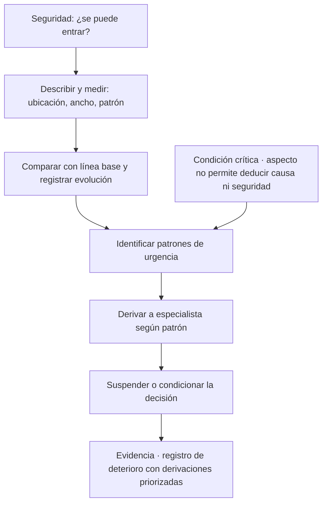
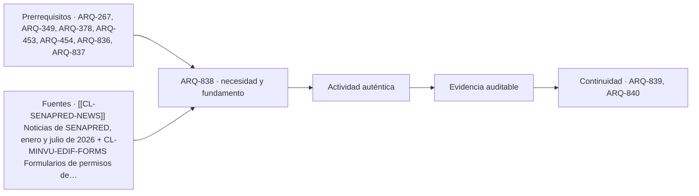

# ARQ-838 · Humedad, fisuras y daño posterior a un sismo: de la observación a la derivación

**Parte 84 · Evaluación de inmuebles, seguros y eventos catastróficos · Chile · Edición 2026.10.**

Material educativo. Enseña a registrar señales visibles de deterioro, a priorizar derivaciones y a no dar diagnósticos; no es una evaluación de daños, un informe estructural ni una autorización de uso. Después de un sismo, la decisión de habitar o no un edificio dañado corresponde a profesionales y autoridades competentes, y ante duda se evacua y se consulta.

**Prerrequisitos recomendados:** `ARQ-267`, `ARQ-349`, `ARQ-378`, `ARQ-453`, `ARQ-454`, `ARQ-836`. La entrada inmediata es `ARQ-837`; la continuidad es `ARQ-839`.

## Pregunta central

¿Cómo se distinguen y se registran las señales de humedad y de fisuración, incluidas las posteriores a un sismo, para priorizar qué derivar a quién y con qué urgencia, sin diagnosticar causa ni gravedad?

**Fallo crítico de esta clase:** una fisura o una mancha no permite deducir causa, gravedad ni seguridad sin diagnóstico profesional.

## Problema y resultado observable

La humedad y las fisuras son las señales de deterioro que más preocupan a quien compra, arrienda o administra un inmueble, y las que con más frecuencia se interpretan mal. Una mancha puede ser condensación, una fuga, una filtración de lluvia, capilaridad desde el suelo o la huella de un problema ya reparado. Una fisura puede ser retracción de un revestimiento, un movimiento sin consecuencia o la señal de un daño estructural. En ambos casos el aspecto no basta. ARQ-453 y ARQ-454 enseñan diagnóstico diferencial para el profesional; esta clase enseña la parte del registro y la derivación, y agrega el caso del inmueble posterior a un sismo, tratado en ARQ-349 y ARQ-378.

Al terminar podrás describir una mancha o una fisura con un vocabulario de observación (ubicación, dimensión, forma, patrón, evolución), reconocer qué patrones aumentan la urgencia de derivar, preparar un **registro de monitoreo** simple y redactar una derivación que el profesional pueda usar. La evidencia es un **registro de deterioro** con fotografías, medidas y derivaciones priorizadas.

## Humedad: lo que se observa y lo que se pregunta

La humedad en una construcción tiene orígenes que pueden distinguirse por preguntas sobre el patrón. Si la mancha aparece en la parte baja de un muro y sube de forma irregular con sales blancas en la superficie, puede relacionarse con humedad ascendente. Si aparece bajo una cubierta o un baño de un piso superior y coincide con lluvias o con el uso del baño, puede relacionarse con una filtración o con una fuga. Si aparece en esquinas, detrás de muebles y en invierno, con moho, puede relacionarse con condensación por poca ventilación o aislamiento insuficiente (ARQ-267). Cada una de esas relaciones es una **hipótesis** que orienta la pregunta y no el diagnóstico.

La observación registra: ubicación en un croquis, dimensión, color y textura, olor, presencia de sales, moho o desprendimiento, si la zona está húmeda al tacto (sin perforar ni retirar nada), antecedentes de lluvia y de uso, y si hay reparaciones previas. Una medición con un instrumento de humedad superficial puede ser una referencia, pero sus lecturas dependen del material y no equivalen a un diagnóstico. Las consecuencias posibles se anotan como **riesgo identificado**: deterioro de terminaciones, daño en madera o elementos metálicos, riesgo eléctrico si hay contacto con instalaciones, efectos en la calidad del aire interior.

## Fisuras: descripción antes de interpretación

Una fisura se describe por su **posición** (muro, encuentro con cielo, esquina de vano), **orientación** (horizontal, vertical, diagonal), **longitud**, **ancho** medido con un patrón de referencia y su **evolución**. El ancho se mide en milímetros con una regla o un fisurómetro, siempre en el mismo punto, con fecha. Una sola medición no dice si la fisura crece. Una serie de mediciones en el tiempo sí aporta información sobre su actividad. La clase recomienda marcar con una referencia y fotografiar con escala, sin sellar la fisura hasta que un profesional lo indique, porque el sello oculta la evidencia.

Algunos patrones **elevan la urgencia de derivar**, sin que por ello se afirme que existe un daño grave. Entre ellos: fisuras diagonales en muros, fisuras que cruzan el espesor del elemento, desplazamiento visible entre dos lados de la fisura, fisuras que se repiten en el mismo lugar de varios pisos, puertas o ventanas que dejaron de cerrar, pisos con pendiente nueva, desprendimiento de revestimientos o descascaramiento del hormigón con armadura visible. En presencia de alguno de esos patrones, la derivación es a un ingeniero civil estructural o a un arquitecto con experiencia en patología, y la decisión de uso queda en suspenso.

## Después de un sismo

La situación cambia porque una fisuración nueva después de un sismo puede ser consecuencia del movimiento. La primera regla es de seguridad: si hay un daño evidente, olor a gas, riesgo de caída de elementos o duda razonable, se evacúa y se informa a la autoridad; no se entra a recoger objetos. La segunda regla es de evidencia: se documenta lo visible desde zonas seguras y se compara con la línea base fotográfica anterior (ARQ-833), para distinguir lo nuevo de lo antiguo. La tercera regla es de decisión: las evaluaciones de habitabilidad y las restricciones de uso las establecen profesionales y autoridades competentes; el corredor, el propietario o el administrador no certifican ni autorizan el uso de un edificio dañado.

En la ficha de la clase, el campo «decisión comercial afectada» adquiere un matiz: una operación inmobiliaria sobre un inmueble con daño posterior a un sismo debe detenerse o condicionarse hasta contar con una evaluación profesional, y debe considerar la posible existencia de un siniestro en curso con un seguro (ARQ-831, ARQ-833). No se negocia el precio como si el daño fuera conocido, porque no lo es.

## Mapa específico de la decisión

## Caso resuelto: departamento con dos señales

Datos **HIPOTÉTICOS**. Un departamento de un edificio de hormigón armado de 22 años, piso 5. El 3 de agosto, después de un sismo moderado, se visita. Primera señal: fisura diagonal de unos 45 cm en un tabique del pasillo, de 0,6 mm de ancho; en la fotografía de enero (línea base) no aparecía. Segunda señal: mancha de humedad con moho en la esquina del dormitorio, de 30 por 40 cm, presente en fotografías anteriores y ampliada.

La ficha: observación 1, «fisura diagonal de 45 cm en tabique del pasillo, ancho máximo 0,6 mm medido con regla de 0,5 mm de resolución; no estaba en la línea base de enero»; hipótesis, «podría corresponder a movimiento sísmico en un elemento no estructural, o a otra causa»; riesgo, «si afectara elementos estructurales podría comprometer otras partes»; verificación, «inspección de un ingeniero estructural y revisión del edificio por la administración»; derivar a ingeniero civil estructural; decisión, «no concluir sobre uso ni valor hasta contar con la inspección». Observación 2, «mancha con moho de 30 × 40 cm en esquina exterior del dormitorio, ampliada desde enero»; hipótesis, «podría corresponder a condensación o a una filtración desde el exterior»; verificación, «inspección de la envolvente y de ventilación»; derivar a arquitecto o especialista en envolvente; decisión, «considerar en el costo de mantención».

Las dos señales tienen prioridades diferentes. La primera tiene urgencia mayor por su novedad después de un sismo, aunque su ancho sea pequeño; la segunda es de mantenimiento. Ninguna de las dos se diagnostica. La nota al cliente dice: «Después del sismo apareció una fisura que debe revisar un ingeniero estructural antes de decidir; la humedad de la esquina requiere inspección de la envolvente. No se evalúa la seguridad del edificio».

## Práctica guiada

Con fotografías didácticas de dos fisuras y dos manchas, completa un registro con ubicación en croquis, descripción y medición, hipótesis rotulada, riesgo identificado, verificación y derivación. Define una pauta de monitoreo de una fisura con fechas, punto de medición y referencia fotográfica. Ordena las cuatro señales por prioridad y explica el criterio. Redacta una derivación de cinco líneas dirigida a un profesional.

## Ejercicio independiente

Para un edificio con una cubierta con filtraciones recurrentes, diseña un plan de registro de humedad de seis meses que el administrador pueda ejecutar sin intervención en elementos constructivos: puntos de observación, frecuencia, fotografías, correlación con lluvias de una fuente oficial y criterios para derivar. Señala qué decisiones no se toman con ese registro. Entrega el plan y una planilla.

## Errores típicos y recuperación

- **Sellar o pintar antes de registrar:** destruye evidencia.
- **Medir una vez:** no informa sobre actividad; repite en fechas y puntos fijos.
- **Diagnosticar por aspecto:** el aspecto no determina la causa.
- **Entrar a un edificio dañado por recuperar objetos:** la seguridad va primero.
- **Negociar precio sin evaluación:** un daño por determinar no se valora.
- **Ignorar la línea base:** sin ella no se distingue lo nuevo.

Para recuperar, vuelve al registro a los dos días y reescribe una causa afirmada como hipótesis.

## Evaluación por evidencias

La entrega se acepta si responde la pregunta central con un registro de deterioro con medidas y fotografías, observaciones sin causa, hipótesis rotuladas, patrones de urgencia identificados, derivaciones priorizadas con profesional nombrado, un protocolo de seguridad posterior a sismo y una frase de límite. Con la rúbrica común, umbral 80/100 y ninguna dimensión bajo 60 %. Si la entrega diagnostica causa o declara que un edificio es seguro o inseguro, la evidencia permanece pendiente.

## Continuidad

`ARQ-839` toma las derivaciones y pregunta cuánto podría costar reparar y mantener, con rangos y supuestos. `ARQ-840` las integra en la carpeta.

<!-- pedagogia-2026:inicio -->
## Decisión pedagógica y posición curricular

### Por qué existe

Esta clase existe para resolver una necesidad concreta del recorrido: ¿Cómo se distinguen y se registran las señales de humedad y de fisuración, incluidas las posteriores a un sismo, para priorizar qué derivar a quién y con qué urgencia, sin diagnosticar causa ni gravedad? Fallo crítico de esta clase: una fisura o una mancha no permite deducir causa, gravedad ni seguridad sin diagnóstico profesional.

### Por qué está exactamente aquí

Ocupa el lugar 8 de la Parte 84. Se estudia después de ARQ-837 · Plano, permiso y realidad: ampliaciones no regularizadas y destino autorizado porque usa esa base para responder «¿Cómo se distinguen y se registran las señales de humedad y de fisuración, incluidas las posteriores a un sismo, para priorizar qué derivar a quién y con qué urgencia, sin diagnosticar causa ni gravedad? Fallo crítico de esta clase: una fisura o una mancha no permite deducir causa, gravedad ni seguridad sin diagnóstico profesional.». Se ubica antes de ARQ-839 · Costos de reparación, mantenimiento y habilitación antes de arrendar o vender porque la evidencia producida aquí debe estar disponible para ese paso.

- **Prerrequisitos:** `ARQ-267`, `ARQ-349`, `ARQ-378`, `ARQ-453`, `ARQ-454`, `ARQ-836`, `ARQ-837`
- **Capacidad que introduce:** La humedad y las fisuras son las señales de deterioro que más preocupan a quien compra, arrienda o administra un inmueble, y las que con más frecuencia se interpretan mal. Una mancha puede ser condensación, una fuga, una filtración de lluvia, capilaridad desde el suelo o la huella de un problema ya reparado. Una fisura puede ser retracción de un revestimiento, un movimiento sin consecuencia o la señal de un daño estructural.
- **Clases o experiencias que dependen de ella:** `ARQ-839`, `ARQ-840`

El diagrama permite comprobar una relación que el texto lineal oculta con facilidad: esta clase recibe capacidades previas, toma decisiones apoyadas por fuentes, exige una experiencia y produce evidencia que habilita trabajo posterior. No representa un procedimiento de obra.

## Resultado observable, evidencia y evaluación

1. Identificar y delimitar las condiciones necesarias para responder la pregunta central de humedad, fisuras y daño posterior a un sismo: de la observación a la derivación.
2. Producir y comprobar la evidencia declarada por la clase: La humedad y las fisuras son las señales de deterioro que más preocupan a quien compra, arrienda o administra un inmueble, y las que con más frecuencia se interpretan mal. Una mancha puede ser condensación, una fuga, una filtración de lluvia, capilaridad desde el suelo o la huella de un problema ya reparado. Una fisura puede ser retracción de un revestimiento, un movimiento sin consecuencia o la señal de un daño estructural.
3. Justificar una decisión de humedad, fisuras y daño posterior a un sismo: de la observación a la derivación mediante fuentes, supuestos, alternativas y límites explícitos.

## Actividad, evidencia y criterio de aceptación

**Actividad:** Con fotografías didácticas de dos fisuras y dos manchas, completa un registro con ubicación en croquis, descripción y medición, hipótesis rotulada, riesgo identificado, verificación y derivación. Define una pauta de monitoreo de una fisura con fechas, punto de medición y referencia fotográfica. Ordena las cuatro señales por prioridad y explica el criterio.

**Evidencia mínima:** La humedad y las fisuras son las señales de deterioro que más preocupan a quien compra, arrienda o administra un inmueble, y las que con más frecuencia se interpretan mal. Una mancha puede ser condensación, una fuga, una filtración de lluvia, capilaridad desde el suelo o la huella de un problema ya reparado. Una fisura puede ser retracción de un revestimiento, un movimiento sin consecuencia o la señal de un daño estructural.

**Archivo sugerido:** `evidence/ARQ-838/evidencia.md`.

**Criterio de aceptación:** la entrega se acepta cuando:

- La entrega responde explícitamente a la pregunta: ¿Cómo se distinguen y se registran las señales de humedad y de fisuración, incluidas las posteriores a un sismo, para priorizar qué derivar a quién y con qué urgencia, sin diagnosticar causa ni gravedad? Fallo crítico de esta clase: una fisura o una mancha no permite deducir causa, gravedad ni seguridad sin diagnóstico profesional.
- La actividad conserva las fronteras del caso y permite reconstruir el procedimiento: Con fotografías didácticas de dos fisuras y dos manchas, completa un registro con ubicación en croquis, descripción y medición, hipótesis rotulada, riesgo identificado, verificación y derivación. Define una pauta de monitoreo de una fisura con fechas, punto de medición y referencia fotográfica. Ordena las cuatro señales por prioridad y explica el criterio.
- Cada afirmación externa puede seguirse hasta una fuente, su alcance consultado y su límite.
- La evidencia deja disponible una entrada comprobable para ARQ-839.
- - Sellar o pintar antes de registrar: destruye evidencia. - Medir una vez: no informa sobre actividad; repite en fechas y puntos fijos.

La [rúbrica común](../../docs/RUBRICA_COMUN.md) complementa estos criterios; no los reemplaza. Una entrega puede superar un promedio y continuar pendiente si oculta una condición crítica.

## Trazabilidad de las decisiones

| # | Decisión o fundamento | Fuente utilizada | Aplicación y límite en esta clase |
|---:|---|---|---|
| 1 | muestra las categorías oficiales de daño en vivienda y que una parte queda «en evaluación». | [[[CL-SENAPRED-NEWS]] Noticias de SENAPRED, enero y julio de 2026](https://www.senapred.cl/noticias/) | Consulta: comunicados de julio de 2026 sobre un sistema frontal, con daños en viviendas clasificados como menor, mayor, destruida y en evaluación. Límite: son balances parciales; no describen patologías ni causas constructivas. Fecha de |
| 2 | ubica el tipo de solicitud que puede corresponder a reparaciones mayores. | [CL-MINVU-EDIF-FORMS Formularios de permisos de edificación](https://www.minvu.gob.cl/elementos-tecnicos/formularios/formularios-de-permisos-de-edificacion/) | Consulta: listado oficial de obra nueva, ampliación mayor a 100 m², alteración, reparación y reconstrucción. Límite: la selección final depende del régimen vigente y de la clasificación realizada con profesional competente y DOM. Fecha de |

La tabla permite auditar las relaciones; la explicación, el caso y la práctica de la clase siguen siendo la documentación principal.

## Autoevaluación, recuperación y continuidad

### Errores diagnósticos

Antes de avanzar, comprueba si puedes reconstruir cada resultado sin mirar la solución, señalar qué evidencia lo sostiene y nombrar una condición que obligaría a revisar tu decisión. Conserva la primera versión, la objeción recibida y la revisión.

**Conexión siguiente:** La continuidad inmediata es ARQ-839 · Costos de reparación, mantenimiento y habilitación antes de arrendar o vender; conserva el método y vuelve a verificar datos y límites.
<!-- pedagogia-2026:fin -->

## Fuentes y alcance de uso

### [[CL-SENAPRED-NEWS]] Noticias de SENAPRED, julio de 2026

Servicio Nacional de Prevención y Respuesta ante Desastres. [https://www.senapred.cl/noticias/](https://www.senapred.cl/noticias/)

**Consulta:** comunicados de julio de 2026 sobre un sistema frontal, con daños en viviendas clasificados como menor, mayor, destruida y en evaluación. **Apoyo:** muestra las categorías oficiales de daño en vivienda y que una parte queda «en evaluación». **Límite:** son balances parciales; no describen patologías ni causas constructivas. **Fecha de consulta:** 30 de octubre de 2026.

### [[CL-DOM-BUILD]] Formularios de obras de edificación

Ministerio de Vivienda y Urbanismo de Chile. [https://www.minvu.gob.cl/elementos-tecnicos/formularios/formularios-de-permisos-de-edificacion/](https://www.minvu.gob.cl/elementos-tecnicos/formularios/formularios-de-permisos-de-edificacion/)

**Consulta:** listado oficial de obra nueva, ampliación mayor a 100 m², alteración, reparación y reconstrucción. **Apoyo:** ubica el tipo de solicitud que puede corresponder a reparaciones mayores. **Límite:** la selección final depende del régimen vigente y de la clasificación realizada con profesional competente y DOM. **Fecha de consulta:** 12 de octubre de 2026, registro heredado de ARQ-801–830.
