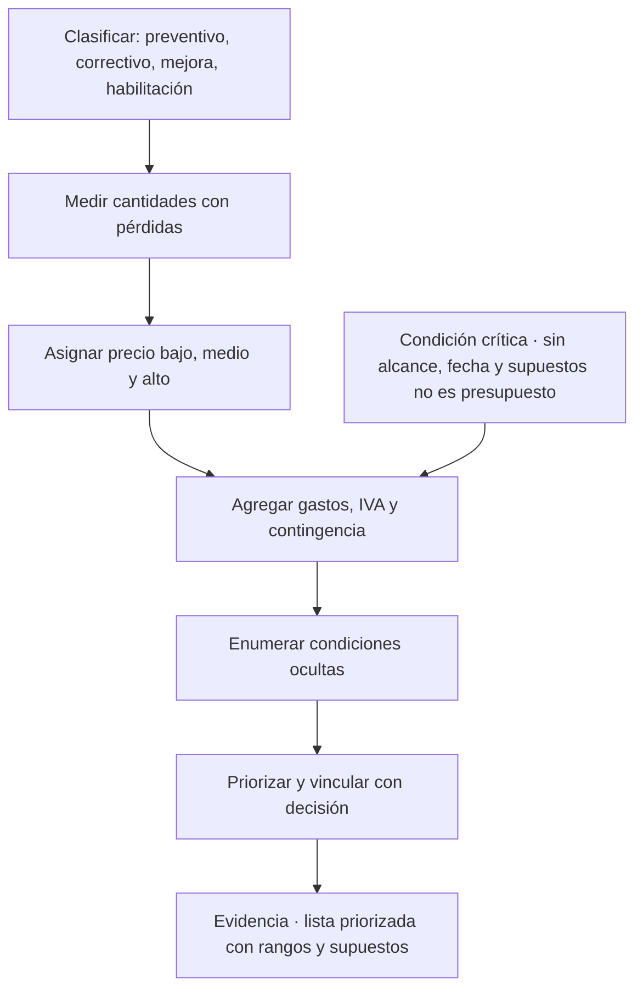
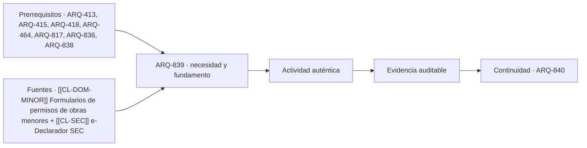

# ARQ-839 · Costos de reparación, mantenimiento y habilitación antes de arrendar o vender

**Parte 84 · Evaluación de inmuebles, seguros y eventos catastróficos · Chile · Edición 2026.10.**

Material educativo. Enseña a construir rangos preliminares de costo con supuestos explícitos; no es un presupuesto de obra, una cotización ni una recomendación de ejecutar trabajos, y no habilita a ejecutar o declarar instalaciones reguladas. Todo precio de la clase es **HIPOTÉTICO** hasta citar fecha, región, fuente, alcance e impuestos.

**Prerrequisitos recomendados:** `ARQ-413`, `ARQ-415`, `ARQ-418`, `ARQ-464`, `ARQ-817`, `ARQ-836`, `ARQ-838`. La entrada inmediata es `ARQ-838`; la continuidad es `ARQ-840`.

## Pregunta central

¿Cómo se estima, con un rango y supuestos declarados, cuánto costaría reparar, mantener o habilitar un inmueble para arrendarlo o venderlo, y qué condiciones ocultas pueden romper esa estimación?

**Fallo crítico de esta clase:** un rango de costo sin alcance, fecha, supuestos ni condición oculta no es un presupuesto.

## Problema y resultado observable

Quien prepara un inmueble para arrendar o vender necesita una idea de cuánto gastar y en qué. Un propietario pregunta si conviene pintar, reparar el baño o cambiar la cocina; un corredor debe aconsejar si conviene vender «tal cual» o preparar el inmueble; un administrador debe programar el mantenimiento. La respuesta que se da a la ligera, «unos dos millones», tiene dos problemas: no dice qué incluye y no dice qué puede cambiarla. ARQ-413 a ARQ-418 enseñan cubicaciones, precios unitarios, costos y ciclo de vida, y ARQ-817 enseña el presupuesto completo para la vivienda propia. Esta clase usa esas ideas con una finalidad distinta: estimaciones **preliminares** para tomar una decisión de operación, rotuladas como tales.

Al terminar podrás clasificar un trabajo como mantenimiento preventivo, reparación correctiva, mejora o habilitación para uso; descomponer una estimación en cantidades, rendimientos y precios con rango; añadir una contingencia con criterio; y entregar una **lista priorizada de intervenciones** con rangos y supuestos. Tu evidencia será una hoja con fórmulas visibles y una página que diga qué incluye, qué excluye y qué podría cambiarla.

## Cuatro tipos de trabajo

El **mantenimiento preventivo** evita el deterioro: limpiar canaletas, renovar sellos, revisar la cubierta, pintar protecciones. El **mantenimiento correctivo** repara lo que ya falló. La **mejora** aumenta las prestaciones por encima de la condición original, por ejemplo cambiar una ventana por una de mejor desempeño. La **habilitación para uso** adapta el inmueble para un fin determinado, como un arriendo: servicios en orden, seguridad de las instalaciones, terminaciones mínimas. La distinción importa para el costo y para la decisión. Reparar una filtración que ya dañó un cielo no es lo mismo que prevenirla, y es más caro. Una mejora puede justificarse por su efecto en el confort o en el costo de operación, pero no es una condición para vender o arrendar. Un trabajo en instalaciones eléctricas o de gas corresponde a instaladores autorizados, con declaración ante el organismo competente cuando corresponda; el propietario no se la atribuye.

## Cantidades, rendimientos y precios

Una estimación mínima tiene tres columnas: **cantidad**, **precio unitario** y **subtotal**. La cantidad se mide en un plano o en el terreno con la unidad que corresponda (m² de muro, metros lineales de canaleta, unidades de artefacto), con un porcentaje de pérdida si el material se corta. El precio unitario incluye materiales y mano de obra, y puede agregar equipos y transporte; para esta clase, se trabaja con tres valores, bajo, medio y alto, que reflejan la variabilidad de calidades y de maestros. El subtotal es la cantidad por el precio. La suma de los subtotales es el **costo directo**. Se agregan **gastos generales y utilidad** si se contrata una empresa y el **impuesto al valor agregado** según el tratamiento del documento. Por último, la **contingencia** cubre lo desconocido; en esta clase se usa como sensibilidad entre 10 % y 20 %, y nunca como tarifa universal. Cuanto menos se ha podido ver del inmueble, más alta es la contingencia razonable; si hay hallazgos pendientes de derivación, la estimación de ese rubro no se hace.

Un buen hábito es separar cada partida en **supuesto visible** y **condición oculta**. El supuesto visible dice qué se vio. La condición oculta dice qué podría haber detrás: bajo un cielo con mancha, puede haber una estructura de madera dañada; bajo un revestimiento, un muro con humedad. Las condiciones ocultas no se estiman, se enumeran y se asocian a una verificación, porque su costo podría ser un múltiplo de la partida visible.

## Qué hace creíble una estimación

Una estimación preliminar es creíble cuando otra persona puede repetirla. Eso exige fecha, región, fuente de cada precio (o rótulo HIPOTÉTICO), unidades, supuestos y exclusiones. También exige separar claramente lo que es **estimación** de lo que es **cotización**. Una cotización la emite un proveedor o contratista con un alcance definido y una validez; una estimación la elabora quien analiza. Se les asigna rangos de confianza distintos. Y exige una **segunda comprobación independiente**: sumar por capítulo y por partida, o calcular con un precio por metro cuadrado de referencia, y conciliar la diferencia.

## Mapa específico de la decisión

## Caso resuelto: preparar un departamento para arriendo

Datos **HIPOTÉTICOS**, fecha octubre de 2026, región por definir, precios sin IVA. Departamento de 55 m². La lista de la visita incluye cinco intervenciones: pintar muros y cielos (aproximadamente 150 m² de superficie pintable), reemplazar la grifería del baño y de la cocina, reparar un sello deteriorado de la ventana del dormitorio, reemplazar un piso flotante dañado de 8 m², y revisar el tablero eléctrico, con un hallazgo de la ficha de inspección pendiente de derivación.

La estimación: pintura, 150 m² a 3.500, 4.800 y 6.500 por m² da un rango de 525.000 a 975.000, con medio de 720.000. Grifería, dos unidades a 45.000, 70.000 y 110.000 más instalación a 20.000 cada una da 130.000 a 260.000, con medio de 180.000. Sello de ventana, 12 metros lineales a 4.000, 6.000 y 9.000 da 48.000 a 108.000, con medio de 72.000. Piso flotante, 8 m² con 10 % de pérdida, es decir 8,8 m², a 18.000, 25.000 y 35.000 da 158.400 a 308.000, con medio de 220.000. Revisión del tablero: **no se estima**; queda como verificación pendiente por un instalador autorizado.

Los subtotales de las cuatro partidas estimadas suman, en bajo, 861.400, en medio 1.192.000 y en alto 1.651.000 (precios hipotéticos sin IVA). La contingencia del 15 % sobre el medio da 178.800, para un total de referencia de 1.370.800 sin IVA. El resultado se presenta como «entre 0,9 y 1,7 millones, con referencia de 1,4 millones, sin incluir la revisión eléctrica, que puede modificar el total». La segunda comprobación es calcular por un valor de CLP 25.000 por m² de refacción liviana: 55 × 25.000 = 1.375.000, cercano al medio con contingencia, lo que da consistencia sin probar exactitud.

La decisión comercial queda en una frase: «Con esta estimación, la intervención básica podría hacerse con un gasto del orden de 1,4 millones, antes de resolver el tablero eléctrico; la decisión de arrendar sin hacer la revisión eléctrica no debe tomarse».

## Práctica guiada

Con la lista de hallazgos de un inmueble didáctico, clasifica cada intervención por tipo. Mide cantidades. Asigna rangos con rótulo HIPOTÉTICO o con cotizaciones fechadas. Calcula costo directo, contingencia y total de referencia. Enumera las condiciones ocultas de cada partida y la verificación que las resolvería. Realiza una segunda comprobación con otra vía de cálculo y concilia. Presenta la lista priorizada con una columna «si no se hace» que describa la consecuencia.

## Ejercicio independiente

Construye un plan de mantenimiento preventivo a cinco años para un edificio de ocho departamentos con cubierta liviana: tareas, frecuencia, costo estimado con rango y criterio de derivación a especialista. Compara el costo acumulado del preventivo con un escenario correctivo en que una filtración no atendida daña tres cielos y una instalación eléctrica; deja visibles los supuestos. Concluye qué dato real cambiaría la comparación. Entrega la hoja con fórmulas.

## Errores típicos y recuperación

- **Dar un monto sin alcance:** siempre dice qué incluye y qué excluye.
- **Mezclar estimación y cotización:** rotúlalas por separado.
- **Estimar lo que no se vio:** enumera la condición oculta y verifica.
- **Olvidar el IVA o la pérdida de material:** son campos configurables y separados.
- **Usar la contingencia como tarifa:** es una sensibilidad que depende de lo desconocido.
- **Atribuirse trabajos regulados:** electricidad y gas requieren instalador autorizado.

Para recuperar, recalcula una partida a los dos días con otra fórmula y corrige una unidad o una fecha.

## Evaluación por evidencias

La entrega se acepta si responde la pregunta central con una lista priorizada de intervenciones con tipo, cantidad, unidad, rango, supuestos y exclusiones, contingencia justificada, condiciones ocultas enumeradas, segunda comprobación independiente, rótulo HIPOTÉTICO en toda cifra no citada y una frase que distinga estimación de cotización. Con la rúbrica común, umbral 80/100 y ninguna dimensión bajo 60 %. Si se presenta un monto único sin rango ni supuestos o se estima lo que debió derivarse, la evidencia permanece pendiente.

## Continuidad

`ARQ-840` integra estos rangos con la ficha de inspección, la matriz de coincidencia, los factores de valor y la lectura de seguros en una carpeta de decisión de operación.

<!-- pedagogia-2026:inicio -->
## Decisión pedagógica y posición curricular

### Por qué existe

Esta clase existe para resolver una necesidad concreta del recorrido: ¿Cómo se estima, con un rango y supuestos declarados, cuánto costaría reparar, mantener o habilitar un inmueble para arrendarlo o venderlo, y qué condiciones ocultas pueden romper esa estimación? Fallo crítico de esta clase: un rango de costo sin alcance, fecha, supuestos ni condición oculta no es un presupuesto.

### Por qué está exactamente aquí

Ocupa el lugar 9 de la Parte 84. Se estudia después de ARQ-838 · Humedad, fisuras y daño posterior a un sismo: de la observación a la derivación porque usa esa base para responder «¿Cómo se estima, con un rango y supuestos declarados, cuánto costaría reparar, mantener o habilitar un inmueble para arrendarlo o venderlo, y qué condiciones ocultas pueden romper esa estimación? Fallo crítico de esta clase: un rango de costo sin alcance, fecha, supuestos ni condición oculta no es un presupuesto.». Se ubica antes de ARQ-840 · Carpeta de evaluación inmobiliaria y puerta de decisión de operación porque la evidencia producida aquí debe estar disponible para ese paso.

- **Prerrequisitos:** `ARQ-413`, `ARQ-415`, `ARQ-418`, `ARQ-464`, `ARQ-817`, `ARQ-836`, `ARQ-838`
- **Capacidad que introduce:** Quien prepara un inmueble para arrendar o vender necesita una idea de cuánto gastar y en qué. Un propietario pregunta si conviene pintar, reparar el baño o cambiar la cocina; un corredor debe aconsejar si conviene vender «tal cual» o preparar el inmueble; un administrador debe programar el mantenimiento. La respuesta que se da a la ligera, «unos dos millones», tiene dos problemas: no dice qué incluye y no dice qué puede cambiarla.
- **Clases o experiencias que dependen de ella:** `ARQ-840`

El diagrama permite comprobar una relación que el texto lineal oculta con facilidad: esta clase recibe capacidades previas, toma decisiones apoyadas por fuentes, exige una experiencia y produce evidencia que habilita trabajo posterior. No representa un procedimiento de obra.

## Resultado observable, evidencia y evaluación

1. Identificar y delimitar las condiciones necesarias para responder la pregunta central de costos de reparación, mantenimiento y habilitación antes de arrendar o vender.
2. Producir y comprobar la evidencia declarada por la clase: Quien prepara un inmueble para arrendar o vender necesita una idea de cuánto gastar y en qué. Un propietario pregunta si conviene pintar, reparar el baño o cambiar la cocina; un corredor debe aconsejar si conviene vender «tal cual» o preparar el inmueble; un administrador debe programar el mantenimiento. La respuesta que se da a la ligera, «unos dos millones», tiene dos problemas: no dice qué incluye y no dice qué puede cambiarla.
3. Justificar una decisión de costos de reparación, mantenimiento y habilitación antes de arrendar o vender mediante fuentes, supuestos, alternativas y límites explícitos.

## Actividad, evidencia y criterio de aceptación

**Actividad:** Con la lista de hallazgos de un inmueble didáctico, clasifica cada intervención por tipo. Mide cantidades. Asigna rangos con rótulo HIPOTÉTICO o con cotizaciones fechadas.

**Evidencia mínima:** Quien prepara un inmueble para arrendar o vender necesita una idea de cuánto gastar y en qué. Un propietario pregunta si conviene pintar, reparar el baño o cambiar la cocina; un corredor debe aconsejar si conviene vender «tal cual» o preparar el inmueble; un administrador debe programar el mantenimiento. La respuesta que se da a la ligera, «unos dos millones», tiene dos problemas: no dice qué incluye y no dice qué puede cambiarla.

**Archivo sugerido:** `evidence/ARQ-839/evidencia.md`.

**Criterio de aceptación:** la entrega se acepta cuando:

- La entrega responde explícitamente a la pregunta: ¿Cómo se estima, con un rango y supuestos declarados, cuánto costaría reparar, mantener o habilitar un inmueble para arrendarlo o venderlo, y qué condiciones ocultas pueden romper esa estimación? Fallo crítico de esta clase: un rango de costo sin alcance, fecha, supuestos ni condición oculta no es un presupuesto.
- La actividad conserva las fronteras del caso y permite reconstruir el procedimiento: Con la lista de hallazgos de un inmueble didáctico, clasifica cada intervención por tipo. Mide cantidades. Asigna rangos con rótulo HIPOTÉTICO o con cotizaciones fechadas.
- Cada afirmación externa puede seguirse hasta una fuente, su alcance consultado y su límite.
- La evidencia deja disponible una entrada comprobable para ARQ-840.
- - Dar un monto sin alcance: siempre dice qué incluye y qué excluye. - Mezclar estimación y cotización: rotúlalas por separado.

La [rúbrica común](../../docs/RUBRICA_COMUN.md) complementa estos criterios; no los reemplaza. Una entrega puede superar un promedio y continuar pendiente si oculta una condición crítica.

## Trazabilidad de las decisiones

| # | Decisión o fundamento | Fuente utilizada | Aplicación y límite en esta clase |
|---:|---|---|---|
| 1 | diferencia solicitudes y declaraciones de obras menores que pueden acompañar algunas reparaciones. | [[[CL-DOM-MINOR]] Formularios de permisos de obras menores](https://www.minvu.gob.cl/elementos-tecnicos/formularios/formularios-de-permisos-de-obra-menor/) | Consulta: listado oficial de ampliación hasta 100 m², modificaciones y regímenes especiales, con referencias a OGUC 5.1.4 y LGUC 166. Límite: la superficie no concede exención automática; ruralidad, copropiedad, patrimonio, riesgo y estructura pueden cambiar el expediente. Fecha de |
| 2 | confirma que la declaración de instalaciones está dirigida a instaladores y profesionales autorizados. | [[[CL-SEC]] e-Declarador SEC](https://www.sec.cl/e-declarador/) | Consulta: servicio oficial y descripción de TE1 para instalaciones eléctricas interiores y TC6 para instalaciones interiores de gas. Límite: la mención de TE1 o TC6 no determina que correspondan en todo proyecto ni habilita al propietario para diseñar, ejecutar o declarar la instalación. Fecha de |

La tabla permite auditar las relaciones; la explicación, el caso y la práctica de la clase siguen siendo la documentación principal.

## Autoevaluación, recuperación y continuidad

### Errores diagnósticos

Antes de avanzar, comprueba si puedes reconstruir cada resultado sin mirar la solución, señalar qué evidencia lo sostiene y nombrar una condición que obligaría a revisar tu decisión. Conserva la primera versión, la objeción recibida y la revisión.

**Conexión siguiente:** La continuidad inmediata es ARQ-840 · Carpeta de evaluación inmobiliaria y puerta de decisión de operación; conserva el método y vuelve a verificar datos y límites.
<!-- pedagogia-2026:fin -->

## Fuentes y alcance de uso

### [[CL-DOM-MINOR]] Formularios de permisos de obras menores

Ministerio de Vivienda y Urbanismo de Chile. [https://www.minvu.gob.cl/elementos-tecnicos/formularios/formularios-de-permisos-de-obra-menor/](https://www.minvu.gob.cl/elementos-tecnicos/formularios/formularios-de-permisos-de-obra-menor/)

**Consulta:** listado oficial de ampliación hasta 100 m², modificaciones y regímenes especiales, con referencias a OGUC 5.1.4 y LGUC 166. **Apoyo:** diferencia solicitudes y declaraciones de obras menores que pueden acompañar algunas reparaciones. **Límite:** la superficie no concede exención automática; ruralidad, copropiedad, patrimonio, riesgo y estructura pueden cambiar el expediente. **Fecha de consulta:** 12 de octubre de 2026, registro heredado de ARQ-801–830.

### [[CL-SEC]] e-Declarador SEC

Superintendencia de Electricidad y Combustibles de Chile. [https://www.sec.cl/e-declarador/](https://www.sec.cl/e-declarador/)

**Consulta:** servicio oficial y descripción de TE1 para instalaciones eléctricas interiores y TC6 para instalaciones interiores de gas. **Apoyo:** confirma que la declaración de instalaciones está dirigida a instaladores y profesionales autorizados. **Límite:** la mención de TE1 o TC6 no determina que correspondan en todo proyecto ni habilita al propietario para diseñar, ejecutar o declarar la instalación. **Fecha de consulta:** 12 de octubre de 2026, registro heredado de ARQ-801–830.
