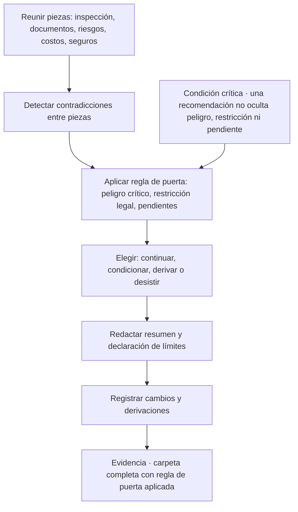
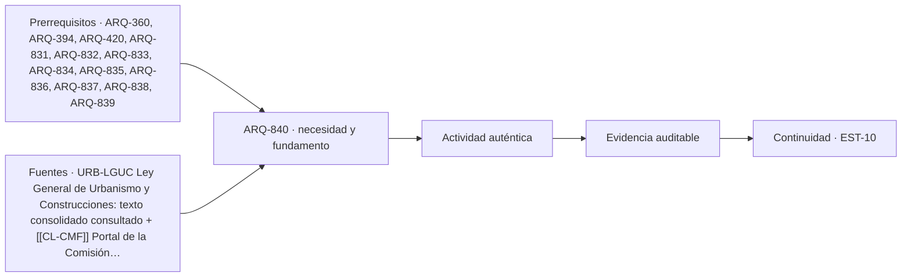

# ARQ-840 · Carpeta de evaluación inmobiliaria y puerta de decisión de operación

**Parte 84 · Evaluación de inmuebles, seguros y eventos catastróficos · Chile · Edición 2026.10.**

Material educativo. Enseña a integrar antecedentes, observaciones, riesgos, costos y seguros en una carpeta que sustente una recomendación; no es un informe técnico, una tasación, una certificación ni asesoría legal o de seguros. La carpeta ordena la decisión de quien opera; no reemplaza a los profesionales a quienes deriva.

**Prerrequisitos recomendados:** `ARQ-360`, `ARQ-394`, `ARQ-420`, `ARQ-831`, `ARQ-832`, `ARQ-833`, `ARQ-834`, `ARQ-835`, `ARQ-836`, `ARQ-837`, `ARQ-838`, `ARQ-839`. La entrada inmediata es `ARQ-839`; la continuidad es `RUTA-35 y EST-06`.

## Pregunta central

¿Cómo se reúne en una carpeta coherente todo lo observado, documentado y estimado sobre un inmueble para decidir si continuar, condicionar, derivar o desistir de una operación, indicando qué verificar y qué riesgos permanecen?

**Fallo crítico de esta clase:** una recomendación comercial no puede ocultar un peligro crítico, una restricción legal o una verificación pendiente.

## Problema y resultado observable

Las nueve clases anteriores producen piezas separadas: una lectura de póliza, una hoja de cobertura, una ficha de caso, una ficha de factores de valor, una ficha de inspección, una matriz de coincidencia, un registro de deterioro y una lista de costos. Un cliente no decide con nueve documentos; decide con una recomendación que se apoya en ellos. La dificultad de integrar es doble. Por un lado, las piezas pueden contradecirse: la matriz muestra una ampliación sin recepción, la lista de costos no la considera, la lectura de póliza describe una superficie menor. Por otro, existe la tentación de simplificar hacia una conclusión conveniente comercialmente. La clase enseña a integrar sin ocultar.

Al terminar podrás armar una **carpeta de evaluación inmobiliaria** con diez secciones, aplicar una **regla de puerta** que impide recomendar «continuar» si existe un peligro crítico o una restricción legal sin resolver, y redactar un resumen de una página para el cliente. La evidencia es la carpeta completa con su índice, la regla de puerta aplicada y la nota al cliente.

## Las diez secciones de la carpeta

La carpeta se ordena de lo que el cliente necesita leer primero a lo que respalda. Primero, el **resumen para el cliente** de una página, escrito sin jerga, con la recomendación, las tres condiciones principales y los límites. Segundo, la **descripción del inmueble y su entorno** con superficie declarada, medida y recepcionada, año, materialidad y entorno. Tercero, el **índice documental** con cada documento, emisor, fecha y estado (recibido, pendiente, contradictorio). Cuarto, la **ficha de inspección educativa** con su declaración de alcance. Quinto, la **matriz de coincidencia** entre documentos y realidad. Sexto, la **revisión normativa inicial**, con las preguntas a la DOM y los instrumentos consultados, marcada con su estado de verificación. Séptimo, la **matriz de riesgos naturales** con fuentes oficiales, que separa amenaza, exposición, vulnerabilidad y riesgo (ARQ-371). Octavo, los **costos preliminares y el plan de mantenimiento**, con rangos y supuestos. Noveno, la **lectura de seguros y la hoja de cobertura**, con el valor de reconstrucción y el escenario extremo. Décimo, la **lista de profesionales a quienes derivar** y la **declaración de límites**.

Cada sección cita su origen en una de las clases previas y conserva los estados de verificación. La carpeta incluye además un **registro de cambios**: qué se agregó o corrigió y por qué, para que otra persona pueda reconstruir la evolución de la recomendación.

## La regla de puerta

La decisión final admite cuatro resultados: **continuar**, **condicionar**, **derivar** y **desistir**. Se aplica una regla explícita que impide que un promedio favorable compense un problema crítico, igual que en el caso de elección de terreno del programa. La regla de puerta tiene tres preguntas en orden. Primera: ¿existe un **peligro crítico** sin resolver, como una exposición documentada a una amenaza grave sin medidas ni posibilidad de cobertura, o un daño visible que sugiere compromiso estructural? Si la respuesta es sí, el resultado no puede ser «continuar»: es «derivar» hasta tener evaluación profesional, o «desistir». Segunda: ¿existe una **restricción legal** sin resolver, como una construcción sin antecedente o un uso no autorizado que afecta la operación? Si sí, el resultado es «condicionar» a la resolución o «derivar» a abogado y arquitecto. Tercera: ¿existen **verificaciones pendientes** que podrían cambiar la decisión? Si sí, la recomendación debe declararlas como condiciones y no puede presentarse como definitiva.

Solo cuando las tres preguntas se responden «no» se puede recomendar «continuar», con los costos y supuestos como referencia. Aun entonces la recomendación se acompaña de las limitaciones. La regla de puerta se aplica por escrito, con la respuesta y la evidencia de cada pregunta, de modo que otro lector pueda cuestionarla.

## El deber de claridad frente al cliente

El resumen para el cliente cumple una función ética: debe ser comprensible y no puede minimizar. Tres frases son obligatorias en toda carpeta. Una dice qué se hizo y qué no (alcance y fecha de la visita, documentos revisados, lo que no se pudo ver). Otra dice qué queda pendiente y quién debe resolverlo. La tercera dice que la carpeta no es una certificación, una tasación ni asesoría legal o de seguros. Los deberes legales de información de un corredor frente a su cliente y frente a la contraparte requieren revisión jurídica especializada y no se resuelven aquí; la clase exige que no se oculte lo conocido y que no se afirme lo desconocido.

## Mapa específico de la decisión

## Caso resuelto: aplicación de la puerta a la casa de 72 m² con ampliación

Se retoma la casa del caso de ARQ-837, con 72 m² recepcionados y 100 m² observados, y se le agregan datos **HIPOTÉTICOS**: ubicada en una zona con antecedentes de anegamiento según el municipio; póliza de incendio con suma de 60.000.000 y valor de reconstrucción estimado de 94 millones (ARQ-832), sin cobertura de inundación; estimación de reparaciones menores de 1,4 millones; una fisura diagonal nueva observada tras un sismo (ARQ-838).

La regla de puerta se aplica así. Primera pregunta, peligro crítico: hay una fisura posterior a un sismo sin evaluación estructural, y una exposición a anegamiento sin medidas documentadas ni cobertura; respuesta, sí. Segunda pregunta, restricción legal: la ampliación de 28 m² no tiene antecedente de permiso ni recepción; respuesta, sí, sin resolver. Tercera pregunta, verificaciones pendientes: evaluación estructural, consulta a la DOM, consulta a un arquitecto y a un corredor de seguros sobre cobertura de inundación; respuesta, sí.

El resultado no puede ser «continuar». Con el peligro posible por la fisura sin evaluar, el resultado es **derivar**: la operación queda detenida hasta contar con la evaluación estructural y con la respuesta de la DOM; a partir de ahí se podría pasar a «condicionar» con las condiciones de regularizar o descontar, asegurar o aceptar la retención, y reparar. El resumen para el cliente dice: «La carpeta no permite recomendar la compra hoy. Hay una fisura posterior a un sismo que debe evaluar un ingeniero estructural, una ampliación de 28 m² sin antecedente que debe consultarse a la DOM, y una exposición a anegamiento sin cobertura de seguro conocida. Se recomienda no fijar condiciones comerciales hasta resolverlas. Esta carpeta no certifica ni tasa el inmueble».

## Práctica guiada

Con las piezas de dos inmuebles didácticos de las clases anteriores, arma una carpeta completa de diez secciones y un índice. Detecta al menos una contradicción entre piezas y regístrala. Aplica la regla de puerta por escrito con la respuesta y la evidencia de cada pregunta. Redacta el resumen de una página y la declaración de límites. Pide a otra persona que lea solo el resumen y diga qué haría; compara con tu intención.

## Ejercicio independiente

Elige uno de los diez laboratorios del caso de evaluación técnica de inmuebles y construye su carpeta completa, con el resultado de la puerta y una versión revisada tras la crítica de una persona que no participó. Conserva ambas versiones y el registro de cambios. Escribe una página que explique qué evidencia nueva cambiaría el resultado de «derivar» a «condicionar». Entrega la carpeta, las dos versiones y la página.

## Segundo caso resuelto: la puerta aplicada a un departamento en copropiedad

Datos **HIPOTÉTICOS**. Un departamento de 62 m² en un edificio de 18 años, piso 3. Piezas: ficha de inspección con una mancha de humedad en un cielo de dormitorio (hipótesis: condensación o filtración desde el piso superior) y sin fisuras; matriz de coincidencia sin diferencias (recepción de 62 m², avalúo de 62 m², escritura de 62 m²); sector sin antecedentes de anegamiento ni remoción en masa según los mapas oficiales consultados; póliza de copropiedad con cobertura de incendio y sismo para bienes comunes y sin cobertura para terminaciones interiores; una cuota extraordinaria aprobada de CLP 900.000 por unidad para reparar fachada; costos preliminares de reparaciones menores entre 0,4 y 0,9 millones.

La regla de puerta: primera pregunta, ¿hay peligro crítico sin resolver? No hay evidencia de uno; la mancha es una hipótesis de mantenimiento. Segunda, ¿hay restricción legal sin resolver? No hay diferencias documentales. Tercera, ¿hay verificaciones pendientes que podrían cambiar la decisión? Sí: la causa de la humedad (que podría ser una fuga del piso superior con consecuencias sobre la administración) y el estado de los fondos de reserva de la copropiedad. El resultado es **condicionar**: continuar sujeto a una inspección de la fuente de humedad y a la lectura de las actas. El resumen para el cliente nombra esas dos condiciones, la cuota extraordinaria que pagaría el comprador y la ausencia de cobertura de terminaciones en la póliza común.

## Lista de contradicciones que se busca

Antes de aplicar la puerta se recorre una lista de contradicciones típicas: la superficie de la matriz no coincide con la de la póliza; la lista de costos no incluye un hallazgo de la ficha; el mapa de riesgo cita una exposición que la ficha no menciona; la declaración de alcance dice que no se vio la cubierta, y el resumen afirma que «el techo está bien»; la hoja de cobertura supone un valor de reconstrucción distinto del usado en los costos. Cada contradicción se resuelve con una acción (corregir una pieza, pedir un dato, derivar) y se anota en el registro de cambios.

## Resumen de una página: estructura

Un resumen eficaz tiene seis bloques cortos: recomendación (una frase: continuar, condicionar, derivar o desistir); por qué (tres razones máximas); condiciones o pendientes (con quién las resuelve); costos y riesgos que se conocen (con rango y fecha); lo que no se evaluó; y la declaración de límites. No incluye adjetivos que no puedan respaldarse, ni porcentajes inventados, ni afirmaciones sobre legalidad o seguridad.

## Autoevaluación con solución razonada

1. *Todas las piezas son favorables salvo una fisura nueva tras un sismo. ¿Qué resultado corresponde?* **Derivar**: el peligro posible sin evaluar impide recomendar continuar, aunque el resto sea favorable.
2. *El corredor tiene prisa por cerrar. ¿Puede omitir la declaración de límites?* No: forma parte de la entrega y protege tanto al cliente como a quien la redacta.
3. *Una verificación pendiente es barata. ¿Se puede resolver con una suposición?* No; si es barata, se ejecuta. Una suposición no la reemplaza.
4. *¿Cuándo corresponde desistir?* Cuando el peligro crítico o la restricción legal no se pueden resolver con los plazos y recursos del cliente, o cuando la evaluación profesional lo desaconseja.
5. *¿Qué se hace con una contradicción entre la hoja de cobertura y la matriz?* Se corrige la pieza que esté mal, se anota en el registro de cambios y se revisa si el cambio afecta la puerta.

## Errores típicos y recuperación

- **Promediar riesgos:** un peligro crítico no se compensa con buenos factores de ubicación.
- **Omitir contradicciones:** si una pieza contradice a otra, se registra y se resuelve o se deriva.
- **Redactar un resumen que suavice:** debe poder leerse sin minimizar nada.
- **Presentar la recomendación como certificación:** la declaración de límites es obligatoria.
- **Perder las versiones:** sin registro de cambios no se puede reconstruir la decisión.
- **Cerrar «continuar» con pendientes abiertos:** los pendientes impiden una recomendación definitiva.

Para recuperar, reconstruye a los dos días la regla de puerta sin mirar la carpeta y compara con la versión guardada.

## Evaluación por evidencias

La entrega se acepta si responde la pregunta central con una carpeta de diez secciones y su índice, contradicciones registradas, regla de puerta aplicada por escrito, resultado entre continuar, condicionar, derivar o desistir, resumen de una página, lista de derivaciones, registro de cambios, estados de verificación visibles y declaración de límites. Con la rúbrica común, umbral 80/100 y ninguna dimensión bajo 60 %. Una recomendación «continuar» con un peligro crítico, una restricción legal o un pendiente sin resolver mantiene la evidencia pendiente aunque el promedio supere el umbral.

## Continuidad

La carpeta es el capstone de RUTA-35 y se presenta en el taller EST-06. Sus piezas se reutilizan en el caso «Decisión integral de construcción resiliente en Chile» del directorio de casos.

<!-- pedagogia-2026:inicio -->
## Decisión pedagógica y posición curricular

### Por qué existe

Esta clase existe para resolver una necesidad concreta del recorrido: ¿Cómo se reúne en una carpeta coherente todo lo observado, documentado y estimado sobre un inmueble para decidir si continuar, condicionar, derivar o desistir de una operación, indicando qué verificar y qué riesgos permanecen? Fallo crítico de esta clase: una recomendación comercial no puede ocultar un peligro crítico, una restricción legal o una verificación pendiente.

### Por qué está exactamente aquí

Cierra la Parte 84: integra lo producido en ARQ-839 · Costos de reparación, mantenimiento y habilitación antes de arrendar o vender para responder «¿Cómo se reúne en una carpeta coherente todo lo observado, documentado y estimado sobre un inmueble para decidir si continuar, condicionar, derivar o desistir de una operación, indicando qué verificar y qué riesgos permanecen? Fallo crítico de esta clase: una recomendación comercial no puede ocultar un peligro crítico, una restricción legal o una verificación pendiente.». La transición hacia el taller final EST-10 y el portafolio longitudinal transfiere el método y la disciplina de evidencia, no los datos o parámetros particulares de esta parte.

- **Prerrequisitos:** `ARQ-360`, `ARQ-394`, `ARQ-420`, `ARQ-831`, `ARQ-832`, `ARQ-833`, `ARQ-834`, `ARQ-835`, `ARQ-836`, `ARQ-837`, `ARQ-838`, `ARQ-839`
- **Capacidad que introduce:** Las nueve clases anteriores producen piezas separadas: una lectura de póliza, una hoja de cobertura, una ficha de caso, una ficha de factores de valor, una ficha de inspección, una matriz de coincidencia, un registro de deterioro y una lista de costos. Un cliente no decide con nueve documentos; decide con una recomendación que se apoya en ellos. La dificultad de integrar es doble.
- **Clases o experiencias que dependen de ella:** `EST-10`

El diagrama permite comprobar una relación que el texto lineal oculta con facilidad: esta clase recibe capacidades previas, toma decisiones apoyadas por fuentes, exige una experiencia y produce evidencia que habilita trabajo posterior. No representa un procedimiento de obra.

## Resultado observable, evidencia y evaluación

1. Identificar y delimitar las condiciones necesarias para responder la pregunta central de carpeta de evaluación inmobiliaria y puerta de decisión de operación.
2. Producir y comprobar la evidencia declarada por la clase: Las nueve clases anteriores producen piezas separadas: una lectura de póliza, una hoja de cobertura, una ficha de caso, una ficha de factores de valor, una ficha de inspección, una matriz de coincidencia, un registro de deterioro y una lista de costos. Un cliente no decide con nueve documentos; decide con una recomendación que se apoya en ellos. La dificultad de integrar es doble.
3. Justificar una decisión de carpeta de evaluación inmobiliaria y puerta de decisión de operación mediante fuentes, supuestos, alternativas y límites explícitos.

## Actividad, evidencia y criterio de aceptación

**Actividad:** Con las piezas de dos inmuebles didácticos de las clases anteriores, arma una carpeta completa de diez secciones y un índice. Detecta al menos una contradicción entre piezas y regístrala. Aplica la regla de puerta por escrito con la respuesta y la evidencia de cada pregunta.

**Evidencia mínima:** Las nueve clases anteriores producen piezas separadas: una lectura de póliza, una hoja de cobertura, una ficha de caso, una ficha de factores de valor, una ficha de inspección, una matriz de coincidencia, un registro de deterioro y una lista de costos. Un cliente no decide con nueve documentos; decide con una recomendación que se apoya en ellos. La dificultad de integrar es doble.

**Archivo sugerido:** `evidence/ARQ-840/evidencia.md`.

**Criterio de aceptación:** la entrega se acepta cuando:

- La entrega responde explícitamente a la pregunta: ¿Cómo se reúne en una carpeta coherente todo lo observado, documentado y estimado sobre un inmueble para decidir si continuar, condicionar, derivar o desistir de una operación, indicando qué verificar y qué riesgos permanecen? Fallo crítico de esta clase: una recomendación comercial no puede ocultar un peligro crítico, una restricción legal o una verificación pendiente.
- La actividad conserva las fronteras del caso y permite reconstruir el procedimiento: Con las piezas de dos inmuebles didácticos de las clases anteriores, arma una carpeta completa de diez secciones y un índice. Detecta al menos una contradicción entre piezas y regístrala. Aplica la regla de puerta por escrito con la respuesta y la evidencia de cada pregunta.
- Cada afirmación externa puede seguirse hasta una fuente, su alcance consultado y su límite.
- La evidencia deja disponible una entrada comprobable para EST-10.
- 1. Todas las piezas son favorables salvo una fisura nueva tras un sismo.

La [rúbrica común](../../docs/RUBRICA_COMUN.md) complementa estos criterios; no los reemplaza. Una entrega puede superar un promedio y continuar pendiente si oculta una condición crítica.

## Trazabilidad de las decisiones

| # | Decisión o fundamento | Fuente utilizada | Aplicación y límite en esta clase |
|---:|---|---|---|
| 1 | marco nacional de competencias, permiso, control de obra y recepción que sustenta la revisión normativa inicial. | [URB-LGUC Ley General de Urbanismo y Construcciones: texto consolidado…](https://www.bcn.cl/leychile/navegar?idNorma=13560) | Consulta: texto vigente consultado; artículos 1, 4, 5, 9, 16–18, 116, 127, 130 y 143–145 según la afirmación de la clase. Límite: no identifica por sí sola el procedimiento completo del predio ni reemplaza OGUC, instrumento territorial, DOM o asesoría profesional. Fecha de |
| 2 | ubica servicios públicos para consultar seguros contratados y orientarse tras temporales. | [[[CL-CMF]] Portal de la Comisión para el Mercado Financiero](https://www.cmfchile.cl/) | Consulta: página principal y accesos visibles a «Conoce tus seguros» y «Temporales en regiones». Límite: no se leyó ninguna norma ni circular; la existencia de un servicio no garantiza cobertura. Fecha de |
| 3 | ejemplo de balances oficiales con fecha, usado para la lectura de eventos. | [[[CL-SENAPRED-NEWS]] Noticias de SENAPRED, enero y julio de 2026](https://www.senapred.cl/noticias/) | Consulta: listado de noticias y comunicados de 2026 sobre incendios forestales y sistemas frontales. Límite: son comunicados institucionales y balances parciales; no sustituyen mapas de amenaza ni estudios de riesgo del predio. Fecha de |

La tabla permite auditar las relaciones; la explicación, el caso y la práctica de la clase siguen siendo la documentación principal.

## Autoevaluación, recuperación y continuidad

### Errores diagnósticos

Antes de avanzar, comprueba si puedes reconstruir cada resultado sin mirar la solución, señalar qué evidencia lo sostiene y nombrar una condición que obligaría a revisar tu decisión. Conserva la primera versión, la objeción recibida y la revisión.

**Conexión siguiente:** La continuidad es EST-10, donde la evidencia se incorpora al portafolio longitudinal y a la defensa final.
<!-- pedagogia-2026:fin -->

## Fuentes y alcance de uso

### [[CL-LGUC]] Ley General de Urbanismo y Construcciones, DFL 458

Biblioteca del Congreso Nacional de Chile. [https://www.bcn.cl/leychile/navegar?idNorma=13560](https://www.bcn.cl/leychile/navegar?idNorma=13560)

**Consulta:** texto vigente consultado; artículos 1, 4, 5, 9, 16–18, 116, 127, 130 y 143–145 según la afirmación de la clase. **Apoyo:** marco nacional de competencias, permiso, control de obra y recepción que sustenta la revisión normativa inicial. **Límite:** no identifica por sí sola el procedimiento completo del predio ni reemplaza OGUC, instrumento territorial, DOM o asesoría profesional. **Fecha de consulta:** 12 de octubre de 2026, registro heredado de ARQ-801–830.

### [[CL-CMF]] Portal de la Comisión para el Mercado Financiero

Comisión para el Mercado Financiero de Chile. [https://www.cmfchile.cl/](https://www.cmfchile.cl/)

**Consulta:** página principal y accesos visibles a «Conoce tus seguros» y «Temporales en regiones». **Apoyo:** ubica servicios públicos para consultar seguros contratados y orientarse tras temporales. **Límite:** no se leyó ninguna norma ni circular; la existencia de un servicio no garantiza cobertura. **Fecha de consulta:** 30 de octubre de 2026.

### [[CL-SENAPRED-NEWS]] Noticias de SENAPRED

Servicio Nacional de Prevención y Respuesta ante Desastres. [https://www.senapred.cl/noticias/](https://www.senapred.cl/noticias/)

**Consulta:** listado de noticias y comunicados de 2026 sobre incendios forestales y sistemas frontales. **Apoyo:** ejemplo de balances oficiales con fecha, usado para la lectura de eventos. **Límite:** son comunicados institucionales y balances parciales; no sustituyen mapas de amenaza ni estudios de riesgo del predio. **Fecha de consulta:** 30 de octubre de 2026.
